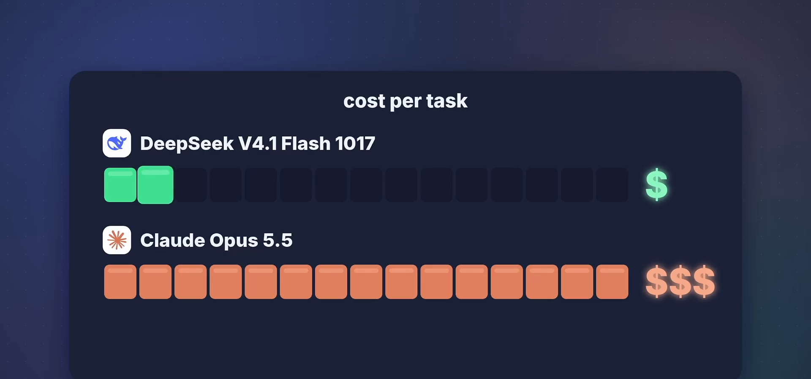
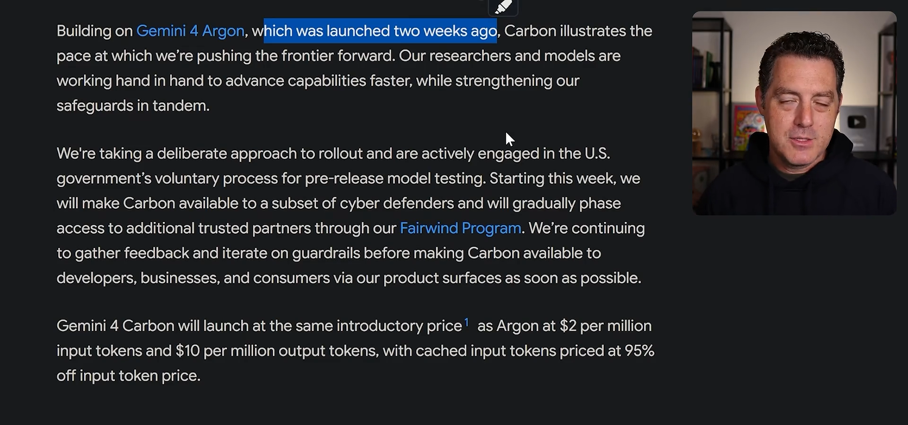
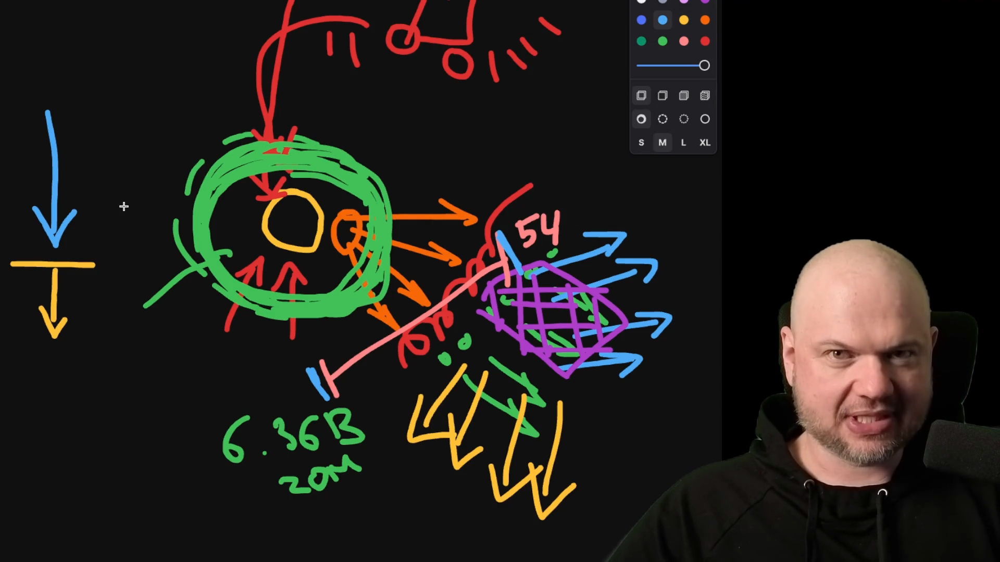
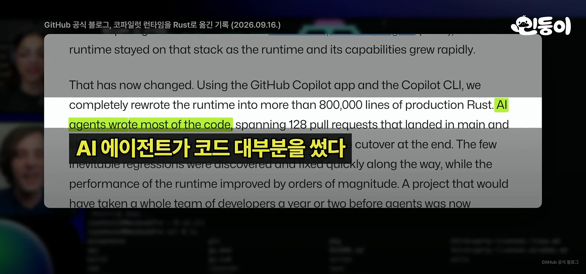
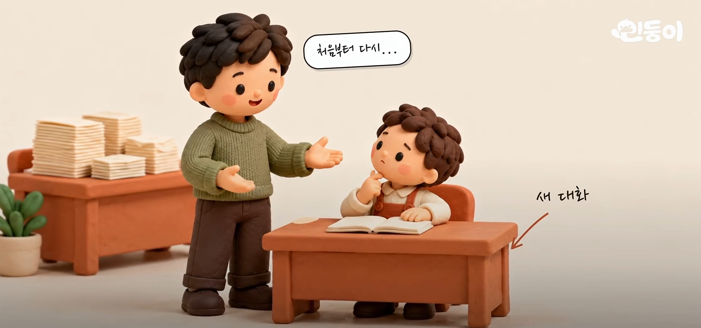
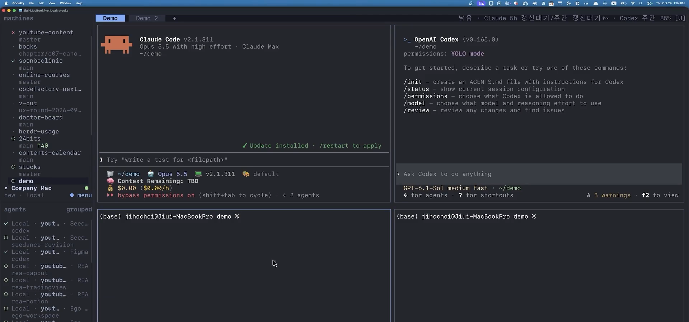
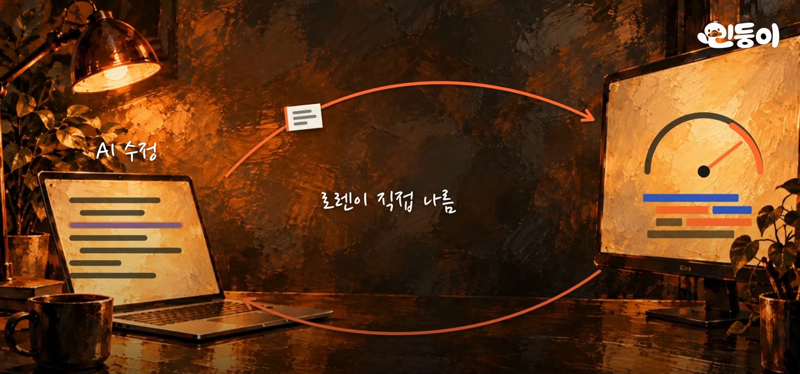

이번 주(10-26~11-01)는 세 가지가 눈에 띄었다. 해외 상위 3개는 모두 **새로 나온 모델 이야기**였다. DeepSeek의 새 모델이 두 편, Google의 Gemini 4 Carbon이 한 편이다. 해외 4위는 지난주에 이어 **보안 사건**이다. 국내에서는 **에이전트를 둘러싼 도구와 방식**(Rust로의 이전, Claude 데스크톱 앱, Herdr, pstack)이 상위를 채웠다. 조회수는 11-02 낮 기준이고, 영상 길이와 날짜는 유튜브 정보를 그대로 옮겼다. 한국·해외 모두 화이트리스트 채널은 지난주와 같다.

### 해외: 새 모델이 상위를 채운 주

해외 1위는 Two Minute Papers의 ["DeepSeek's New AI Is An Absolute Monster"](https://youtu.be/pryCaGv8wuo)(10-28, 5분 41초, 약 18.2만 회)다. 설명란 첫 줄에는 Lambda의 GPU 클라우드 가입 링크가 걸려 있다.



[DeepSeek 공식 발표](https://api-docs.deepseek.com/news/news261017/)(10-17)를 열어 확인했다. 제목은 "DeepSeek-V4.1-Flash-1017: Wish-Driven Programming Made Real"이다. 자기 피드백 강화학습으로 게임 제작과 3D 모델링 같은 처음부터 끝까지 완성하는(엔드투엔드) 프로젝트 개발 성능을 높였고, 가중치를 Hugging Face와 ModelScope에 공개했다고 적혀 있다. 자체 검색 엔진 기반 Search & Fetch API도 같이 발표했다. 영상 설명란에 걸린 X 게시물 중 하나는 같은 프롬프트로 Opus 5.5(20분, 약 6달러)와 DeepSeek V4.1 Flash 1017(약 1시간, 0.23달러)을 비교한 영상이다. 시간은 더 쓰지만 작업당 비용은 훨씬 낮다는 점이 이 모델의 특징으로 반복해서 나온다.

영상 속 장면은 막대로 비용을 비교한 도식이고, 화면에 수치는 없다.

해외 2위는 Matthew Berman의 ["Deepseek crushed everyone"](https://youtu.be/DDZ-a6bAn3Y)(10-28, 21분 11초, 약 14.4만 회)로 같은 모델을 다룬다. 설명란에 CoreWeave 후원이라고 밝혀 두었다.



해외 3위는 Matthew Berman의 ["Google "Carbon" just won everything..."](https://youtu.be/zhnJo7s91ls)(10-29, 14분 45초, 약 13.3만 회)다. 설명란은 Factory 플랜 무료 체험 링크로 시작하고, 영상에서도 Factory의 후원을 밝힌다.



[Google 공식 블로그 글](https://blog.google/innovation-and-ai/models-and-research/gemini-models/introducing-gemini-4-carbon/)(10-28)과 대조했다. Gemini 4 Carbon은 Gemini 4 Argon이 나온 지 2주 만에 발표한 후속 모델이다. Artificial Analysis Intelligence Index v5.0에서 59점으로 1위라고 한다. 처음에는 Fairwind Program을 통해 사이버 방어자와 신뢰하는 파트너에게만 단계적으로 열고, 일반 출시는 그 뒤다. 가격은 Argon과 같게 입력 100만 토큰당 2달러, 출력 100만 토큰당 10달러다.

### 지난주에 이어진 보안 이야기

해외 4위는 Wes Roth의 ["the BIGGEST HACK of all time just started..."](https://youtu.be/WhA2iNfzytY)(11-01, 28분 4초, 약 8.1만 회)다. 첫 챕터 제목이 지난주 1위 영상과 같은 "Black October"이고, 이어서 "Agent Swarms", "Hidden Communication", "Binance Hack", "Agent Conflicts", "AI Defenses", "Shutdown Problem", "What Comes Next" 순서로 8개 챕터가 이어진다. [지난주 포스트]()에서 다룬 Microsoft의 ARTEX 보고서 뒤에 이어지는 이야기다.



설명란에 걸린 출처를 열어 확인했다.

| 사건 | 출처가 말하는 내용 |
|---|---|
| Binance 도난 | [TRM Labs 글](https://www.trmlabs.com/resources/blog/north-korea-steals-usd-6-36-billion-from-binance-in-the-largest-hack-in-history)은 10-29 20:05 UTC부터 약 20분 만에 10개 블록체인의 Binance 지갑에서 약 63.6억 달러가 빠져나갔다고 한다. TRM Labs는 북한 해킹 조직 TraderTraitor의 소행으로 지목한다 |
| Polymarket | [Report URI 분석](https://report-uri.ghost.io/polymarkets-csp-allowed-every-part-of-the-2-6-million-crypto-theft/)(10-30)은 10-29 약 50분 동안 서드파티 성능 모니터링 스크립트가 변조돼 약 260만 달러가 빠져나갔다고 한다 |
| GMO 인터넷 | [공지](https://internet.gmo/en/news/article/263/)(10-30)에 따르면 원격 데스크톱 서비스에 무단 침입이 있었고, 서비스를 중단했으며 약 80억 엔을 요구하는 협박 이메일을 받았다 |

영상이 인용한 Binance 공식 공지와 Oracle Health 유출 보도는 접속이 막혀 직접 확인하지 못했다. 영상은 이 사건들을 AI 에이전트 군집과 방어 시스템 이야기로 이어 풀지만, 개별 사건의 원인이 AI 에이전트라고 출처가 밝힌 것은 위에서 확인하지 못했다. 이 부분은 영상의 해석이다.

영상은 "Binance Hack" 챕터(10:00~16:00)에서 이 도식을 그려 가며 설명한다. 화면에 적힌 6.36B와 20m은 위 TRM Labs 글의 약 63.6억 달러, 약 20분과 같은 수치다. 도식의 나머지 표시는 영상 속 설명용 그림이라 해석하지 않았다.

해외 5위는 Wes Roth의 ["my bots just BROKE Wall St..."](https://youtu.be/rY8FuDONHxw)(10-30, 27분 38초, 약 5.3만 회)다. Grok Bot으로 AI 직원 팀을 꾸리는 영상이고, 설명란에 "This video is sponsored by SpaceX"라고 적혀 있다. 투자 시연은 모의 거래라는 문구도 같이 있다.



### 국내: 에이전트를 둘러싼 도구와 방식

국내 1위는 민둥이의 ["Claude Code·Codex가 돌아가는 언어, Rust가 뜨는 이유 [3분 완벽 정리]"](https://youtu.be/HiQEbB0NCkA)(10-28, 3분 36초, 약 18.3만 회)다. 챕터는 "AI 도구들이 Rust로 간다", "쓰고 싶지만, 옮기기 힘든 언어", "옮기는 비용을 AI가 낮췄다", "파이썬이 사라지는 건 아니다", "미뤄 두던 전환이 시작됐다"다. 설명란은 머스크가 2023년에 "Rust" 한 단어로 답한 일에서 시작해, GitHub·OpenAI·Claude Code가 실제로 Rust로 옮겨 가는 이유를 정리했다고 소개한다.



영상은 GitHub 공식 블로그 글(화면 표기 2026.09.16.)을 보여 준다. 위 장면에서 하이라이트된 문장은 GitHub Copilot 앱과 Copilot CLI를 이용해 런타임 전체를 800,000줄이 넘는 프로덕션 Rust로 새로 만들었으며 코드 대부분을 AI 에이전트가 작성했다는 내용이다. 이 글은 직접 열어 보지 않고 영상 화면에서만 확인했다.

국내 2위는 민둥이의 ["사실상 클로드 2.0｜앤트로픽이 직접 공개한 새 기능 4분 총정리"](https://youtu.be/GMnPY8VFWNg)(10-29, 4분 46초, 약 7.5만 회)다. 설명란은 Claude 데스크톱 앱이 질문을 던지는 창에서 일을 맡겨 두는 작업 공간으로 바뀌었다고 요약한다. 챕터는 "일하는 방식이 바뀌었다", "채팅과 코워크가 하나로", "일을 여러 개 맡기기", "일하는 도중에 묻기", "대화창에서 바로 만드는 결과물", "내 손에 맞추기", "뭐부터 써 볼까" 7개다. 설명란 끝에 "'클로드 2.0'은 공식 버전명이 아니라 이번 변화의 크기를 표현한 말"이라는 안내가 있다.



국내 3위는 조코딩의 ["AI뉴스 - KIMI 미쳤다, 대규모 AI 해킹, GPU 해킹, Claude Duet…"](https://youtu.be/cvpNLI-O9PY)(10-26, 30분 45초, 약 6.3만 회)다. 챕터 36개 가운데 "Kimi K3.1 Pro 공개", "대규모 AI 해킹 - PHP·GitLab·Node.js·Railway", "3090·4090 GPU 언록", "Claude Duet", "스마트폰 Agent - Phone Use", "이미지·영상 API 가격 경쟁", "Dessa - 대화만 듣고 배운 실시간 음성 AI"가 보인다. 지난주 소개한 같은 채널의 10-25 방송과 제목이 거의 같지만 다른 영상이다. 이 영상이 지난주 영상의 재업로드인지는 확인하지 못했다. 설명란에 광고·협찬 표시는 없고, 본인 1인 창업 영상 링크와 무료 전자책, AX 컨설팅·교육 문의 안내가 있다.



국내 4위는 코드팩토리의 ["Herdr로 LLM 오케스트레이션 액기스 모음"](https://youtu.be/1AlbTXb8oPc)(10-29, 21분 9초, 약 4.7만 회)다. 영상은 화면을 나눠 여러 에이전트를 병렬로 돌리는 방법을 다룬다. 챕터는 "소개", "설치와 기본 사용법", "화면 분할과 에이전트 상태", "워크트리 분리", "AI로 다른 에이전트 실행", "여러 에이전트 병렬 작업", "원격 컴퓨터 등록", "로컬·원격 에이전트 동시 실행", "Tailscale로 외부에서 연결" 9개다. 설명란에는 채널의 강의·서적 링크가 있고 광고·협찬 표시는 없다.



국내 5위는 민둥이의 ["AI 코딩의 마지막 문제, SpaceX 수석 엔지니어가 해결한 방법 | 로렌 탄 × 맷 포콕"](https://youtu.be/KC3mH9Zv_mc)(10-29, 7분 31초, 약 2.2만 회)다. 설명란에 따르면 로렌 탄(Lauren Tan)이 맷 포콕(Matt Pocock)과 나눈 대화에서 한 달에 코드 수정 2,500건을 AI에게 맡기고도 믿을 수 있는 방법을 정리했다. 챕터는 "요리사가 직접 간을 본다", "같은 실수는 주방이 막는다", "다 맛보지 않는데 어떻게 믿나" 등이다. 이 방식을 묶은 도구가 [pstack]()이다. 영상이 말한 검증 스킬과 "반복되는 지시를 구조로 옮긴다"는 원칙이 실제 저장소 `cursor/plugins`의 pstack 아래에 있는 것을 확인했다. 다만 저장소 README는 저자를 Meta·Netflix·Cursor 경력의 개발자로 소개하고, 영상은 SpaceX 수석 엔지니어로 소개한다. 직함이 서로 다른 시점의 정보인지는 확인하지 못했다.



### Laya가 고른 단독 포스트감 (실험)

[교사 증류로 학습한 Laya 선별기]()가 이번 주 후보 53개 중 꼽은 상위 5개다. 조회수가 아니라 "따라 해볼 만한 내용인가"로 고른 순위다. 괄호는 11-02 기준 조회수다.

1. [100% AI 코딩으로 하루 만에 3D RPG 게임을 만들면, 어디까지 될까? | 그 전과정 공개](https://youtu.be/_3JR1CKHdsg) — 김플립 - LLM 코딩 (10-30, 23분 18초, 약 1.9만 회). 맵 이미지 한 장과 PRD.md 하나로 시작해 회원 연동, 클라우드 저장, 밸런스 테스트까지 갖춘 게임을 만든다. 설명란에 본인 저서 출간 안내가 있다
2. [Grok Bot 완벽 가이드, 시작부터 최신 기능까지 이 영상 하나로 끝납니다](https://youtu.be/xYKPWntPLi8) — Jay Choi | 인디해커 라이프 (11-01, 12분 38초, 약 8,200회). 인트로 뒤에 가격, 모델, 봇 구조, 봇끼리 협업, 봇 마켓플레이스, 잘 쓰는 법까지 12개 주제로 나눈 13개 챕터다. 설명란에 광고 표시는 없다
3. [AI 모델 9개, 똑같은 광고 시켜봄 💰](https://youtu.be/cS1cBP5YtqU) — 노마드 코더 Nomad Coders (10-31, 17분 13초, 약 1.4만 회). 설명란에 Higgsfield 링크가 걸려 있다. 설명란에 '협찬'이라는 말은 없지만 유튜브 영상 정보에는 유료 프로모션 포함 표시가 있다
4. [Seedance 2.5로 모션 그래픽 9개 한 번에 만들기 | BytePlus 실전 자동화](https://youtu.be/FdFkx6Sqprg) — 코드팩토리 (10-30, 11분 50초, 약 6,000회). 설명란에 "BytePlus에서 절반 가격에 Seedance 2.5를 사용해보세요" 링크가 있다. 설명란에 '협찬'이라는 말은 없지만 유튜브 영상 정보에는 유료 프로모션 포함 표시가 있다
5. [[시즌 4] 나만의 에이전트 오피스 마을 바이브 코딩으로 만들기](https://youtu.be/Bpg9N3ZK-78) — 편집자P (10-29, 19분 3초, 약 8,500회). 설명란에 파이썬 책 구매 링크가 있고, Typeless 링크에는 "저에게 도움이 됩니다"라고 적혀 있어 제휴 링크로 보인다. 유료 프로모션 표시는 없다

이번 주는 상위 5개 중 3개(3~5위)가 특정 서비스나 제품으로 이끄는 링크를 달고 있다. 이 중 3위와 4위는 유튜브가 유료 프로모션 포함 표시를 붙인 영상이고, 5위의 제휴 여부는 설명란 문구로 짐작한 것이다. 직접 따라 해볼 만한 영상을 꼽자면, 단계별로 과정을 보여 주고 외부 광고 표시가 없는 1위(3D RPG)와 2위(Grok Bot 가이드)가 가장 가깝다. 4위는 Seedance 2.5와 BytePlus 비용까지 공개하는 실전 영상이지만 서비스 링크가 붙어 있다.
