코드 깎는 노인 채널이 11월 7일에 올린 33분 31초짜리 영상이다. 제목은 "AI 모션 영상, 실제로는 이렇게 만듭니다 \| 원리부터 스킬까지 무료 공개"다. 영상 속 모션그래픽은 편집 프로그램으로 손수 움직인 것도 카메라로 찍은 것도 아니고, 코딩 에이전트가 웹 기술로 짠 코드를 브라우저가 그림으로 그린 것이다. 앞 11분은 그 원리와 직접 만드는 방법이고, 나머지는 영상에서 쓴 표현 기법을 하나씩 열어 보는 데모 소개다.

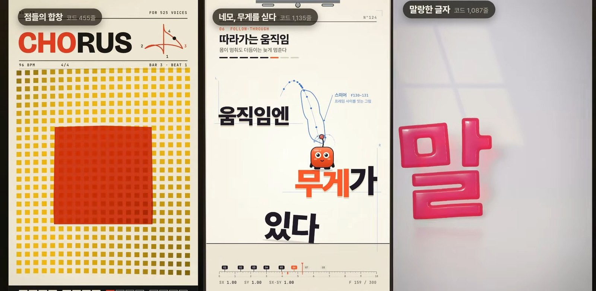

영상 설명란에 `aimotion`이라는 스킬 저장소가 있어서 [kstost/cokacmotion](https://github.com/kstost/cokacmotion)의 README와 구현 노트를 직접 읽고 영상 내용과 대조했다. 영상과 저장소가 같은 말을 하는지는 항목마다 "저장소 확인"으로 따로 적었다. 확인하지 못한 것은 영상의 설명이라고 적었다.



영상의 결론은 한 줄이다. **영상도 결국 "시간 t를 받아서 그 순간의 그림 한 장을 돌려주는 함수" 하나에서 시작한다.**

## 1. 코드로 그림을 그린다는 뜻

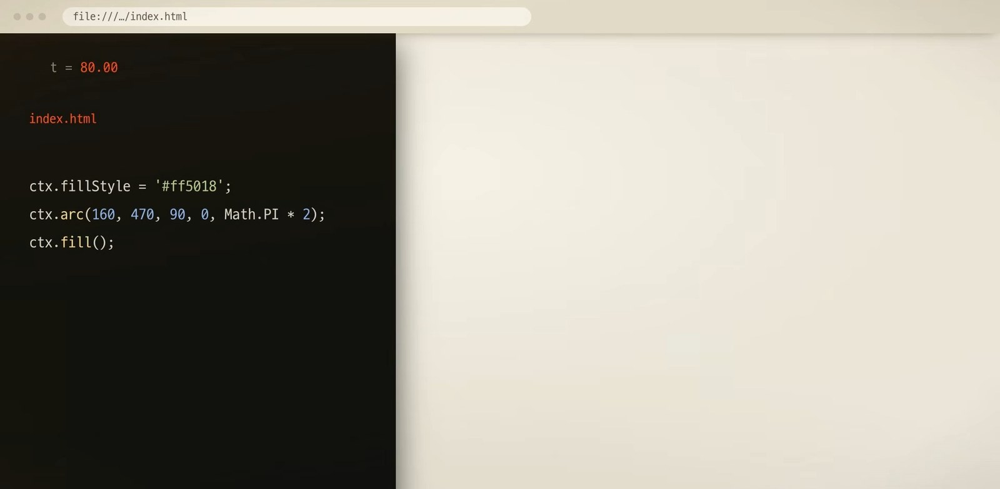

브라우저는 웹페이지의 코드를 읽어서 화면에 그려 주는 프로그램이다. 동그라미를 그리라고 적으면 동그라미가 나온다. 동그라미의 가로 위치를 숫자 하나로 정해 두고 그 숫자를 조금씩 바꾸면서 매번 다시 그리면 동그라미가 움직이기 시작한다. 영상은 이것이 코드로 만드는 영상의 출발점이라고 한다.

영상은 사실 1초에 30장, 많게는 60장씩 넘어가는 그림이다. 코드로 만들 때는 이 일을 함수 하나에 맡긴다. 시간 `t`를 넣으면 그 순간의 그림 한 장을 돌려주는 함수다. `t`에 0을 넣으면 첫 장면이, 3.2를 넣으면 3.2초의 장면이 나온다. 그림을 그리는 붓은 브라우저 안에 여러 개 있다. 글자와 상자를 다루는 HTML과 CSS, 선과 도형을 그리는 SVG, 점을 직접 찍는 캔버스, 그래픽 카드로 픽셀마다 계산하는 WebGL이다. 어떤 붓이든 원리는 같다.

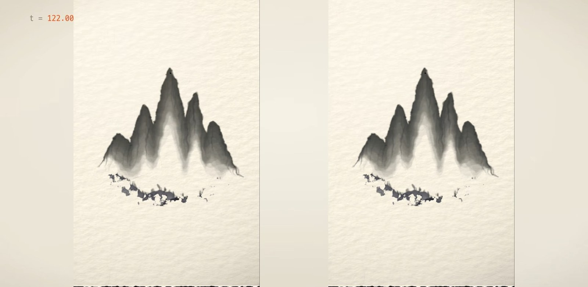

여기서 지켜야 할 규칙이 하나 있다. **같은 `t`를 넣으면 언제나 같은 그림이 나와야 한다.** 그래서 이 코드에는 진짜 무작위 값이나 지금 시각 같은 것이 들어가지 않는다. 무작위가 필요하면 시드를 정해 둔 난수를 써서 매번 같은 순서로 뽑는다. 이 규칙만 지키면 앞으로 가든 뒤로 가든 같은 장면이 나오고, 몇 번을 녹화해도 결과가 같다. 쏟아지는 구슬이나 바람에 날리는 천처럼 앞 순간이 다음 순간을 정하는 움직임은 실행할 때마다 달라질 수 있어서, 미리 끝까지 계산해 저장해 두고 재생할 때는 `t`에 맞는 결과를 읽기만 한다.

> **저장소 확인.** README도 같은 원칙을 적고 있다. "모든 데모는 시각 t의 순수 함수로 그린다. 어느 시각으로 옮겨도 같은 그림이 나와서 프레임 단위 영상 렌더에 그대로 맞는다."

## 2. 모든 움직임은 타임라인 하나에

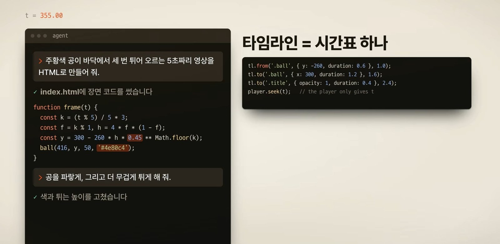

영상은 에이전트가 쓰는 장면 코드에 정해진 뼈대가 있다고 설명한다. 모든 움직임을 타임라인이라는 시간표 하나에 올려 두고, 재생기는 지금 시각 `t`만 알려 준다. 그러면 그 시각의 모습이 바로 계산되어서 어디로 건너뛰어도 그 순간의 장면이 그대로 나온다.

내레이션을 넣고 싶으면 대본만 건네면 된다고 한다. 에이전트가 대본을 문장마다 나눠 음성을 만들고 그 길이를 재서 영상의 시간표로 삼는다. 움직임은 몇 초가 아니라 어느 문장에 맞출지로 정해 두기 때문에, 대본을 고쳐 문장이 길어져도 뒤의 장면들이 알아서 밀려난다. 영상 파일로 만들 때는 화면을 그대로 녹화하지 않는다. 녹화하면 컴퓨터가 버거운 장면에서 프레임이 빠지기 때문에, 시계를 1/30초씩 옮겨 가며 한 장씩 그리고 찍어서 차례로 이어 붙인다. 같은 `t`에는 늘 같은 그림이 나오므로 한 장에 몇 초가 걸려도 결과는 끊김이 없다.

> **저장소 확인.** 이 절의 음성 길이로 시간표를 만드는 방식과 프레임 단위 렌더 과정은 영상의 설명이다. README는 "시각 t의 순수 함수라서 프레임 단위 영상 렌더에 맞는다"는 것까지만 적고 있어서 음성 시간표 부분은 저장소에서 확인하지 못했다.

## 3. aimotion 스킬이 하는 일

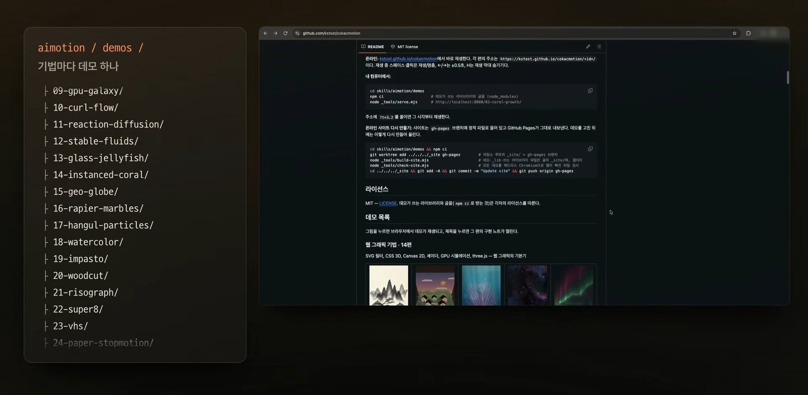

표현할 수 있는 기법은 끝이 없어서, 저자는 영상 콘텐츠를 만들 때 자주 쓸 효과를 스킬로 정리해 두었다. 스킬 안에는 기법 하나마다 짧은 데모가 하나씩 들어 있다. 데모는 설치 없이 웹페이지에서 바로 재생된다. 영상 파일이 아니라 코드가 지금 그리고 있는 화면이다. 제목을 누르면 구현 노트가 열린다. 몇 초에 무엇이 보이는지, 어떤 원리로 만들었는지, 소스의 어느 줄인지까지 적혀 있다. 노트 옆에는 소스 전체와 장면 그림이 함께 있어서 에이전트가 읽고 원리를 이해한 다음 그 기법만 가져다 쓸 수 있다. 쓰는 방법은 마음에 드는 데모를 짚어서 "이 느낌으로 만들어 줘"라고 하는 것이다.

> **저장소 확인.** README 기준으로 데모는 **166편, 12개 분류**이고 라이선스는 MIT다. 분류별 편수는 웹 그래픽 기법 14, 아날로그 표현 19, 웹 플랫폼 기술 3, 자연 현상·광학·수학 9, 실험 타이포그래피 21, GSAP 6, 유명 라이브러리 14, 웹 네이티브 애니메이션 3, 영상 표현력 27, 타이포그래피 모션그래픽 26, 모션그래픽 디자인 14, 3D 장면 10이고 합치면 166이다. 데모는 모두 세로 9:16(1080×1920), 10초 안팎, 화면 아래 자막이라는 같은 틀로 만들었다. README는 **데모가 표현한 소재와 장면은 가져가지 말고 기술만 가져가라**는 원칙도 적고 있다. 설치는 명령 두 줄이다.
>
> ```
> claude plugin marketplace add kstost/cokacmotion
> claude plugin install aimotion@aimotion
> ```
>
> 데모는 [kstost.github.io/cokacmotion](https://kstost.github.io/cokacmotion/)에서 바로 재생한다. 본문의 데모 링크는 이 사이트의 편별 주소이고 모두 열리는 것을 확인했다.

## 4. 실제로 시켜 보면

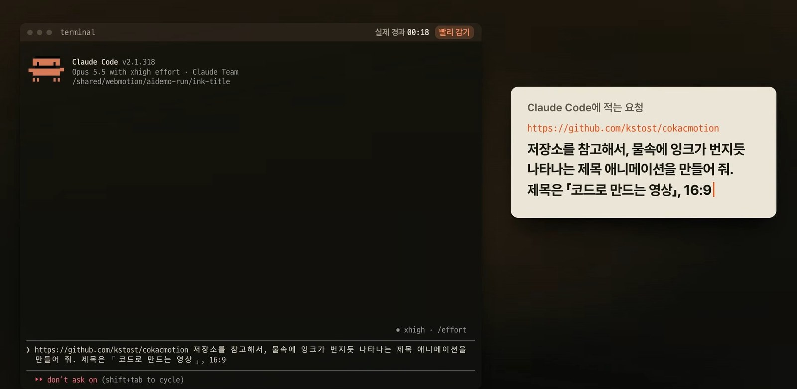

영상의 시연은 이렇다. 빈 폴더를 만들고 그 안에서 Claude Code를 실행한다. 저장소 주소와 함께 "물속에 잉크가 번지듯 나타나는 제목을 만들어 줘"라고 적는다. 에이전트는 저장소를 내려받아 스킬 안내 문서부터 읽고, 잉크와 유체를 다룬 데모를 찾아 그 노트와 소스와 그림을 읽는다. 기법을 이해한 뒤 GPU 유체 시뮬레이션으로 이 제목만을 위한 장면을 새로 짠다. 다 짠 다음에는 직접 프레임을 찍어 확인한다. 처음에는 화면이 전부 까맣게 나왔는데 스스로 원인을 찾아 고쳤다. 잉크가 너무 많아 제목이 묻히자 잉크의 양과 흐름을 여러 번 고쳐 가며 다시 봤고, 같은 시각에 같은 그림이 나오는지까지 점검한 뒤 HTML 파일 하나로 넘겨줬다고 한다.

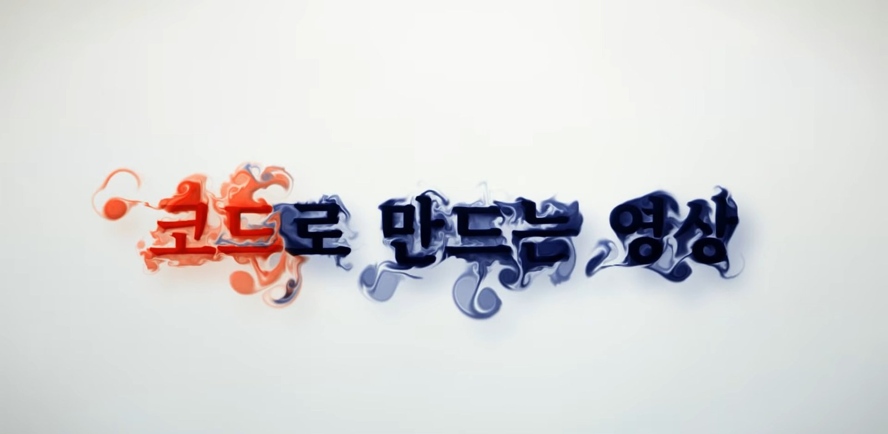

이어서 종이 인형극 데모를 참고해 오려 붙인 종이 꽃밭에서 꽃이 피고 벌이 날아드는 장면을, 사진 시차 데모를 참고해 저녁 골목 안으로 카메라가 걸어 들어가는 장면을 같은 방식으로 만든다. 요령은 처음 부탁할 때도 고칠 때도 같다. 무엇이 어떻게 움직이는지, 몇 초짜리인지, 어떤 느낌인지를 적어 주면 된다. 영상은 지금 보고 있는 이 영상도 이렇게 만들었고 화면 전체가 웹페이지 하나라고 말한다. 저자는 대본을 건네고 장면을 보면서 고칠 곳을 말로 알려 줬고, 코드를 짜고 고치고 확인하는 일은 에이전트가 했다고 한다.

> **저장소 확인.** 이 시연은 영상에서 본 것이고, 같은 결과가 나오는지는 직접 돌려 보지 않았다. 저장소에서 확인한 것은 스킬이 이런 용도로 설계됐다는 점이다. README는 스킬이 "대본에 필요한 표현으로 기법을 찾고, 그림으로 확인하고, 노트와 소스를 충분히 읽어 원리를 이해한 뒤, 그 기술만 작업 중인 영상의 장면에 맞춰 다시 쓴다"고 설명한다.

## 5. 코드로 만든 영상의 장점과 한계

영상이 꼽는 장점은 이렇다. 글자가 진짜 글자라서 4K로 키워도 선명하다. 대본이 바뀌면 시간표를 다시 뽑으면 된다. 몇 번을 다시 만들어도 같은 결과가 나온다. 코드라서 무엇을 고쳤는지 줄 단위로 비교하고 언제든 되돌릴 수 있다. 영상을 문서처럼 다루는 셈이다.

한계도 말한다. 브라우저에서 바로 볼 때는 컴퓨터가 매 프레임을 실시간으로 그려야 해서 무거운 장면은 미리 구워 두거나 해상도를 낮춘다. 그래픽 카드를 많이 쓰는 데모는 한꺼번에 많이 띄울 수 없다. 에이전트가 처음부터 원하는 그림을 내지는 못해서, 결과를 보고 말로 고쳐 달라는 왕복을 몇 번은 거쳐야 한다.

## 6. 영상이 소개한 기법들

영상의 나머지 22분은 데모를 분류별로 열어 보는 시간이다. 모든 데모는 스킬 안에 들어 있어서 마음에 드는 기법이 보이면 그 데모를 에이전트에게 레퍼런스로 짚어 주면 된다. 아래는 영상 순서대로 정리한 것이다.

### 글자와 도형을 다루는 붓

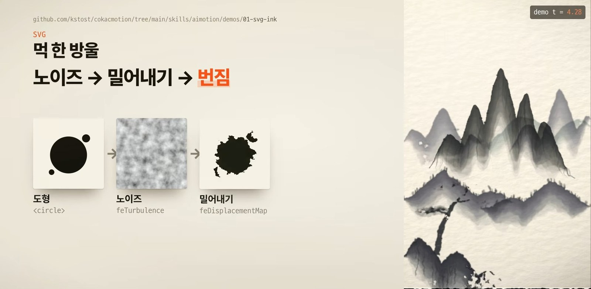

[먹 한 방울의 번짐](https://kstost.github.io/cokacmotion/01-svg-ink/)은 SVG 필터로 만들었다. SVG 필터는 그림에 효과를 거는 작은 단계들을 차례로 이어 붙인 파이프라인이다. 도형에서 노이즈를 만들고, 그 노이즈만큼 가장자리를 밀어낸 다음, 흐리게 번지게 한다. 이 필터는 무거워서 번진 모양을 미리 한 번 구워 두고, 재생할 때는 번짐이 도착하는 시간을 담은 지도를 조금씩 열어 먹이 종이를 타고 번지게 한다. 자라나는 산호는 캔버스에 선을 그어서 그렸고, 스페이스 콜로니제이션이라는 알고리즘으로 가지가 가까운 먹이 점을 향해 한 걸음씩 자란다.

### 픽셀마다 계산하는 셰이더와 3D

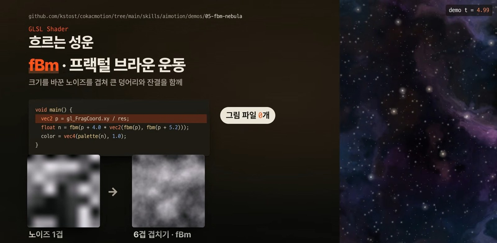

[흐르는 성운](https://kstost.github.io/cokacmotion/05-fbm-nebula/)에는 그림 파일이 하나도 없다. 화면의 모든 픽셀을 프래그먼트 셰이더 하나가 계산한다. 바탕은 노이즈이고, 크기가 다른 노이즈를 여섯 겹 겹치면 구름 같은 무늬가 나온다. 이것이 fBm(프랙털 브라운 운동)이다. 여기에 노이즈로 좌표 자체를 한 번 더 휘게 하는 도메인 워핑을 쓰면 가스가 소용돌이치며 접힌 모양이 된다.

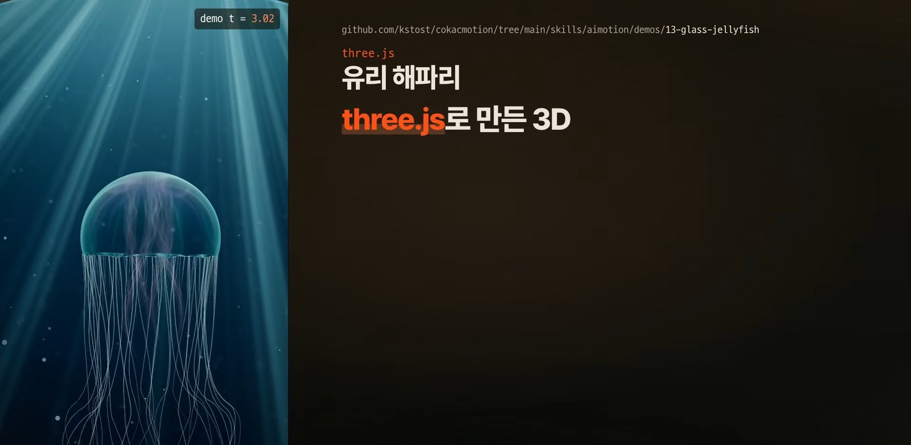

[유리 해파리](https://kstost.github.io/cokacmotion/13-glass-jellyfish/)는 3D 라이브러리 three.js로 만들었다. 갓은 빛이 통과하며 꺾이는 물리 기반 재질이라 안쪽에서 빛나는 기관이 일그러져 비쳐 보인다. 촉수는 갓의 움직임을 시간을 두고 따라가게 해서, 박동이 파도처럼 촉수를 타고 내려간다.

### 움직임과 연출

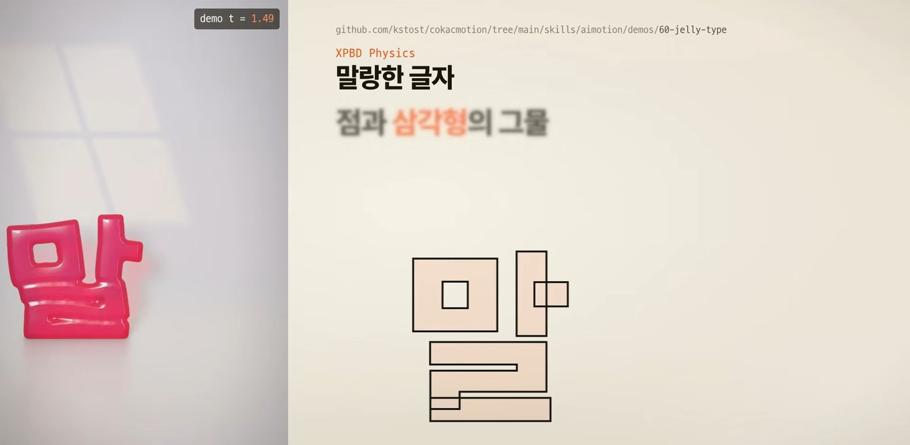

[말랑한 글자](https://kstost.github.io/cokacmotion/60-jelly-type/)는 글꼴의 외곽선과 안쪽에 점을 촘촘히 찍고 삼각형으로 이은 그물이다. 쓰인 기술은 XPBD(확장 위치 기반 동역학)다. 힘을 계산하는 대신 점들이 지켜야 할 규칙, 곧 변의 길이와 삼각형의 넓이를 지키게 위치를 직접 고쳐 나간다. 위에서 누르면 넓이를 지키려고 옆으로 부푼다. 이 물리 계산도 미리 끝까지 돌려서 점의 위치를 저장해 두고 재생할 때 `t`에 맞는 장면을 꺼낸다. [블릿 타임](https://kstost.github.io/cokacmotion/166-bullet-time/)은 물풍선이 터지는 순간 시간이 멈추고 카메라만 도는 장면이다. 비밀은 시계가 두 개라는 것이다. 카메라는 영상 시간을, 물과 풍선은 따로 흐르는 장면 시간을 따르고, 둘 사이를 곡선으로 잇는 것을 타임 리매핑이라고 한다.

> **저장소 확인.** 블릿 타임의 구현 노트에 "카메라 4.4초 동안 장면은 0.0035초(3.5ms)만 흐른다"고 적혀 있어서 영상의 설명과 같다.

### 재료의 질감

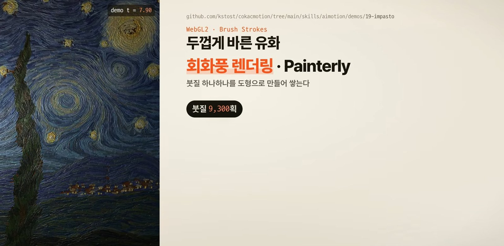

[두껍게 바른 유화](https://kstost.github.io/cokacmotion/19-impasto/)는 사진처럼 칠하는 대신 붓질 하나하나를 도형으로 만들어 쌓는 회화풍 렌더링이다. 붓은 그림 속 흐름을 따라 길게 이어지다가 색이 크게 바뀌는 곳에서 멈춘다. 붓질마다 물감의 두께를 높이로 기록해 두니 빛이 비치면 물감 결이 도드라져 보이고, 이 방식을 높이 맵 조명이라고 한다. 목판화는 모양의 가장자리까지 거리를 재는 거리 변환으로 칼선을 내고, [붓으로 쓴 한 글자](https://kstost.github.io/cokacmotion/42-calligraphy/)는 붓털 하나하나에 먹의 양을 따로 줘서, 빠르게 그은 획일수록 먹이 먼저 말라 갈라지는 비백까지 낸다.

> **저장소 확인.** 유화의 구현 노트에 "합계는 약 9300획"이라고 적혀 있고, 붓글씨는 인덱스에 "96가닥의 털"이라고 적혀 있어서 영상의 수치와 맞는다.

### 글자가 주인공인 장면

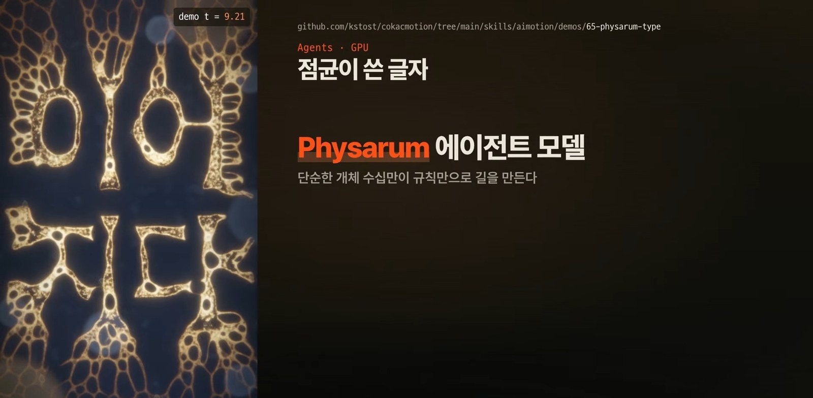

[점균이 쓴 글자](https://kstost.github.io/cokacmotion/65-physarum-type/)는 작은 점 수십만 개가 스스로 길을 찾아 글자를 그린다. 점마다 앞과 양옆의 냄새를 맡고 진한 쪽으로 방향을 틀면서 지나간 자리에 흔적을 남기는 에이전트 모델(Physarum)이다. 글자 모양의 먹이를 깔아 두면 흔적이 쌓여 점균의 길이 글자가 된다. 이 밖에 줄무늬 필름을 밀면 멈춘 그림이 움직이는 것처럼 보이는 배리어 그리드 애니메이션, 사람 손의 움직임 연구에서 나온 최소 저크 곡선으로 긋는 형광펜 주석, 소리마다 외곽선을 다르게 깎은 만화 의성어가 소개된다.

> **저장소 확인.** 구현 노트에 에이전트가 327,680개(640×512)라고 적혀 있어서 영상이 말한 "33만 개"와 같다.

### 애니메이션 도구, 모션그래픽, 촬영과 편집

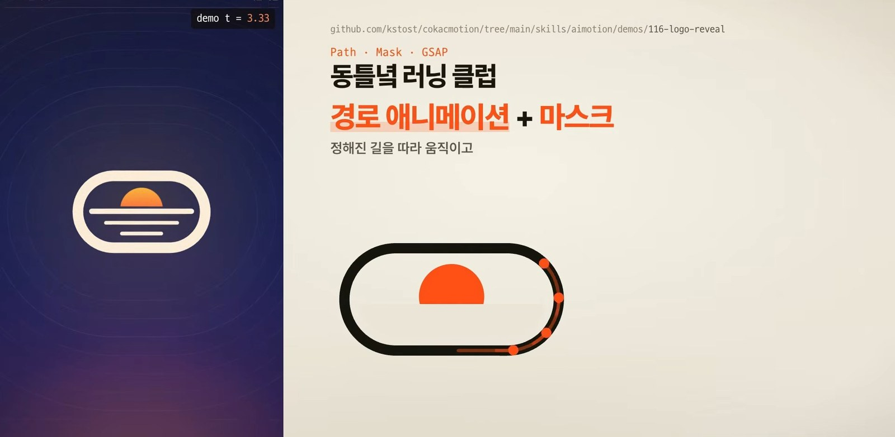

애니메이션 라이브러리 쪽은 GSAP 타임라인 하나로 3D 장면 전체를 움직이는 카메라 연출, anime.js의 스태거로 시작을 엇갈리게 하는 점들의 물결, 스쿼시 앤드 스트레치 같은 디즈니의 애니메이션 원칙을 코드로 옮긴 마스코트, 면의 방향 지도로 빛을 다시 비추는 노멀 맵 조명, 데이터 시각화 라이브러리 D3로 항목을 끝까지 같은 물체로 이어 주는 데이터 애니메이션, SVG 애니메이션의 `setCurrentTime`으로 움직이는 톱니바퀴가 나온다. 모션그래픽은 [로고 등장](https://kstost.github.io/cokacmotion/116-logo-reveal/)(경로 애니메이션과 마스크), 점 하나하나의 크기로 모양을 그리는 점 격자(부호 거리 장), CSS 3D로 판 12장을 겹친 휴대폰, 디자인 토큰에서 출발하는 방송 자막, 빛의 양을 세 단계로 자르는 툰 셰이딩이 소개된다.

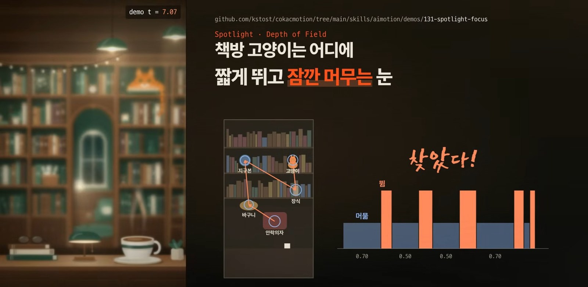

촬영과 편집 쪽에서는 효과를 박자마다 쌓는 임팩트 키트와 부딪히는 순간 시간을 멈추는 히트 스톱, 끝나는 시각을 먼저 정해 두고 어느 순간이든 위치를 바로 계산하는 닫힌 식 물리, 발이 땅에서 미끄러지지 않게 하는 보행 주기, 숫자와 바늘로 높이를 재는 HUD 계기판, 렌즈 공식으로 거리마다 흐림을 계산하는 [시선 유도](https://kstost.github.io/cokacmotion/131-spotlight-focus/)가 있다. [타임랩스](https://kstost.github.io/cokacmotion/160-time-lapse/)는 시간 압축과 장노출로 하루를 10초에 담는다.

> **저장소 확인.** 타임랩스의 구현 노트에 "18.8시간을 10초에 담는다(평균 6,700배)"라고 적혀 있어서 영상의 "18시간이 넘는 하루를 10초에"와 맞는다. 이 소제목에 나온 다른 기법 이름과 설명은 영상의 설명이고 일일이 노트와 대조하지는 않았다.

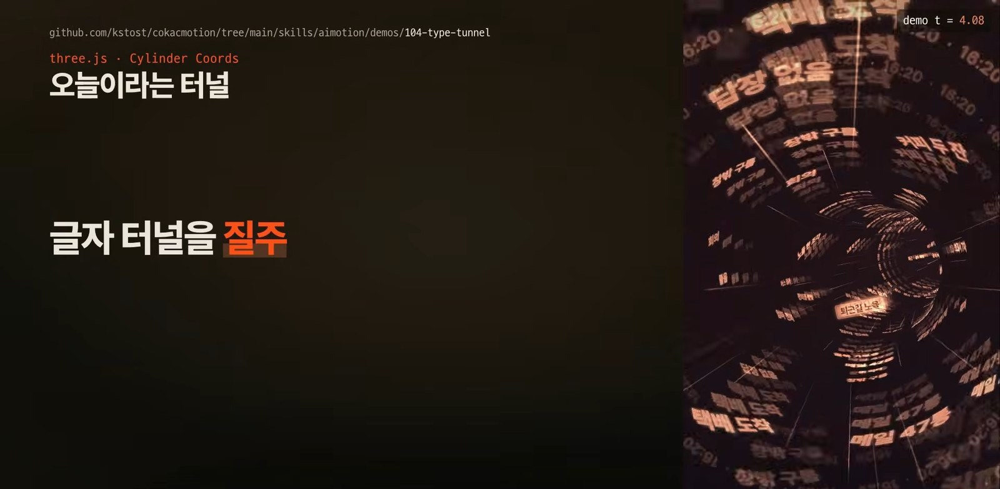

마지막은 글자로 만드는 모션그래픽이다. 글자를 움직이는 대신 카메라만 움직이는 키네틱 타이포그래피, 블록이 헝가리안 알고리즘으로 짝을 찾아 날아가 글자를 짓는 복셀 글자, 문장 속 한 단어만 갈아 끼우는 단어 교체 키트, 글자마다 원통 좌표를 줘서 터널 벽에 붙이는 [글자 터널](https://kstost.github.io/cokacmotion/104-type-tunnel/), 한글 입력기의 조합 규칙을 코드로 옮겨 치고 지우는 과정을 보여 주는 장면, 경첩이 이어진 사슬로 접히는 쪽지, 끝없이 흐르는 글자 테이프, 용수철 공식으로 튀어나오는 예능 자막이 있다.

## 마무리

영상은 붓이 작품마다 달라도 원리는 모두 같다고 정리한다. 시간을 받아 그림을 돌려주는 코드 한 줄에서 시작한다는 것이다. 이 영상은 첫 번째 편이고, 다음 편에서는 저자가 영상 콘텐츠를 만들 때 쓰는 도구를 소개하겠다고 예고한다. 데모는 전부 웹에서 직접 재생해 볼 수 있으니, 어떤 표현이 가능한지 감을 잡으려면 [데모 사이트](https://kstost.github.io/cokacmotion/)를 먼저 둘러보는 것이 빠르다.

## 참고

- 영상: [코드 깎는 노인 채널, 2026-11-07](https://www.youtube.com/watch?v=B_s4nWIqCUA)
- 저장소: [kstost/cokacmotion](https://github.com/kstost/cokacmotion) (MIT, 스킬 이름 `aimotion`)
- 데모 사이트: [kstost.github.io/cokacmotion](https://kstost.github.io/cokacmotion/)
