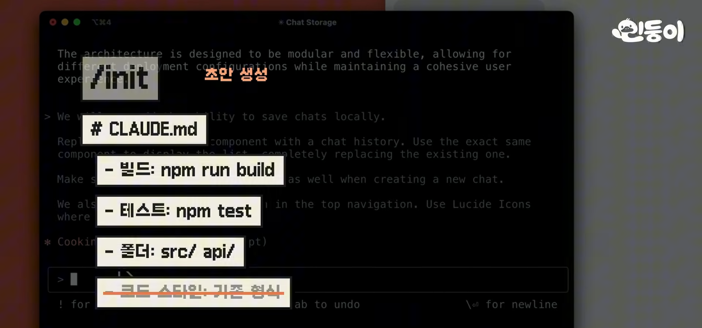
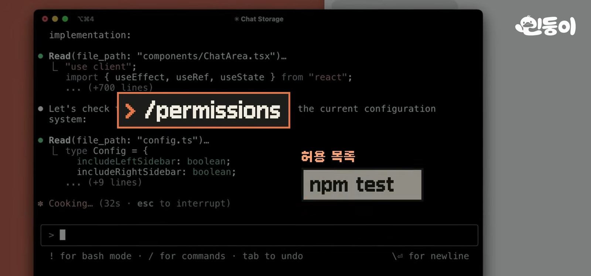
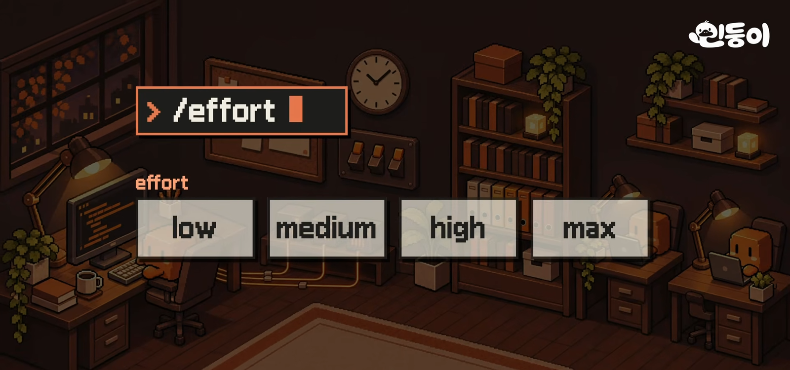
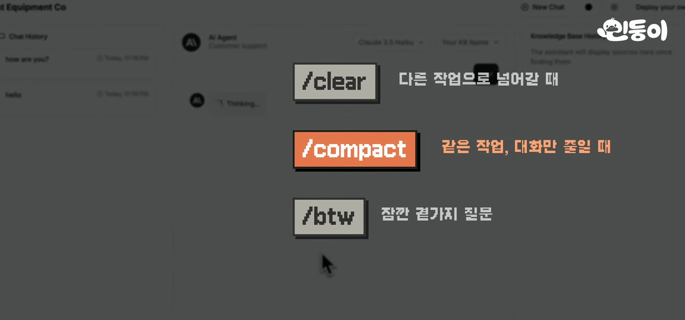
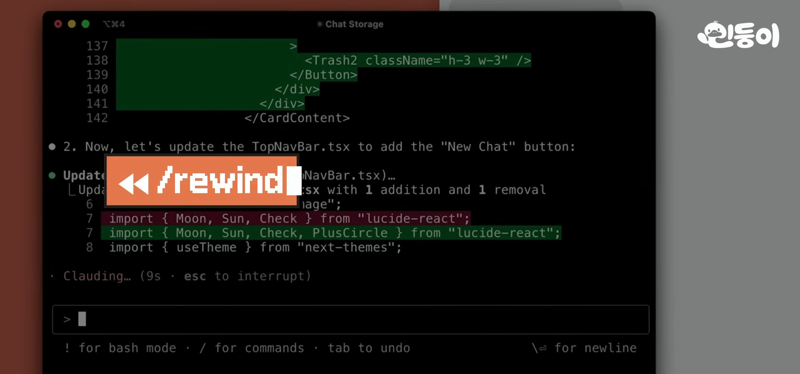
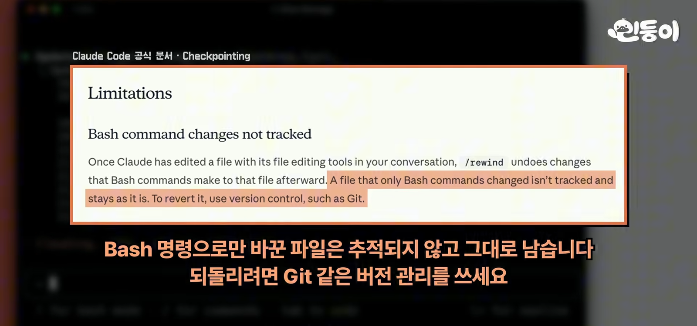
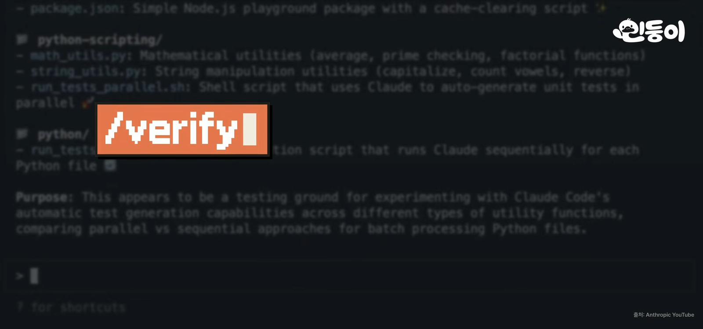
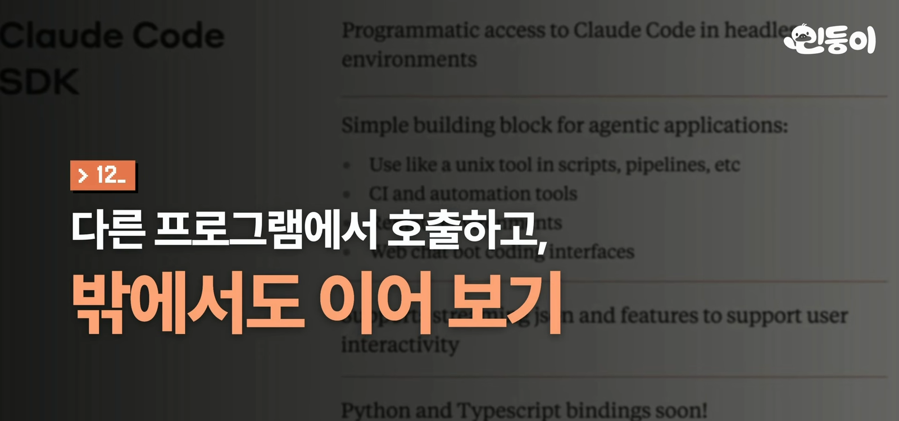

민둥이(쉽게 배우는 AI) 채널이 11월 8일에 올린 9분 18초짜리 영상이다. 제목은 "클로드 코드 공식 교과서 \| 앤트로픽이 직접 공개한 기본기 12가지 [9분 총정리]"이고, 처음 준비하는 일부터 일 맡기기, 결과 확인, 자동화까지 개발하는 순서대로 12가지를 짚는다.

영상에 나온 명령어와 기능 이름은 영상 설명란과 [앤트로픽 공식 문서](https://code.claude.com/docs)를 대조해서 옮겼다. 영상과 문서가 다른 곳은 항목마다 "문서 확인"으로 따로 적었다. 문서에서 찾지 못한 것은 못 찾았다고 적었다.



영상의 결론은 한 줄이다. **12가지를 다 외울 필요는 없고, 원하는 결과를 먼저 정하고, 작업에 필요한 정보만 남기고, 끝났는지는 실제로 확인하게 하면 된다.**

## 1. intent.md와 플랜 모드

만들고 싶은 것을 `intent.md`에 먼저 적는다. 누가 쓰는지, 어떤 기능이 필요한지, 무엇이 되면 완성인지를 적는 파일이다. 생각이 덜 정리됐으면 Claude에게 "나한테 질문하고 답을 intent.md에 정리해 줘"라고 시키면 된다. 그다음 새 대화에서 `/plan`을 켜고 intent.md를 보고 구현 계획을 세우게 한다. 어떤 파일을 어떤 순서로 바꾸고 결과를 어떻게 확인할지 먼저 보고, 잘못 이해한 부분을 고친 뒤에 구현을 맡긴다. 작은 수정은 바로 시켜도 되고, 새 프로젝트나 큰 기능은 계획부터 맞추는 편이 좋다는 설명이다.

> **문서 확인.** `/plan`은 공식 명령이다. 소스를 고치기 전에 계획을 제안하고 승인을 받는 플랜 모드로 들어간다([권한 모드](https://code.claude.com/docs/en/permission-modes)). 하지만 `intent.md`는 공식 기능이 아니라 영상이 쓰는 방식이다. 공식 문서의 모범 사례는 같은 역할의 파일 이름으로 `SPEC.md`를 쓴다([모범 사례](https://code.claude.com/docs/en/best-practices)). 이름은 아무거나 써도 된다.

## 2. 반복할 설명은 CLAUDE.md에

작업마다 지킬 규칙은 `CLAUDE.md`에 남긴다. 대화를 시작할 때 자동으로 읽는 파일이라 테스트 명령이나 프로젝트 주의 사항을 매번 설명하지 않아도 된다. `/init`으로 초안을 만들고 필요한 내용만 다듬는다. 프로젝트 폴더에 두면 그 프로젝트에만, 홈 폴더의 `.claude` 안에 두면 모든 프로젝트에 적용된다. 매번 읽히는 파일이라 짧게 유지해야 한다. 코드만 봐서는 알 수 없는 규칙과 반복해서 지적한 실수만 남기고, 가끔 쓰는 긴 절차는 스킬로 옮기라고 한다.

> **문서 확인.** `/init`은 "프로젝트에 CLAUDE.md 안내서를 만든다"는 공식 명령이고, 이미 파일이 있으면 덮어쓰지 않고 개선안을 낸다. 길이는 200줄 이하를 권장한다([메모리](https://code.claude.com/docs/en/memory)).

## 3. 권한 설정

명령을 실행할 때마다 승인을 눌러야 하면 작업이 자꾸 끊긴다. 오토 모드는 이 확인을 자동으로 처리하면서 위험해 보이는 동작은 실행 전에 검사한다. 자주 쓰는 명령은 `/permissions`에서 미리 허용할 수 있다. 터미널에서는 `claude --dangerously-skip-permissions`로 아예 권한 확인을 건너뛰는 방법도 있다. 이름 그대로 위험한 동작의 확인까지 함께 건너뛰기 때문에, 컨테이너나 가상 머신처럼 따로 떼어 둔 환경에서만 쓰라고 영상은 말한다.

> **문서 확인.** 권한 모드는 `default`, `acceptEdits`, `plan`, `auto`, `dontAsk`, `bypassPermissions`가 있다. 오토 모드는 별도 분류기 모델이 실행 전에 동작을 검토하는 방식이고, 플랜·모델·제공자 조건이 있어서 모든 환경에서 쓸 수 있는 것은 아니다. `/permissions`는 허용·확인·거부 규칙을 관리하는 창이다([권한 모드](https://code.claude.com/docs/en/permission-modes)). "격리된 환경에서만 쓰라"는 안내 문장은 문서에서 따로 확인하지 못했다. `--dangerously-skip-permissions` 옵션 자체는 설치된 Claude Code 2.1.322의 도움말에서 확인했다.

## 4. 에포트는 작업에 맞게

에포트는 Claude가 얼마나 깊게 생각할지 정하는 설정이다. 처음부터 높일 필요는 없다. 빠르게 아이디어를 주고받을 때는 `/effort low`, 일반 작업은 medium으로 시작하고, 잘 안 풀리거나 복잡한 판단이 필요할 때 high로 올린다. 한 번의 요청만 깊게 생각시키고 싶으면 프롬프트에 `ultrathink`를 넣는다. 가장 높은 max는 어려운 문제를 오래 풀게 할 때 쓴다. 높일수록 시간과 사용량도 늘어난다. 중요한 판단은 더 센 모델에게 묻게 하는 `/advisor`도 있다. `/advisor`를 켜 두면 방향을 정하기 전이나 같은 오류에 막혔을 때, 끝났다고 하기 전에 더 센 모델에게 조언을 구한다. 영상은 아직 실험 기능이고 조언받은 만큼 사용량도 같이 쓰인다고 한다.

> **문서 확인.** `/effort`의 레벨은 low, medium, high, xhigh, max다. 영상이 말하지 않은 xhigh가 있고, 지원하는 레벨은 모델마다 다르다. 예를 들어 Opus 4.6은 xhigh를 high로 대체한다. 설정 파일의 `effortLevel`에는 max를 쓸 수 없고 max는 그 세션에만 적용된다. `ultrathink`는 그 턴만 깊게 생각시키고 세션 설정은 바꾸지 않는다([모델 설정](https://code.claude.com/docs/en/model-config)). `/advisor`는 문서에서도 실험 기능으로 분류되고 Anthropic API에서만 쓸 수 있다. Bedrock, Vertex, Foundry에서는 쓸 수 없다([advisor](https://code.claude.com/docs/en/advisor)).

## 5. 대화 정리

대화 정리는 세 가지만 구분하면 된다. 다른 작업으로 넘어갈 때는 `/clear`, 같은 작업을 이어가면서 대화를 줄일 때는 `/compact`, 잠깐 곁가지 질문을 할 때는 `/btw`다. `/compact`에는 "결정한 내용과 남은 작업은 유지해 줘"처럼 남길 내용을 함께 적는다. 같은 수정을 반복해도 계속 틀리면, 지금까지 확인한 내용을 정리해서 새 대화로 시작하는 편이 나을 수 있다. 컨텍스트가 차면 자동으로 요약되니 수시로 비울 필요는 없다. `/context`로 상태를 확인하고, 상관없는 작업을 한 대화에 계속 쌓지 않는 정도만 기억하면 된다.

> **문서 확인.** 네 명령 모두 공식 명령이다. `/clear`는 빈 컨텍스트로 새 대화를 시작하고, `/compact`는 지금까지의 대화를 요약해 컨텍스트를 비우고, `/btw`는 대화에 쌓지 않고 곁가지 질문을 하고, `/context`는 컨텍스트 사용량을 색 격자로 보여 준다([명령어](https://code.claude.com/docs/en/commands)).

## 6. 멈추고 되돌리기

작업 방향이 잘못됐다면 Esc로 멈추고, 이미 바뀐 내용을 되돌리려면 `/rewind`를 쓴다. 입력창이 비어 있을 때 Esc를 두 번 눌러도 된다. 이전 시점을 골라 코드, 대화, 또는 둘 다 되돌릴 수 있다. 창을 닫았다면 `claude -c`로 가장 최근 대화를 이어가고, `/resume`으로 이전 대화를 찾아 연다.

다만 터미널 명령으로 바꾼 파일까지 전부 되돌리는 것은 아니다. 그래서 잘 작동하는 단계마다 git 커밋을 남겨 두라고 한다. 영상이 보여 준 공식 문서 화면에도 "Bash 명령으로만 바뀐 파일은 추적되지 않고 그대로 남는다"고 적혀 있다.

> **문서 확인.** 영상 설명이 맞다. `/rewind`는 Bash 명령으로 바뀐 파일과 대부분의 서브에이전트 편집을 되돌리지 않는다. Git을 대신하는 기능도 아니다([체크포인트](https://code.claude.com/docs/en/checkpointing)). `claude -c`는 `--continue`의 줄임말로 설치된 버전의 도움말에서 확인했다.

## 7. 확인할 방법을 주기

되돌릴 일 자체를 줄이려면 Claude가 자기 결과를 확인하게 해야 한다. "잘 만들었어?"라고 묻기보다 실제로 실행하고 검사한 결과를 보여 달라고 한다. 버그를 고칠 때는 "이 버그를 재현하는 테스트부터 만들어 줘"라고 한다. 테스트가 실패하는 것을 확인한 뒤 "테스트는 유지하고 통과하도록 코드를 고쳐 줘"라고 하면, 해결됐는지 확인할 기준을 먼저 만드는 셈이다. 화면 작업은 참고 이미지를 주고, 구현한 화면을 캡처해서 비교하며 고치게 한다. `/verify`는 앱을 실행해 바뀐 기능이 실제로 작동하는지 확인한다. 작동을 확인했다면 처음 원한 기능이 빠지지 않았는지도 봐야 하는데, 서브에이전트에게 intent.md와 비교해서 누락된 요구 사항을 찾아 달라고 시킨다.

마무리 단계에서는 `/simplify`로 코드를 정리하고 `/code-review`로 버그를 검토한다. 완료 조건까지 계속 작업시키려면 `/goal`에 그 조건을 적는다. 무엇이 되면 끝나는지 분명하게 적는 것이 중요하다.

> **문서 확인.** 네 명령 모두 공식 명령이다. `/verify`는 앱을 빌드해 실행하고 결과를 관찰하는 번들 스킬이다. `/simplify`는 정리와 단순화만 하고 정확성 버그는 찾지 않는다. 버그 검토는 `/code-review`(`--fix`, `--comment` 옵션 있음)가 맡는다. `/goal`은 조건이 충족될 때까지 턴을 넘어 계속 작업하며, 별도 평가 모델이 매 턴 조건을 판정한다. 이 평가 모델은 도구를 실행하지 않고 대화에 나온 내용만 보고 판단한다([명령어](https://code.claude.com/docs/en/commands), [goal](https://code.claude.com/docs/en/goal)).

## 8. 잘된 작업은 스킬로

원하는 결과가 나왔다면 "지금까지의 작업 절차와 검증 방법을 스킬로 만들어 줘"라고 해 본다. 다음에 같은 일을 할 때 긴 설명을 다시 쓰지 않고 저장한 절차를 꺼내 쓸 수 있다. 공식 플러그인인 `skill-creator`를 `/plugin`으로 설치하면 스킬 작성부터 테스트와 개선까지 도움을 받는다. 만든 뒤에는 표현을 바꿔 요청해도 필요한 스킬이 선택되는지 확인한다. 스킬이 쌓였다면 `/skill-doctor`로 사용 빈도와 컨텍스트 사용량을 보고 잘 쓰지 않는 것은 정리한다.

> **문서 확인.** `/skill-doctor`는 스킬별 컨텍스트 비용과 사용 빈도를 보여 주는 공식 명령이다. 기능 플래그를 가져올 수 있는 환경이어야 해서 Bedrock, Vertex, Foundry에서는 쓸 수 없다. `skill-creator`는 내장 기능이 아니라 플러그인이고, `/plugin install skill-creator@claude-plugins-official`로 설치한다([스킬](https://code.claude.com/docs/en/skills)).

## 9. 훅, loop, schedule

스킬로 적어 둔 절차 중 반드시 실행해야 하는 것은 훅으로 설정한다. 파일을 수정한 뒤 코드 형식을 정리하거나, 특정 파일을 수정하기 전에 검사해서 막는 식이다. Claude가 기억해서 실행하기를 기다리지 않고 정해진 순간에 명령이 자동으로 실행된다. 시간 간격으로 반복할 일은 `/loop`를 쓴다. "5분마다 배포 상태 확인해 줘"처럼 요청하면 된다. 컴퓨터를 끈 동안에도 돌리려면 `/schedule`로 클라우드 예약 작업을 만든다. 매일 아침 새 이슈를 정리하는 일 같은 데 쓴다.

> **문서 확인.** 훅은 설정 파일의 `hooks` 블록에 적는 사용자 정의 셸 명령이다([훅 가이드](https://code.claude.com/docs/en/hooks-guide)). `/loop`는 세션이 열려 있는 동안만 반복하고, 세션이 끝나면 멈추며 7일 뒤 만료된다. Esc나 Ctrl+C로 멈추는 것은 스스로 간격을 정하는 루프만 해당하고, 고정 간격 루프는 Claude에게 취소를 요청해야 한다([예약 작업](https://code.claude.com/docs/en/scheduled-tasks)). `/schedule`의 클라우드 작업은 Pro, Max, Ultra, Team, Enterprise 플랜이 필요하고 리서치 프리뷰 단계다([루틴](https://code.claude.com/docs/en/routines)).

## 10. MCP로 외부 도구 연결

노션 문서나 외부 서비스의 정보를 매번 복사해서 붙이고 있다면 MCP를 쓸 수 있다. AI와 외부 도구를 연결하는 공통 규격이다. 필요한 서비스를 연결하면 Claude가 직접 정보를 읽고, 제공되는 기능과 권한에 따라 수정 작업까지 한다. 노션의 기획서를 읽고 개발에 반영하도록 맡기는 식이다. 연결된 도구와 현재 상태는 `/mcp`에서 확인한다.

> **문서 확인.** `/mcp`는 MCP 서버 연결과 OAuth 인증을 관리하는 공식 명령이다([MCP](https://code.claude.com/docs/en/mcp)).

## 11. 서브에이전트와 워크트리

일을 나누는 방법은 두 가지다. 조사나 검토처럼 결과만 받으면 되는 일은 서브에이전트에게 맡긴다. 별도의 대화 공간에서 일하고 결과만 가져오기 때문에 긴 작업 기록이 메인 대화에 쌓이지 않는다. Claude가 필요에 따라 자동으로 쓰기도 하고, 반복하는 검토를 전담할 에이전트를 만들어 둘 수도 있다. 반대로 중간에 내가 들어가서 직접 보고 이어서 말해야 하는 일이라면 세션을 따로 연다. 터미널에서는 `claude --bg`로 띄운 세션들을 `claude agents`에서 한눈에 본다.

여러 세션이 동시에 코드를 수정한다면 워크트리로 작업 공간도 나눈다. `claude -w 이름`으로 실행하면 같은 프로젝트를 별도 폴더에서 작업하므로 서로의 파일을 덮어쓰는 일을 피한다. 처음에는 독립적으로 진행할 수 있는 작업 두세 개부터 나눠 보라고 한다. 병렬로 돌리는 만큼 사용량과 검토할 결과도 늘어난다.

> **문서 확인.** 서브에이전트 정의 파일은 `.claude/agents/`에 둔다([서브에이전트](https://code.claude.com/docs/en/sub-agents)). `claude -w 이름`은 `<저장소>/.claude/worktrees/<이름>/`에 격리된 워크트리를 만들고 브랜치 이름은 `worktree-<이름>`이다([워크트리](https://code.claude.com/docs/en/worktrees)). `-w/--worktree`, `--bg`, `claude agents`는 설치된 2.1.322의 도움말에서도 확인했다.

## 12. 다른 프로그램에서 호출하고, 밖에서도 이어 보기

`claude -p`를 쓰면 대화를 주고받지 않고 명령 한 줄로 작업을 실행한다. 예를 들어 `claude -p "오늘 변경한 코드를 요약해 줘"`라고 입력하면 결과를 출력하고 끝난다. 이렇게 호출할 수 있으니 다른 프로그램이나 자동화 과정에서도 Claude에게 일을 맡길 수 있다.

어디서 실행되는지도 구분해 두면 좋다. `/remote-control`은 내 컴퓨터에서 돌고 있는 세션을 휴대폰에서 이어 보는 기능이라 컴퓨터와 세션을 켜 두어야 한다. 노트북을 덮어도 계속 일하게 하려면 `claude --cloud`로 처음부터 클라우드에서 시작한다. 정해진 시간마다 돌릴 일은 앞에서 본 `/schedule`이 맞다.

> **문서 확인.** 이 항목의 명령은 대조 에이전트가 공식 문서에서 확인하지 못했다. 설치된 2.1.322의 도움말에서 `-p/--print`, `--cloud`, `--remote-control` 옵션이 있는 것은 직접 확인했다. `/remote-control` 슬래시 명령과 영상이 설명하는 세부 동작은 확인하지 못했다.

## 마무리: 꼭 남길 세 가지

12가지를 다 기억하기 어렵다면 세 가지만 남겨도 된다는 것이 영상의 정리다. **원하는 결과를 먼저 정하고, 작업에 필요한 정보만 유지하고, 끝났는지는 실제로 확인하게 한다.** 처음부터 전부 쓸 필요는 없고 지금 하는 작업에서 필요한 기능부터 적용해 보면 된다. 내가 실제로 어떻게 쓰고 있는지는 `/insights`로 최근 사용 기록을 분석해 볼 수 있다고 한다. 자주 막히는 부분과 활용할 만한 기능을 보고서로 정리해 준다는 설명이다. `/insights`는 이번에 문서에서 확인하지 못했다.

## 참고

- 영상: [민둥이(쉽게 배우는 AI) 채널, 2026-11-08](https://www.youtube.com/watch?v=2g6j_JX-n_o)
- 공식 문서: [Claude Code 문서](https://code.claude.com/docs)
