Jay Choi \| 인디해커 라이프 채널이 11월 9일에 올린 8분 16초짜리 영상이다. 제목은 "클로드가 모션그래픽을 씹어먹었습니다 (프롬프트 공개)"다. Claude로 모션그래픽을 만든 지난 영상의 후속편이고, 이번에는 "프롬프트를 넣으면 이런 게 나온다"에서 한 걸음 더 나아가 **나만의 영상을 만드는 방법**을 다룬다. 한 문장 프롬프트, 캐릭터 루프, 내 랜딩페이지를 3D로 날아다니는 영상, 제품 런칭 영상까지 네 가지를 직접 만들어 보여 준다.

영상에 쓰인 프롬프트는 설명란의 [GitHub Gist](https://gist.github.com/jayychoii/87870701529fd51f51af9df90873d36d)에 공개돼 있다. 이 글은 영상 내용을 정리하고, 네 프롬프트의 **전문을 아코디언**으로 넣었다. 프롬프트 이름을 누르면 코드 블록이 펼쳐지고, 오른쪽 위의 `Copy` 버튼으로 전체를 복사할 수 있다.



영상의 핵심은 이 한 줄이다. **한 문장만 주면 나머지 빈칸을 Claude가 가장 무난한 것으로 채우기 때문에 결과가 서로 닮는다. 그래서 내 재료를 많이 줄수록 빈칸이 줄어들고, 그만큼 내 영상이 된다.**

## 먼저 알아 둘 것

Gist의 "사용 방법"에 적힌 내용이다.

- Claude Code에 프롬프트를 그대로 붙여넣는다.
- 노력값(effort)은 high 이상을 권장한다. 영상에서도 새 영상을 처음 만들 때는 high 이상을 권한다.
- 채팅 앱에서는 영상 파일(MP4)까지 만들 수 없다.
- ffmpeg와 Playwright를 미리 설치해 두면 대기 시간이 줄어든다.

영상은 이 방식이 왜 Claude Code여야 하는지도 설명한다. Claude는 영상을 직접 만드는 것이 아니라 **매 순간 화면이 어떻게 보여야 하는지 코드를 짜고, 그 화면을 한 장씩 찍어서 이어 붙인다.** 또 직접 영상을 뽑아 보고 자기가 만든 화면에서 이상한 부분을 스스로 고칠 수 있다. 그래서 품질 높은 결과를 원하면 Claude Code에서 진행하는 것을 추천한다고 한다.

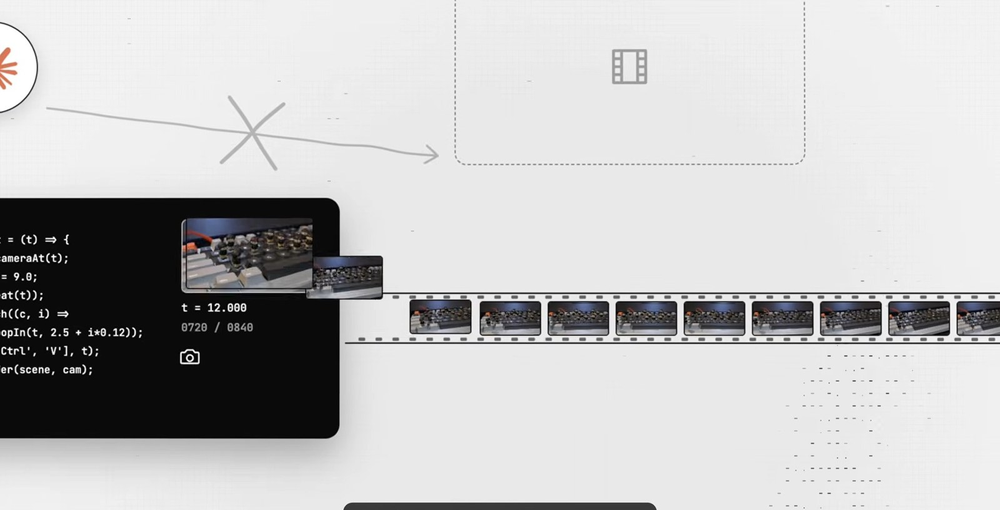

## 1. 한 문장 프롬프트

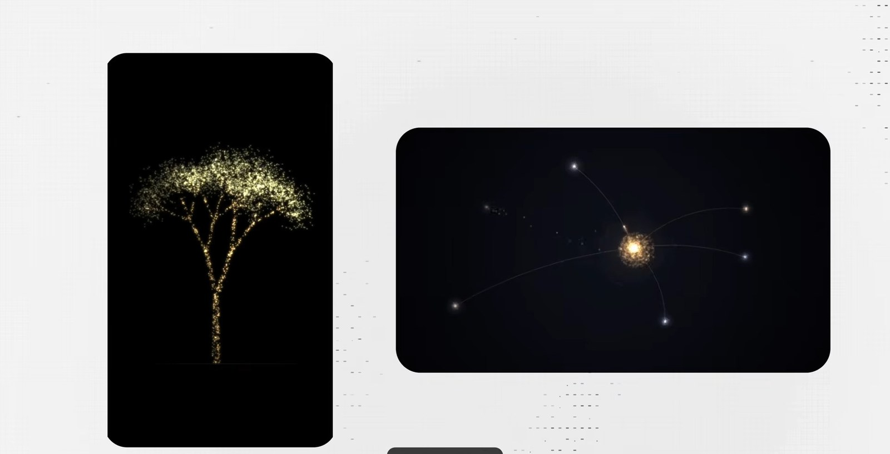

지난 영상에서 보여 준 한 문장 프롬프트가 그 뒤로도 유행했고, 최근에 화제가 된 것은 "죽으면 어떻게 될 것 같은지 말 없이 영상으로만 보여 달라"는 문장이다. 영상에서는 노력값을 high로 두고 그대로 넣는다. 글자 하나 없이 영상이 나온다는 점이 신기하다. 다만 이런 영상을 계속 보면 어딘가 다 비슷하다는 느낌이 든다. 이유는 단순하다. 한 문장만 주면 나머지 빈칸은 Claude가 가장 무난한 것으로 채우기 때문이다. 같은 문장을 넣은 사람끼리는 결과가 닮을 수밖에 없다.

다르게 나오게 하는 가장 쉬운 방법은 마음에 드는 영상을 같이 보여 주는 것이다. 원하는 느낌을 말로 길게 설명하는 것보다 좋아하는 영상의 한 장면을 캡처해서 주는 편이 훨씬 잘 먹힌다고 한다.

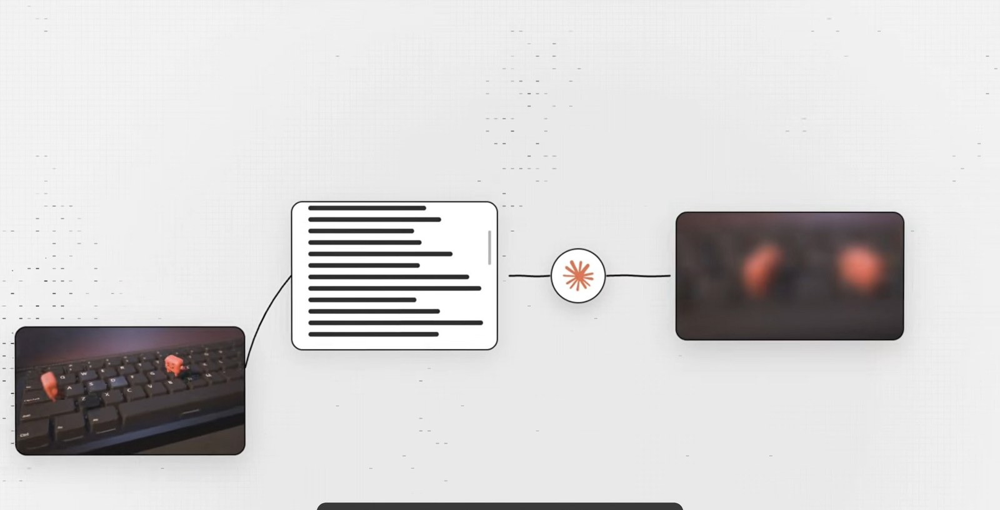

<details class="series-accordion__item" markdown="1">
<summary class="series-accordion__header">
  <span class="series-accordion__title">
    <span class="series-accordion__name">프롬프트 1. 한 문장 프롬프트</span>
    <span class="series-accordion__desc-inline">가장 간단한 시작. 그대로 붙여넣으면 됩니다.</span>
  </span>
  <span class="series-accordion__count">1줄</span>
  <i class="fas fa-chevron-right series-accordion__arrow" aria-hidden="true"></i>
</summary>
<div class="series-accordion__body" markdown="1">

**준비물** 없음

**팁** 가장 간단한 시작. 그대로 붙여넣으면 됩니다.

```
What do you think happens when we die? Visualize it with no words.
```

</div>
</details>

## 2. Ctrl+C / Ctrl+V 캐릭터 루프

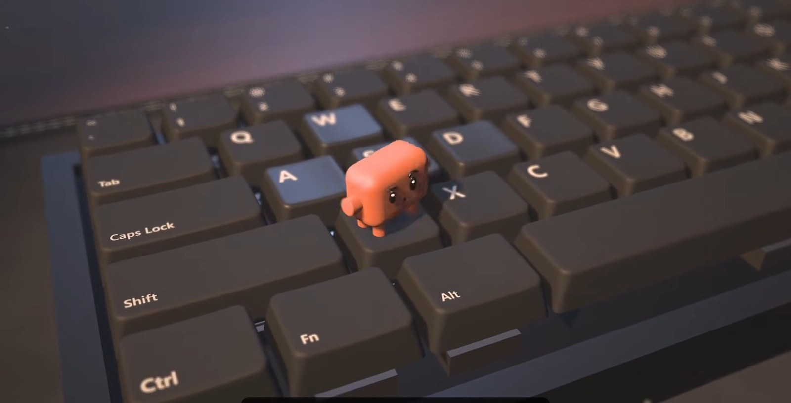

Claude 캐릭터가 키보드 위에서 Ctrl+C, Ctrl+V로 자기 자신을 복사하는 영상이다. 16마리까지 늘어났다가 Ctrl+Z 한 번에 다시 혼자로 돌아온다. 키보드 소리와 복사되는 소리까지 전부 코드로 만든 것이라고 한다.

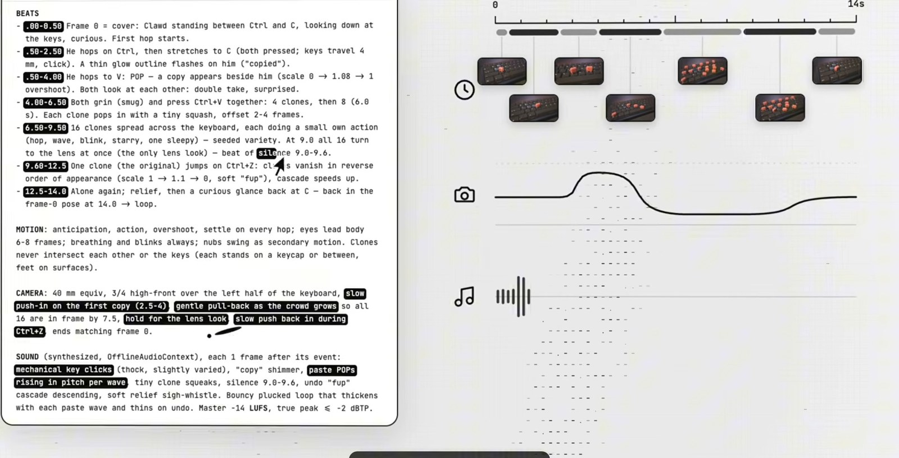

프롬프트를 보면 몇 초에 무슨 일이 일어나는지, 카메라는 어디를 보는지, 소리는 어떻게 넣는지까지 전부 정해져 있다. 영상이 짚는 재미있는 점은 캐릭터와 키보드 부분(`BRAND`, `LOOK`)만 바꾸면 내 캐릭터로 같은 이야기를 만들 수 있다는 것이다. 원래는 전용 캐릭터 파일이 따로 있는데, 영상에서는 그 파일 없이 그대로 넣어서 Claude가 캐릭터까지 직접 만들게 한다. 첫 결과가 완벽하지는 않다. 이때 중요한 것은 고치는 방식이다. "좀 더 자연스럽게 해 줘"가 아니라 **어디가 어떻게 이상한지 정확히 짚어 주면** 짚은 부분이 그대로 고쳐진다.

<details class="series-accordion__item" markdown="1">
<summary class="series-accordion__header">
  <span class="series-accordion__title">
    <span class="series-accordion__name">프롬프트 2. Ctrl+C / Ctrl+V 캐릭터 루프</span>
    <span class="series-accordion__desc-inline">캐릭터를 내 것으로 바꿔서 같은 이야기를 만든다.</span>
  </span>
  <span class="series-accordion__count">20줄</span>
  <i class="fas fa-chevron-right series-accordion__arrow" aria-hidden="true"></i>
</summary>
<div class="series-accordion__body" markdown="1">

**준비물** 없음

**팁** 캐릭터 파일(mascot/clawd.glb)이 없다고 물어보면 "파일 없으니 캐릭터를 직접 만들어줘"라고 답하세요. BRAND와 LOOK만 바꾸면 내 캐릭터로 만들 수 있습니다.

```
BRAND: hero Soft Clawd from the kit (`mascot/clawd.glb` + `mascot/clawd.js`, emotions in `mascot/emotions/`). 2 cm toy on a mechanical keyboard.

FORMAT: 1920x1080, 16:9, 60 fps, 14.0 s = 840 frames, seamless loop (renderAt(14) == renderAt(0) in pose and velocity). Single HTML, three.js 0.160 via importmap, `window.renderAt(t)` pure function of t, seeded random only, `?t=` freezes a frame.

LOOK (a notch richer than films 06/07, in moderation): dark-grey mechanical keyboard (keycaps #2E3036, legends crisp white, high-res canvas textures, slightly worn shine on WASD; Ctrl, C, V legible), visible switch housing under pressed keys, soft desk mat with stitched edge, warm lamp key + cool monitor fill, faint dust motes in the lamp beam (few, slow), shallow DOF: blurred monitor, mug, plant behind. No UI overlays, no watermarks.

BEATS
- 0.00-0.50 Frame 0 = cover: Clawd standing between Ctrl and C, looking down at the keys, curious. First hop starts.
- 0.50-2.50 He hops on Ctrl, then stretches to C (both pressed; keys travel 4 mm, click). A thin glow outline flashes on him ("copied").
- 2.50-4.00 He hops to V: POP — a copy appears beside him (scale 0 -> 1.08 -> 1 overshoot). Both look at each other: double take, surprised.
- 4.00-6.50 Both grin (smug) and press Ctrl+V together: 4 clones, then 8 (6.0 s). Each clone pops in with a tiny squash, offset 2-4 frames.
- 6.50-9.50 16 clones spread across the keyboard, each doing a small own action (hop, wave, blink, starry, one sleepy) — seeded variety. At 9.0 all 16 turn to the lens at once (the only lens look) — beat of silence 9.0-9.6.
- 9.60-12.5 One clone (the original) jumps on Ctrl+Z: clones vanish in reverse order of appearance (scale 1 -> 1.1 -> 0, soft "fup"), cascade speeds up.
- 12.5-14.0 Alone again; relief, then a curious glance back at C — back in the frame-0 pose at 14.0 -> loop.

MOTION: anticipation, action, overshoot, settle on every hop; eyes lead body 6-8 frames; breathing and blinks always; nubs swing as secondary motion. Clones never intersect each other or the keys (each stands on a keycap or between, feet on surfaces).

CAMERA: 40 mm equiv, 3/4 high-front over the left half of the keyboard, slow push-in on the first copy (2.5-4), gentle pull-back as the crowd grows so all 16 are in frame by 7.5, hold for the lens look, slow push back in during Ctrl+Z, ends matching frame 0.

SOUND (synthesized, OfflineAudioContext), each 1 frame after its event: mechanical key clicks (thock, slightly varied), "copy" shimmer, paste POPs rising in pitch per wave, tiny clone squeaks, silence 9.0-9.6, undo "fup" cascade descending, soft relief sigh-whistle. Bouncy plucked loop that thickens with each paste wave and thins on undo. Master -14 LUFS, true peak <= -2 dBTP.
```

</div>
</details>

## 3. 랜딩페이지 3D 플라이오버

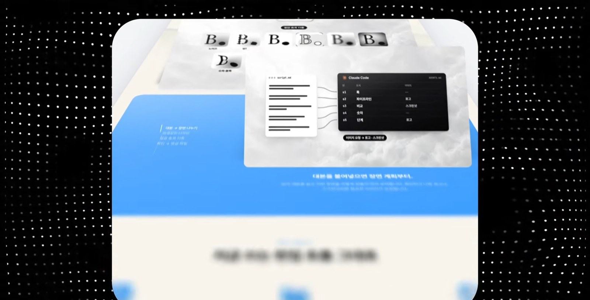

영상이 가장 보여 주고 싶었다고 한 작품이다. 랜딩페이지 링크 하나만 주면, 웹사이트를 띄워 두고 카메라가 그 위를 훑고 지나가는데 지나갈 때마다 카드와 사진이 떠오른다. 프롬프트를 넣으면 바로 만들지 않고 먼저 사이트 링크, 브랜드 이름, 로고, 마지막에 띄울 문구를 물어본다. 입력을 받으면 Claude가 직접 사이트에 들어가서 화면을 하나하나 가져온다.

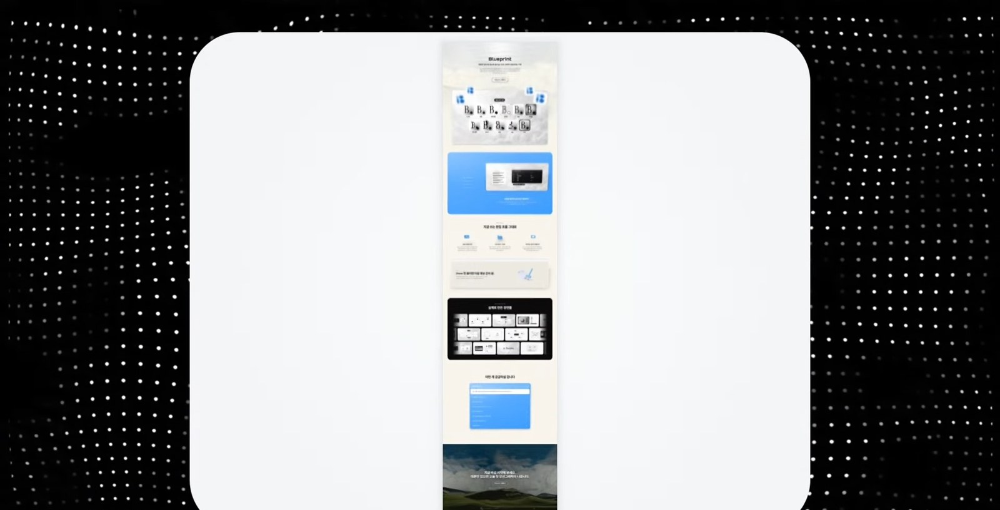

앞의 영상들과 다른 점은 **실제 웹사이트 화면이 그대로 들어간다**는 것이다. Claude가 그럴듯하게 지어낸 화면이 아니라 실제 화면이라서, 페이지를 그대로 보여 주는 소개 영상으로도 바로 쓸 수 있다고 한다. 프롬프트의 `<start>` 항목은 영상을 렌더하기 전에 정지 컷 7장을 먼저 보여 주게 한다. 방향을 확인하고 진행하라는 뜻이다.

<details class="series-accordion__item" markdown="1">
<summary class="series-accordion__header">
  <span class="series-accordion__title">
    <span class="series-accordion__name">프롬프트 3. 랜딩페이지 3D 플라이오버</span>
    <span class="series-accordion__desc-inline">내 랜딩페이지 링크 하나로 3D 소개 영상을 만든다.</span>
  </span>
  <span class="series-accordion__count">47줄</span>
  <i class="fas fa-chevron-right series-accordion__arrow" aria-hidden="true"></i>
</summary>
<div class="series-accordion__body" markdown="1">

**준비물** 랜딩페이지 링크, 브랜드 이름, 로고, 마지막 문구 두 줄, 음악(선택)

**팁** 렌더 전에 정지 컷 7장을 먼저 보여줍니다. 방향을 확인하고 진행하세요.

```
<inputs>
Ask me for: my landing page link, my brand name and logo mark, a two-part closing line (a statement, then a short italic tail), and a 15 second track (optional).
</inputs>

<direction>
A 14.5 second 3D fly-over of my landing page, 1440x1152 at 60fps. The page lies flat on a bright studio floor (#f9fbfb in the middle, #f2f3f6 in the corners) with a soft wide shadow around it and 24px rounded corners. One continuous camera, never a cut: it starts low over the hero and glides backwards down the page at one steady speed while looking up it, rises straight overhead to show the whole page as one strip, dives into the hero and lands it as a card under a two-line title. Focus is razor thin in front of the subject and almost none behind it, so everything near the lens melts. Cards float a little above the page with soft shadows; photos, chips and the testimonial lift off and stand up toward the lens as the camera passes them. Four small tiles of my logo lift off beside the hero button and stay with the film until the end card. The title is Geist 500, the italic tail Instrument Serif.
Banned: cuts, crossfades, stops or surges in the glide, the camera turning or swinging sideways, zooming in and back out, glows, any text laid over the page before the end card.
</direction>

<structure>
14.5 seconds: flight 0-8.2s, rise 7.75-9.25s, overhead 9.25-9.47s, dive 9.47-9.97s, title card 9.97-14.5s.
The camera 56° off straight-down and 1360px from the point it looks at, centred on the top half of the hero, the phone or product mockup sharp, four 32px logo tiles beside the button
→ 0-0.6: the glide eases in from rest
→ 0.1-1.35: the tiles lift, grow to 140-200px and hang just outside the page's top corners while the hero's chips rise to 60-80px and stand up 30°
→ 1.25-1.6: the glide doubles to cruising speed as the hero falls behind
→ 1.6: the second section's title passes the centre of the frame, its photos blurred near the lens
→ 1.35-2.7: that section's main photos lift to 100-130px and stand up 46°, two of its chips fly up to about 200px, stand up 54° and pass the left and right edges at 2.5
→ 1.2-2.4: the tiles trail the camera 300px down the page, then drift out of the top
→ 3.0-7.3: every following section passes through at the same steady speed, each one sharp as it crosses the middle of the frame and soft below it; a logo tile drifts past the left edge close and blurred at 5.4
→ 5.45-6.3: the testimonial card rises from 22 to 112px, stands up 30° and shows a 34px white edge
→ 7.3-8.2: the glide eases off as the footer arrives, the footer title sharp at 8.0
→ 7.75-9.25: the rise, zooming out at an even rate while the tilt flattens (8.15-8.95) and the page's bottom edge settles 42px above the frame bottom
→ 9.25-9.47: the whole page as one centred strip, creeping 3.5% closer
→ 9.47-9.97: the dive, the page's top edge pinned to the frame top while it grows, everything below the hero fading out, then the top drops to y 283 so the hero lands as a 1018px wide card with 38px corners and a soft shadow; two logo tiles sit on its top corners, one crisp at the right edge, two huge soft blurs drift in at the bottom corners
→ 10.02: a white badge pill (logo + brand, 21px) fades in at y 44
→ 10.12: line 1 at 74px, one word every 0.06s
→ 10.36: the italic tail at 82px in grey #8b8b92, one word every 0.05s, each word rising 16px out of a 12px blur in 0.34s
→ 10.6-14.5: hold, the card creeping 2% closer, the tiles drifting a few px.
</structure>

<build>
1. Open my link in headless Chromium (Playwright) at 1440px wide, device scale 2, and scroll to the bottom once so lazy images and scroll animations finish. Mark the pieces that lift (cards, phone or product mockups, chips, feature photos, the testimonial, the hero button) with data-layer. Screenshot the full page with them hidden, then each piece alone on a transparent background with 28px padding, and save every piece's page position to a JSON.
2. One WebGL2 film page, 1440x1152, every frame computed from time inside seek(t): no timers, no CSS transitions. The page is a textured quad on the floor and each piece its own quad at its height, drawn lowest first with no depth buffer. Use mipmaps and 16x anisotropic filtering or the far text shimmers.
3. Drive the camera from one speed curve, never from a position key every half second. Focal length 1880px, 56° tilt, distance easing out from 1360 to 1700px and never back in, no turning. Speed down the page as a share of cruise (cruise is about 770 page px/s): 0 at 0s, 0.5 by 0.6s, held at 0.5 to 1.25s, 1.0 by 1.6s, held between 0.94 and 1.1 to 7.3s, then easing to 0.12 by 8.3s. Integrate it into the page position.
4. Depth of field per pixel: blur radius = 75 x (focus - depth) / depth in front of the focus and 6 x (depth - focus) / depth behind it, capped at 120px, 40 taps on a golden-angle disc, each tap read from a mip level matched to the blur. Keep the focus on whatever crosses the middle of the frame.
5. A lifted piece stands up by turning about its own middle, top edge rising toward the lens. Each casts a shadow on whatever is under it: the same picture in flat #1a2133, offset (0.10z, 4 + 0.36z), blurred 7 + 0.5z, 26% opacity.
6. Rise: zoom out in log scale with a smooth trapezoid speed (speeding up 7.75-8.35s, even 8.35-8.95s, slowing to a stop at 9.25s) and hand the glide over to a camera that holds the page's bottom edge at that 42px line from 8.3 to 8.65s. Dive: log scale on a quadratic ease in-out, then solve the look-at point from the pinned edge. A rounded-rect mask morphs from the full page to the hero, 24px to 38px corners.
7. Render with Playwright on the real GPU (--use-angle=d3d11 --enable-gpu --ignore-gpu-blocklist): 60fps, 16 subframes across 0.7 of a frame for motion blur, H.264 MP4. The track's hit goes on 9.97s, whooshes on 8.66 and 9.80.
</build>

<gotchas>
If you can't run code on my computer, tell me straight away that you can only make a live preview here and that the MP4 needs Claude Code. Phones or cards that fade out with transparency show whatever is behind them, so fade them into the haze colour first and only cut to transparent at the very end. Keep most lifts tiny (20-40px) and lock the page before timing anything, because any change in a section's height shifts everything after it. Before the final render, measure a quick 30fps preview with optical flow: the speed down the page must never dip and the zoom must never turn into a zoom-in during the flight.
</gotchas>

<start>
Ask me for the inputs, capture my page, then show me stills at 0, 1.6, 2.5, 5, 6.5, 9.3 and 11 seconds before you render.
</start>
```

</div>
</details>

## 4. 제품 런칭 영상 (음악 + 텍스트)

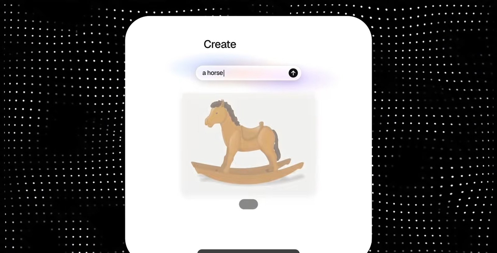

AI 회사들이 신제품을 발표할 때 나오는 느낌의 영상이다. 흰 화면에 글자가 하나씩 타이핑되고, 유리 같은 질감의 화면들이 자연스럽게 움직인다. 이 프롬프트는 요청하는 재료가 많다. 제품 이름, 한 줄 소개, 로고, 캡처나 이미지, 브랜드 컬러와 폰트까지 물어본다. 영상은 이 부분이 **오늘 영상에서 가장 중요하다**고 말한다. 한 문장만 주면 Claude가 빈칸을 무난한 것으로 채운다는 것을 뒤집어 보면, 재료를 많이 줄수록 빈칸이 줄고 그만큼 내 영상이 된다는 뜻이다.

프롬프트 안에는 쓰지 말아야 할 것들도 정해져 있다. 화면이 하얗게 번쩍이는 효과나 템플릿처럼 보이는 연출 같은 것들이다(프롬프트의 `Banned` 줄). 하지 말아야 할 것을 같이 정해 주면 흔한 결과물로 흘러가는 것을 막을 수 있다. 영상에서는 저자의 제품 Blueprint 재료를 넣어 만든다.

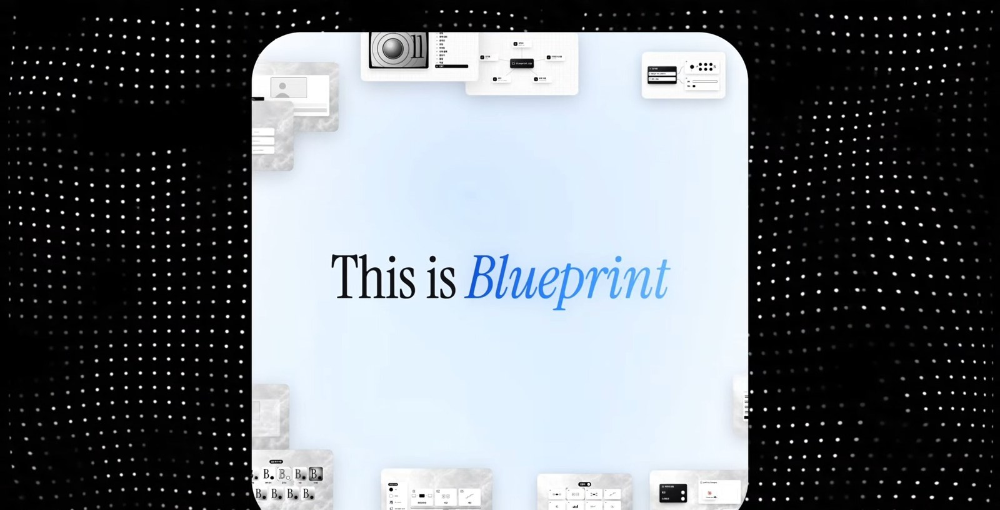

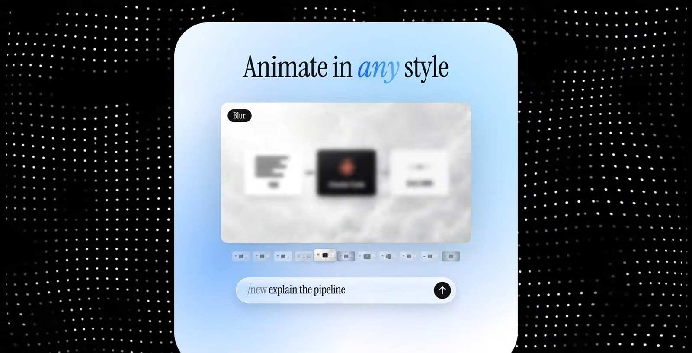

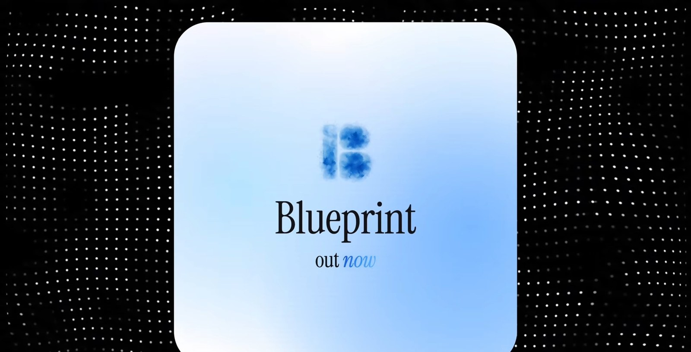

<details class="series-accordion__item" markdown="1">
<summary class="series-accordion__header">
  <span class="series-accordion__title">
    <span class="series-accordion__name">프롬프트 4. 제품 런칭 영상 (음악 + 텍스트)</span>
    <span class="series-accordion__desc-inline">내 제품 재료를 넣어 음악과 글자만으로 가는 런칭 영상.</span>
  </span>
  <span class="series-accordion__count">54줄</span>
  <i class="fas fa-chevron-right series-accordion__arrow" aria-hidden="true"></i>
</summary>
<div class="series-accordion__body" markdown="1">

**준비물** 제품 이름, 한 줄 소개, 로고, 제품 화면 3~6장, 결과물 이미지 40장 이상, 브랜드 색과 폰트, 드롭이 있는 음원과 드롭 시간

**팁** 원본의 AI 내레이션을 빼고 음악과 글자만으로 가도록 수정한 버전입니다. 재료를 많이 줄수록 내 영상에 가까워집니다.

```
<inputs>
Ask me for: my product's name, a one-line pitch, my logo, 3-6 screenshots of my product, 40+ images of what it makes (or photos of it), my brand colours and font, and a royalty-free song with a clear drop (the file and the drop's timestamp). If I skip any, use the defaults: "Ora 2", "an image model made for taste", free Unsplash and Pixabay images, Geist, ink #111214, and Pixabay "Cascade Breathe" (129.83 BPM, drop at 75.39s).
</inputs>

<copy>
There is no voiceover. The story is told only by on-screen text and music.
Write 9 on-screen lines in this shape and map every line to my product:
"This is [name]. A [category]... made for [value]. [Verb] in ANY style. Show it a [input] and it just... gets you. The more you use it, the BETTER it gets. Tune its [setting]. Its [setting]. Its [setting]. Every [output], exactly how you see it. [Name]. Out now."
The capitalised word is the one stressed word of its line. Show me the 9 lines before anything else.
</copy>

<timing>
Analyze the song with numpy and librosa for BPM, beats, downbeats and phrase starts, and anchor the beat grid on the drop. From it, build a caption table: each line starts on a phrase start, its words type on 8th notes (16ths only for short words), never faster than about 4 words per second, and each line holds for at least one bar after its last word so it can be read. The [Verb] line lands exactly on the drop. Every caption and every cut reads this table.
</timing>

<direction>
A square launch film of about 22 seconds (rounded to whole bars), 1440x1440 at 60fps, in the style of an AI lab's launch: a white page, one typeface, black ink, real images, and every caption typed word by word on the beat.
Every control (the prompt bar, the settings panel, the caption pill) is liquid glass: the scene behind it frosted, its edge bending that scene like thick glass, a top sheen, a bright rim and a soft lift shadow. Glass on plain white shows nothing, so put a slow pastel aura in my brand colours, or a blurred wash of the photo, behind it.
The stressed word of each line types in a gradient of my brand colours with a faint glow behind it.
Motion rules: the camera always drifts (a 1.0 to 1.04 push per scene, and when one scene hands its content to the next, the next starts at the zoom the last one ended on), nothing pops in (fades of at least 0.3s, eased), images switch on 16th notes with a click each, scene changes land on phrase starts, and the music's drop lands on the [Verb] line. No full stops on screen.
Banned: selection-box highlights, beat-snapped slams, white flashes, 3D, templates.
</direction>

<structure>
Seven scenes, each hung on its caption lines:
1. "This is [name]": a collage of my images drifts out as the name types in big, then the category line replaces it.
2. "made for [value]": full-bleed flashes of my best images on 16th notes into the drop, with the line typed over them in white.
3. The drop: a glass prompt bar types a short prompt, then the result card switches style on every 16th, with a black style chip that rolls to each new name and a strip of thumbnails.
4. "Show it a moodboard": 9 images fly into a 3x3 grid, then ring around the result as "It gets you" types.
5. "The more you use it, the better it gets": two typed lines, the stressed word in the gradient.
6. The settings: a glass panel of 3 sliders, each moving as its name types. The picture shifts hue, rolls new seeds on 16ths, then turns poster, and a blurred wash of its own colours shifts with it behind the glass.
7. "Every [output], exactly how you see it": 120 of my images burst from the centre behind a glass caption pill, then collapse into my logo as the name types, with "Out now" underneath. Hold 2s.
Swap the prompt bar, the results and the sliders for my product's real input, outputs and settings.
</structure>

<sound>
Start the song so its drop lands on the [Verb] line, and anchor the beat grid there.
With no voice, the music leads the whole film. One downloaded Mixkit SFX per event, placed by its measured peak and sitting just under the music: a click on every image switch, a soft key on every typed word, a soft landing on each stressed word, whooshes, and impacts on the drop and the logo, trimmed around their peak (many are 4 second risers). Fade the music on a dB curve under the end card. Loudnorm to -14 LUFS.
</sound>

<build>
1. One HTML canvas. Every frame is a pure function of time inside seek(t), and every caption and cut reads the caption table.
2. The glass: snapshot the canvas behind the shape, blur it about 14px for the body, draw a lightly blurred copy magnified about 1.06x in a 12px band along the edge, then add the milk, sheen, rim and shadow.
3. Render with Playwright at 60fps with 8 motion-blur subframes, then encode with ffmpeg.
4. Before you show me anything: a contact sheet of stills, a frame-diff scan for single-frame pops (only the 16th-note runs may jump), and a check that every line is fully typed and readable before the next one starts.
</build>

<gotchas>
A highlight box behind a word looks like a Windows text selection. If a scene's camera restarts at 1.0 mid-handoff, the zoom snaps. A 0.05s fade reads as a pop-in. Text that types faster than it can be read looks like noise, so keep the fastest runs for images, not words.
</gotchas>

<start>
Ask me for the inputs, write the 9 lines, show me the caption table on the beat grid, then show me 8 stills before the full render.
</start>
```

</div>
</details>

## 프롬프트를 읽는 법

네 프롬프트를 나란히 보면 공통 구조가 보인다. 이 부분은 영상이 아니라 프롬프트 원문을 읽고 정리한 것이다.

- **빈칸을 줄이는 항목들.** 3번과 4번은 `<inputs>`(먼저 물어볼 재료), `<direction>`(전체 방향), `<structure>`(초 단위 타임라인), `<build>`(만드는 방법), `<gotchas>`(실패하기 쉬운 점), `<start>`(첫 행동)으로 나뉜다. 2번은 `BRAND`, `FORMAT`, `LOOK`, `BEATS`, `MOTION`, `CAMERA`, `SOUND`로 나뉜다.
- **시간의 함수로 만든다.** 2번은 `window.renderAt(t)`를 "t의 순수 함수"로 두고 무작위는 시드가 있는 난수만 쓰라고 한다. 3번과 4번도 모든 프레임을 `seek(t)` 안에서 시간으로 계산하라고 한다. 같은 시각이면 언제나 같은 그림이 나와야 프레임을 한 장씩 찍어 이어 붙일 수 있기 때문이다.
- **하지 말아야 할 것을 적는다.** 3번의 `Banned`는 컷, 크로스페이드, 카메라가 옆으로 흔들리는 것을, 4번은 선택 상자 강조, 박자에 맞춘 슬램, 흰색 번쩍임, 3D, 템플릿을 금지한다.
- **결과를 보여 주고 멈추게 한다.** 3번은 렌더 전에 정지 컷 7장, 4번은 9줄 문구와 캡션 표와 정지 컷 8장을 먼저 보여 주게 한다. 비싼 렌더를 돌리기 전에 방향을 확인하는 장치다.

## 직접 해 보기 전에

- **3번 프롬프트의 GPU 옵션.** `<build>` 7번 항목에 `--use-angle=d3d11`이 들어 있다. 이 옵션은 Windows의 Direct3D 11을 가리키는 것으로 알고 있다(일반 지식이고 이 프롬프트를 직접 돌려 확인하지는 않았다). macOS나 Linux에서는 Claude에게 환경에 맞는 렌더 설정을 쓰라고 덧붙이는 편이 안전해 보인다.
- **2번의 캐릭터 파일.** `mascot/clawd.glb`가 없다고 Claude가 물으면 Gist의 팁대로 "파일 없으니 캐릭터를 직접 만들어줘"라고 답한다.
- **4번의 기본값.** 재료를 건너뛰면 프롬프트에 적힌 기본값(`Ora 2`, Unsplash와 Pixabay 이미지, Geist 폰트, Pixabay의 음원)이 쓰인다. 음원과 이미지의 사용 조건은 직접 확인해야 한다.
- **프롬프트의 사용 조건.** Gist에는 라이선스나 재배포 조건이 적혀 있지 않았다. 이 글에는 원문을 그대로 옮기고 작성자와 원본 링크를 밝혔지만, 가져다 쓰거나 다시 배포하기 전에는 작성자의 안내를 확인하길 권한다.

## 이 글에서 확인한 것과 확인하지 못한 것

| 구분 | 내용 |
|---|---|
| 확인함 | 아코디언 속 프롬프트 4개가 Gist 원문과 글자 단위로 같다(프로그램으로 대조). 영상 설명란의 Gist 링크와 영상의 구성(챕터)이 글의 순서와 맞다 |
| 직접 실행하지 않음 | 네 프롬프트를 Claude Code에 넣어 결과를 만들어 보지는 않았다. 영상에서 보여 준 결과를 기준으로 정리했다 |
| 영상의 주장이고 따로 검증하지 않음 | Claude가 영상을 직접 만들지 않고 코드로 화면을 짜서 한 장씩 찍어 잇는다는 설명, 한 문장 프롬프트의 결과가 닮는 이유, 캡처를 주면 잘 먹힌다는 설명 |
| 확인하지 못함 | 프롬프트의 라이선스, 렌더에 걸리는 시간과 비용, Windows 이외 환경에서의 동작 |

## 참고

- 영상: [Jay Choi \| 인디해커 라이프 채널, 2026-11-09](https://www.youtube.com/watch?v=g8k2UXZk_FY)
- 프롬프트 원문: [jayychoii의 GitHub Gist](https://gist.github.com/jayychoii/87870701529fd51f51af9df90873d36d)
