긱뉴스 채널이 11월 5일에 올린 10분 57초짜리 영상이다. 제목은 "쿼리 엔진은 어떻게 동작할까? Trino와 DuckDB 이해하기 \| 최신 데이터 인프라 이해하기 시즌2 EP04"다. 레이크에 파일로 쌓아 둔 데이터를 SQL 한 줄로 분석하려면 무엇이 필요한지, 그 일을 하는 쿼리 엔진이 어떻게 읽고 계산하는지를 Trino, Dremio, Apache Drill, Apache Impala, DuckDB로 짚는다.

영상은 개념 설명이라 설치 과정이 나오지 않는다. 그래서 이 글은 영상 내용을 정리한 뒤, 영상의 시나리오(광고로 들어온 고객의 주문을 상품별로 집계)를 **내 컴퓨터에서 직접 돌려 볼 수 있게** 설치 과정을 자세히 적었다. 어떤 도구가 무료이고 어떤 도구가 유료인지, 유료라면 무엇으로 대신할 수 있는지도 구분했다. 직접 실행해서 확인한 것, 문서로만 확인한 것, 확인하지 못한 것은 본문에서 따로 표시했다.



## 먼저 알아 둘 것

- **이 글의 실습은 전부 무료다.** DuckDB와 Trino 모두 오픈소스를 내 컴퓨터에 설치하는 방식이라 가입도 결제도 없다. 필요한 것은 디스크 약 2.5GB(Trino 이미지)와 시간이다.
- **직접 실행해 검증한 환경.** macOS 26.6.2(Apple Silicon, arm64), Python 3.13.7, Docker 29.7.1, DuckDB 2.0.0, Trino 484, 2026-11-10. 다른 환경에서는 확인하지 않았다. Windows와 Linux 명령은 공식 문서에 있는 것을 옮겼고 직접 돌려 보지 않았다.
- **실습 시간.** DuckDB 약 10분, Trino 약 20분이다(이미지 내려받기 시간은 네트워크에 따라 다르다. 필자는 35초였다).

## 영상 요약

### 쿼리 엔진이 하는 일

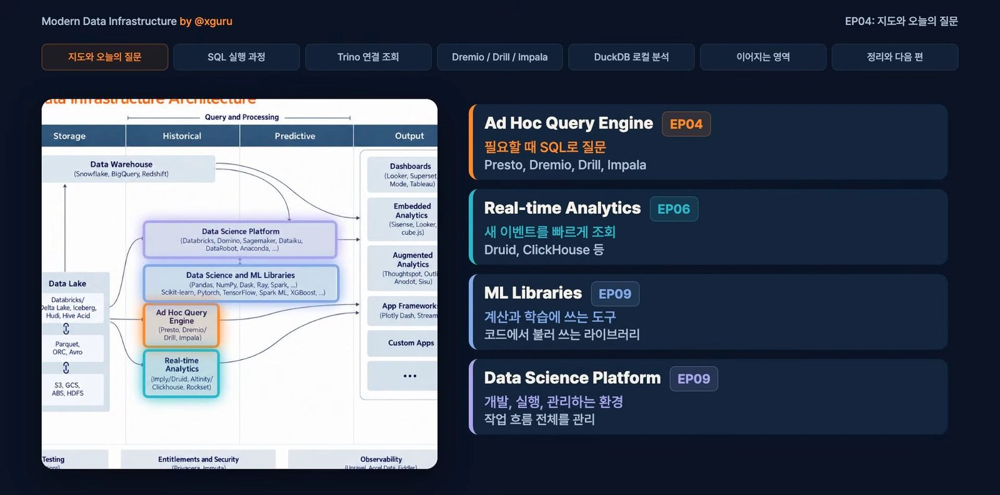

영상의 출발점은 이 질문이다. "지난 6개월간 키보드 광고를 보고 들어온 고객은 결국 어떤 상품을 주문했을까?" 방문 기록과 주문 내역이 파일로 모여 있다고 답이 저절로 나오지는 않는다. 광고로 들어온 고객을 찾고, 그 고객의 주문을 연결하고, 상품별로 묶는 계산이 필요하다. 이 계산을 실행하는 프로그램이 쿼리 엔진이다. 영상은 데이터 인프라 지도에서 이 엔진들을 "Ad Hoc Query Engine" 칸으로 묶는다.

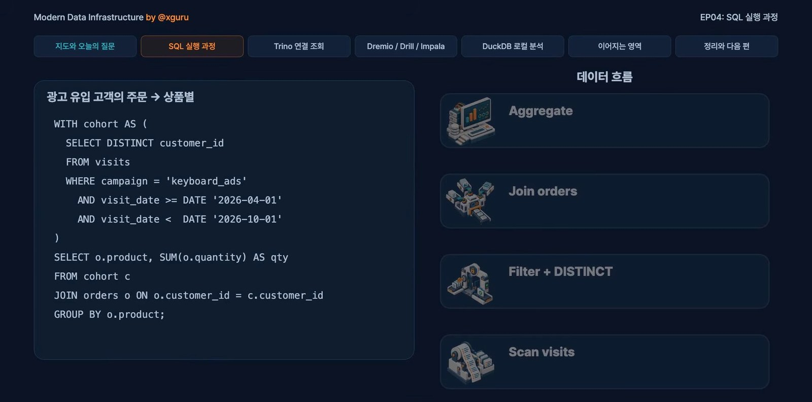

SQL에는 어떤 답을 원하는지만 적는다. 엔진은 그 답을 만들려고 실행 계획을 세운다. 어떤 데이터를 먼저 읽고, 어디서 조건을 걸고, 어떻게 연결하고, 어떻게 집계할지를 정하는 것이다. 영상의 그림은 이 과정을 방문 데이터 읽기, 중복 제거와 조건, 주문 연결, 집계로 보여 준다. 카탈로그와 테이블 정보는 읽을 파일을 찾는 데 쓰이고, 실제 계산은 엔진이 한다. Parquet나 Iceberg에 넣었다고 알아서 광고 분석을 해 주는 것은 아니다.

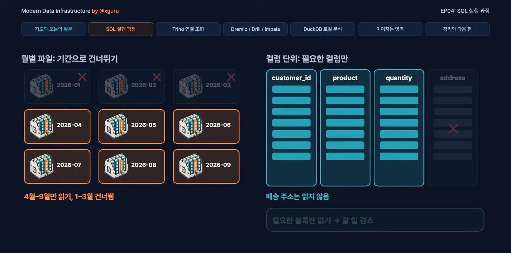

영상이 강조하는 기준은 하나다. **얼마나 읽고, 얼마나 계산하고, 얼마나 옮기는가.** 6개월을 분석하는데 다른 기간의 기록을 다 읽을 필요는 없고, 고객과 상품만 필요하니 배송 주소를 읽을 필요도 없다. 필요한 부분만 읽을 수 있으면 그만큼 할 일이 줄어든다. 데이터가 여러 서버에 나뉘어 있으면 연결하는 과정에서 일부를 옮겨야 하고, 서버를 더 붙이는 것도 이 일을 줄이거나 나누기 위한 선택이라고 설명한다. 뒤에서 실제로 이 말이 실행 계획에 어떻게 나타나는지 직접 확인한다.

### 영상이 소개한 도구 6가지

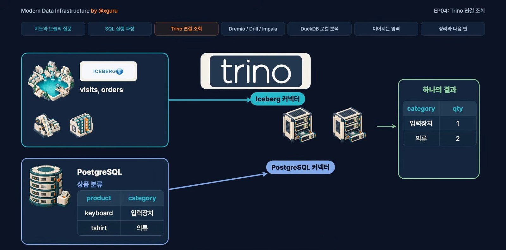

**Trino.** 여러 서버가 나눠서 계산하는 SQL 쿼리 엔진이다. 방문 기록과 주문은 레이크에 있고 상품 분류는 회사의 다른 DB에 있어도, 커넥터로 각 저장소에 접근해서 하나의 SQL에서 함께 조회한다. 서로 다른 곳의 데이터를 함께 조회하는 이 방식을 연합 조회라고 한다. 데이터를 Trino 전용 저장소에 다시 넣을 필요가 없고, 질문을 받은 코디네이터가 일을 나누면 워커들이 읽고 계산한다. 다만 복사하지 않는다고 이동이 없어지는 것은 아니다. 연결하고 집계하는 동안 네트워크를 쓰고 원본 DB에 부담을 줄 수도 있다. 영상은 새로 이런 조회 시스템을 구성한다면 Trino를 고르면 된다고 말한다. 오픈소스 커뮤니티의 지지와 풍부한 커넥터 생태계를 이유로 든다.

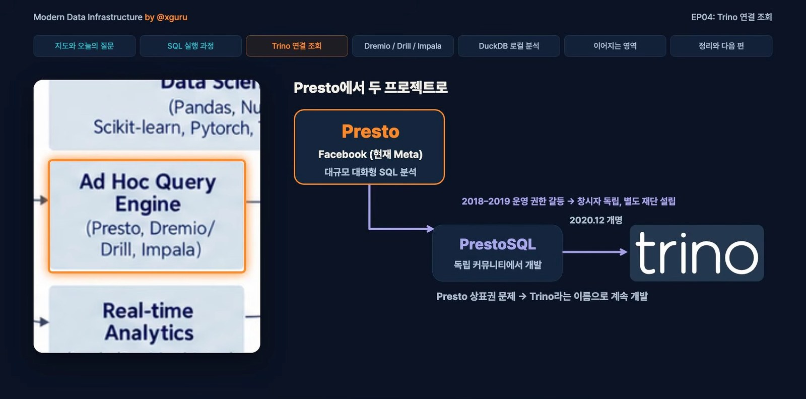

데이터 인프라 지도에 "Presto"라고 적혀 있는 이유도 설명한다. 영상 슬라이드에 따르면 Presto는 페이스북(현 메타)에서 만든 대규모 SQL 엔진이다. 운영 권한을 둘러싼 갈등으로 초기 개발자들이 독립시킨 프로젝트가 PrestoSQL이고, 이후 상표 문제로 이름을 Trino로 바꿨다. 메타 쪽에 남은 Presto는 PrestoDB로 이어져서 두 프로젝트는 서로 갈라졌다.

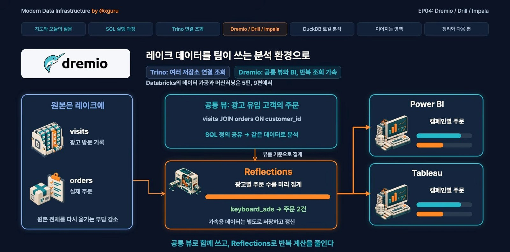

**Dremio.** 여러 저장소를 연결해 질문하는 것에서 한 걸음 더 나아가, 그 데이터를 회사 사람들이 반복해서 분석하기 편하게 만드는 기능이 강점이다. 방문 기록과 주문을 연결하는 SQL을 담당자마다 새로 쓰는 대신 **뷰**로 만들어 공유한다. Power BI나 Tableau 같은 도구를 붙여 대시보드로 볼 수도 있다. 핵심은 **Reflections**다. 광고별 주문 수처럼 자주 계산하는 내용을 집계 데이터로 미리 준비해 두고, 조회가 들어오면 엔진이 그 가속 데이터를 활용해서 매번 방대한 방문 기록부터 다시 계산하는 부담을 줄인다.

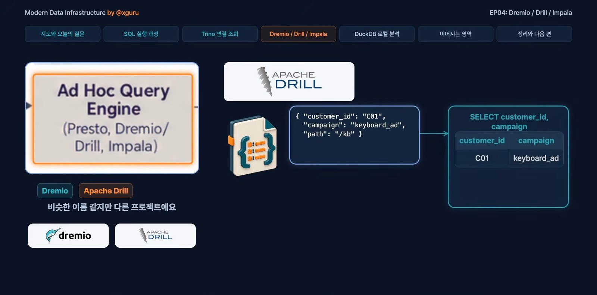

**Apache Drill.** 지도에는 Dremio와 Drill이 슬래시로 함께 적혀 있지만 서로 다른 프로젝트다. Drill은 JSON처럼 구조가 다양한 데이터나 파일을 SQL로 조회한다. 방문 이벤트 JSON 파일을 열어 고객과 캠페인 값을 확인할 때, **테이블을 미리 정의하지 않고도** 조회할 수 있다는 점이 장점이다.

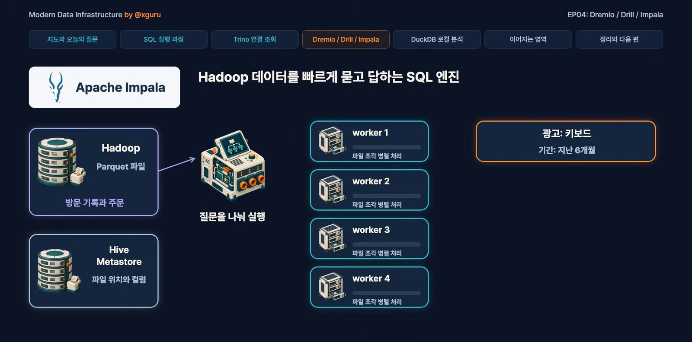

**Apache Impala.** Hadoop 환경에 저장된 데이터를 대화형 SQL로 빠르게 조회하는 데 강점이 있다. 여러 서버가 데이터를 나눠 읽고 동시에 계산하는 MPP 구조이고, Hive 메타스토어에 있는 테이블 정보를 이용해서 분석가가 SQL을 바꿔 가며 빠르게 결과를 확인한다. 회사가 이미 Hadoop 환경을 쓰고 있는지가 선택의 기준이 된다.

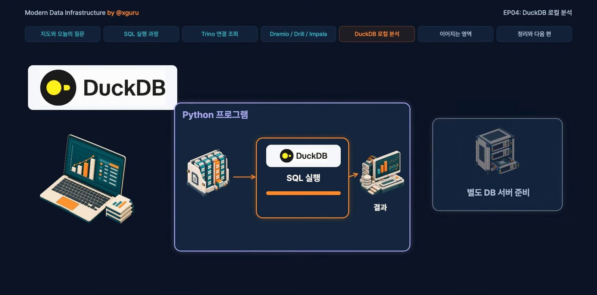

**DuckDB.** 분석용 SQL을 실행하는 DB인데 **내 프로그램 안에서 함께 실행**할 수 있다. 별도의 DB 서버를 먼저 마련하지 않아도 된다. 광고 캠페인 하나에 해당하는 방문 기록과 주문 파일을 받았다면, 노트북에서 DuckDB로 Parquet 파일을 바로 읽고 고객을 연결해서 어떤 상품을 주문했는지 확인한다. 파일을 다른 서버에 올리고 테이블을 만들고 데이터를 다시 넣는 준비 과정이 줄어든다. 파이썬에서 계산한 결과를 받아 그래프를 그리는 일도 자연스럽게 이어진다. 지난 편에서 다룬 DuckLake도 여기서 이어진다. DuckLake가 파일 목록과 테이블 상태를 관리하면 DuckDB가 그 정보를 이용해 읽고 계산한다.

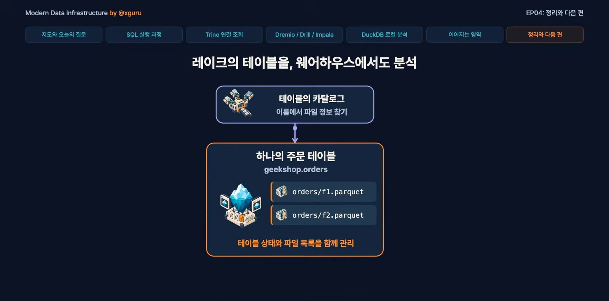

**Snowflake.** 영상 끝에서는 레이크에 저장한 테이블을 웨어하우스에서도 분석할 수 있다고 연결한다. Spark로 정리한 Iceberg 주문 테이블을 Trino로 조회하고 Snowflake에서도 분석하는 식이다. 같은 데이터를 도구마다 따로 옮기는 부담을 줄일 수 있다. 영상의 선택 기준은 이렇다. 캠페인 Parquet 파일을 내 프로그램에서 바로 분석한다면 DuckDB가 가장 쉽고 빠르다. 여러 저장소의 데이터를 SQL로 함께 조회한다면 Trino 같은 연결 조회 엔진이다. 데이터가 내 컴퓨터에 있는지, 여러 저장소에 흩어져 있는지부터 보고, 회사가 이미 Hadoop 같은 시스템을 쓰는지, 같은 분석을 자주 반복하는지를 함께 본다.

## 유료와 무료 한눈에 보기

가격과 정책은 바뀌는 정보라서 **2026-11-10에 확인한 값**으로 적었다. 직접 확인하지 못한 항목은 "확인 못함"이라고 적었고, 결제 전에는 각 공식 페이지를 다시 봐야 한다.

| 도구 | 무료로 쓰는 방법 | 라이선스 | 돈이 드는 곳 | 대신 쓸 수 있는 것 |
|---|---|---|---|---|
| DuckDB | 내 컴퓨터에 설치, 완전 무료 | MIT | 없음. 클라우드판 MotherDuck만 유료 | 해당 없음 |
| Trino | 내 컴퓨터나 서버에 설치, 무료 | Apache-2.0 | 상용판 Starburst가 따로 있음 | 해당 없음 |
| PrestoDB | 설치 무료 | Apache-2.0 | 확인 못함 | Trino |
| Apache Drill | 설치 무료 | Apache-2.0 | 확인 못함 | DuckDB(파일을 바로 조회하는 용도) |
| Apache Impala | 설치 무료 | Apache-2.0 | 확인 못함 | Trino |
| Dremio | Community Edition이 문서에 있음(Docker). 저장소는 Apache-2.0 | 저장소 기준 Apache-2.0. Docker 이미지 라이선스는 확인 못함 | Dremio Cloud와 Enterprise는 유료. 가격 숫자는 확인 못함 | Trino, DuckDB |
| Snowflake | 30일 무료 체험 | 상용 | 사용량 기반. 크레딧 단가는 확인 못함 | DuckDB(로컬), Trino |
| Starburst | Galaxy Free 티어(클러스터 3개까지), 30일 체험에 컴퓨트 $500 | 상용 | Pro 크레딧당 $0.50부터, Enterprise 크레딧당 $0.75부터 | Trino 오픈소스 |
| MotherDuck | Lite 플랜 $0(10GB, 월 10시간) | 상용 | Business 월 $250에 사용량 추가 | DuckDB 로컬 |
| Databricks | Free Edition(상업적 사용 불가) | 상용 | DBU 종량제. 단가는 확인 못함 | DuckDB, Trino, Apache Spark(Apache-2.0) |

표를 읽는 기준을 적어 둔다.

- **라이선스**는 각 프로젝트의 GitHub 저장소 정보(API)로 확인한 값이다. Trino, PrestoDB, Drill, Impala, Dremio 저장소, Spark는 Apache-2.0이고 DuckDB는 MIT다.
- **Starburst, MotherDuck, Snowflake의 숫자와 체험 조건**은 각 공식 가격 페이지와 문서의 본문에서 직접 확인했다. Snowflake 체험은 가입일부터 30일 또는 무료 사용량을 다 쓸 때까지이고, 유효한 이메일만 있으면 되며 결제 정보는 필요 없다. 체험 계정에서는 카드를 등록하기 전까지 AI 기능이 꺼져 있다. MotherDuck은 체험과 Lite에 카드가 필요 없다고 적혀 있다.
- **Databricks Free Edition**은 공식 문서에 비상업적 용도라고 명시되어 있다. 기존 Community Edition을 대체했고, 쿼터를 넘기면 그날 컴퓨트가 중단된다.
- **Dremio**는 가격 페이지가 동적으로 그려져서 본문에서 숫자를 읽지 못했다. 오픈소스 쪽은 저장소가 보관(archived)되지는 않았지만 마지막 갱신이 2025년 9월이고, Docker Hub 이미지의 마지막 갱신도 2025년 9월 10일이다. 약 14개월 동안 갱신이 없어서 지금도 활발히 유지되는지는 판단하지 못했다.
- **"대신 쓸 수 있는 것"**은 같은 일을 할 수 있는 무료 도구를 가리킨다. 관리형 서비스, 여러 사용자 관리, 컴퓨트와 스토리지 분리, 지원 같은 상용 기능이 그대로 있다는 뜻은 아니다. 이 차이는 공식 비교 문서로 확인하지 못했다.

## 준비물

| 항목 | 실습 1 DuckDB | 실습 2 Trino |
|---|---|---|
| 필요한 것 | Python 3와 터미널 | Docker(Docker Desktop 등) |
| 디스크 | 수십 MB | 이미지 약 2.4GB |
| 메모리 | 거의 없음 | 컨테이너가 약 0.9GB 사용(필자 측정) |
| 서버 | 없음. 프로그램 안에서 실행 | 컨테이너 하나. 포트 8080 |
| 비용 | 무료 | 무료 |

Docker가 설치돼 있는지는 `docker --version`으로 확인한다. Docker Desktop을 쓴다면 설정에서 메모리를 2GB 이상 할당하는 것이 좋다. 필자의 Docker에는 4GB가 할당돼 있었다. 이 숫자는 필자 환경에서 Trino가 약 0.9GB를 쓴 것을 근거로 한 권장이고, 공식 최소 요구량은 문서에서 확인하지 못했다.

## 실습 1. DuckDB로 영상의 분석을 그대로 돌려 보기

영상의 시나리오는 이렇다. 방문 기록 파일과 주문 파일이 있고, 지난 6개월 동안 키보드 광고로 들어온 고객이 무엇을 주문했는지 상품별로 센다. 같은 구조의 샘플 Parquet 파일을 만들어서 DuckDB로 돌린다.

### 1단계. 작업 폴더와 가상환경 만들기

```bash
mkdir -p ~/query-engine-lab
cd ~/query-engine-lab
python3 -m venv .venv
source .venv/bin/activate
```

Windows PowerShell에서는 마지막 줄 대신 `.venv\Scripts\Activate.ps1`을 쓴다(이 명령은 직접 확인하지 않았다). 가상환경을 쓰는 이유는 이 실습에서 설치하는 패키지를 시스템 파이썬과 섞지 않기 위해서다. 실습이 끝나면 폴더 하나만 지우면 된다.

### 2단계. DuckDB 설치

```bash
pip install duckdb
python -c "import duckdb; print(duckdb.__version__)"
```

필자의 결과는 `2.0.0`이었다. DuckDB 공식 문서가 안내하는 명령줄(CLI) 설치 방법도 있다. macOS와 Linux는 `curl https://install.duckdb.org | bash`, Windows PowerShell은 `powershell -NoExit -ExecutionPolicy Bypass -Command "irm https://install.duckdb.org/install.ps1 | iex"`다. 두 명령은 공식 설치 문서의 문구와 같은지 확인했지만 직접 실행하지는 않았다. 이 글의 실습은 파이썬 패키지 방식으로 진행한다.

### 3단계. 샘플 데이터 만들기

`make_data.py` 파일을 만들어 아래 내용을 저장한다. 방문 기록 2만 행과 주문 5천 행을 Parquet 파일로 쓴다.

```python
import duckdb

con = duckdb.connect()

con.execute("""
COPY (
  SELECT
    i AS visit_id,
    1 + CAST(hash(i) % 2000 AS BIGINT) AS customer_id,
    (['keyboard_ad', 'mouse_ad', 'search'])[1 + CAST(hash(i * 7) % 3 AS BIGINT)] AS campaign,
    DATE '2026-11-01' - CAST(hash(i * 13) % 270 AS INTEGER) AS visited_at
  FROM range(1, 20001) t(i)
) TO 'data/visits.parquet' (FORMAT parquet)
""")

con.execute("""
COPY (
  SELECT
    i AS order_id,
    1 + CAST(hash(i * 3) % 2000 AS BIGINT) AS customer_id,
    (['keyboard', 'mouse', 'monitor', 'desk'])[1 + CAST(hash(i * 5) % 4 AS BIGINT)] AS product,
    10 + CAST(hash(i * 11) % 190 AS BIGINT) AS amount,
    DATE '2026-11-01' - CAST(hash(i * 17) % 270 AS INTEGER) AS ordered_at
  FROM range(1, 5001) t(i)
) TO 'data/orders.parquet' (FORMAT parquet)
""")

print("visits :", con.execute("SELECT count(*) FROM 'data/visits.parquet'").fetchone()[0], "행")
print("orders :", con.execute("SELECT count(*) FROM 'data/orders.parquet'").fetchone()[0], "행")
```

실행하기 전에 출력 폴더를 만들고 스크립트를 돌린다.

```bash
mkdir -p data
python make_data.py
```

기대하는 출력은 다음과 같다.

```
visits : 20000 행
orders : 5000 행
```

`data` 폴더에 `visits.parquet`(약 151KB)과 `orders.parquet`(약 53KB)이 생긴다.

> **이 코드를 처음 쓸 때 만난 오류.** 필자가 처음 쓴 코드는 `(['keyboard_ad', ...])[1 + (hash(i * 7) % 3)]`였고 `No function matches the given name and argument types 'array_extract(VARCHAR[], UBIGINT)'` 오류가 났다. `hash()`가 부호 없는 정수(`UBIGINT`)를 돌려주는데 리스트 인덱스는 `BIGINT`여야 하기 때문이다. 위 코드는 `CAST(... AS BIGINT)`로 고친 것이다. 같은 오류가 보이면 이 부분을 확인한다.

### 4단계. 영상의 질문을 SQL로 쓰기

`query.py` 파일을 만든다. 6개월(2026-05-01 이후) 안에 `keyboard_ad`로 들어온 고객을 찾고, 그 고객의 같은 기간 주문을 상품별로 센다.

```python
import duckdb

SQL = """
SELECT
  o.product,
  count(*)      AS order_count,
  sum(o.amount) AS total_amount
FROM 'data/orders.parquet' AS o
JOIN (
  SELECT DISTINCT customer_id
  FROM 'data/visits.parquet'
  WHERE campaign = 'keyboard_ad'
    AND visited_at >= DATE '2026-05-01'
) AS v ON v.customer_id = o.customer_id
WHERE o.ordered_at >= DATE '2026-05-01'
GROUP BY o.product
ORDER BY order_count DESC
"""

con = duckdb.connect()
con.sql(SQL).show()
print()
print(con.execute("EXPLAIN " + SQL).fetchall()[0][1])
```

`con.sql(...).show()`는 pandas 없이 표를 출력한다. 처음에는 `.df()`를 썼는데 pandas가 따로 필요해서 바꿨다.

### 5단계. 실행하고 결과 읽기

```bash
python query.py
```

필자 환경(DuckDB 2.0.0)의 결과다.

```
┌──────────┬─────────────┬──────────────┐
│ product  │ order_count │ total_amount │
│ varchar  │    int64    │    int128    │
├──────────┼─────────────┼──────────────┤
│ desk     │         803 │        81687 │
│ mouse    │         795 │        83080 │
│ monitor  │         773 │        84160 │
│ keyboard │         768 │        80842 │
└──────────┴─────────────┴──────────────┘
```

샘플 데이터는 `hash()` 함수로 만들었기 때문에 DuckDB 버전이 다르면 숫자가 달라질 수 있다. 중요한 것은 숫자가 아니라 구조다. 상품 네 개가 나오면 정상이다. 이 쿼리가 영상의 SQL(광고 유입 고객을 찾고, 주문을 연결하고, 상품별로 집계)과 같은 흐름이다.

### 6단계. 실행 계획에서 "필요한 부분만 읽는다"를 확인하기

`query.py`가 마지막에 출력하는 `EXPLAIN` 결과에서 파일을 읽는 두 단계만 발췌한다.

```
╭─ Parquet Scan ────────────────────────╮
│ Function: PARQUET_SCAN                │
│ Projections: customer_id, product,    │
│              amount                   │
│ Filters:                              │
│ ordered_at >= '2026-05-01'::DATE      │
╰───────────────────────────────────────╯

╭─ Parquet Scan ────────────────────────╮
│ Function: PARQUET_SCAN                │
│ Projections: customer_id              │
│ Filters:                              │
│ campaign = 'keyboard_ad',             │
│ visited_at >= '2026-05-01'::DATE      │
╰───────────────────────────────────────╯
```

영상이 말한 "필요한 부분만 읽으면 일이 줄어든다"가 그대로 나온다. 주문 파일은 `customer_id`, `product`, `amount` 세 열만 읽고(`Projections`), 방문 파일은 `customer_id` 하나만 읽는다. 열이 더 많은 파일이었다면 나머지 열은 읽지 않는다. 날짜와 캠페인 조건(`Filters`)은 파일을 읽는 단계에서 이미 걸린다.

### 7단계. 정리

```bash
deactivate
cd ~
rm -rf ~/query-engine-lab
```

`rm -rf`는 지정한 폴더를 되돌릴 수 없게 지운다. 경로를 다시 한 번 확인한 뒤 실행한다.

## 실습 2. Trino를 Docker로 띄우고 연합 조회 재현하기

영상에서 Trino의 특징은 "서로 다른 저장소의 데이터를 하나의 SQL에서 연결한다"였다. Trino 이미지에는 연습용 데이터를 만들어 주는 `tpch` 커넥터와 메모리에 테이블을 만드는 `memory` 커넥터가 기본으로 들어 있다. 이 둘을 서로 다른 저장소로 보고 한 SQL에서 연결한다.

### 1단계. Docker 확인

```bash
docker --version
docker ps
```

`docker ps`가 오류 없이 목록(비어 있어도 된다)을 보여 주면 Docker가 켜져 있는 것이다.

### 2단계. Trino 컨테이너 실행

Trino 공식 문서의 안내는 `docker run --name trino -d -p 8080:8080 trinodb/trino`이다. 이 글에서는 **버전을 고정**하고 **내 컴퓨터에서만 접속**되도록 아래처럼 실행했다.

```bash
docker run --name trino -d -p 127.0.0.1:8080:8080 trinodb/trino:484
```

- `trinodb/trino:484`는 공식 문서가 버전 고정 예시로 보여 주는 형식이다. 484는 2026-10-15에 나온 현재 안정 버전이다(공식 릴리스 문서 기준). 태그를 빼면 그 시점의 최신판이 받아지므로, 이 글의 결과를 그대로 재현하려면 태그를 붙인다.
- `127.0.0.1:8080:8080`은 이 컴퓨터에서만 접속하게 한다. Trino의 기본 설정에는 인증이 없어서 `-p 8080:8080`으로 열면 같은 네트워크의 다른 기기도 접속할 수 있다.
- 이미지는 처음 실행할 때 자동으로 내려받는다. 필자의 환경에서는 약 35초가 걸렸고 이미지 크기는 `docker images` 기준 2.4GB였다.
- 8080 포트를 이미 다른 프로그램이 쓰고 있으면 `-p 127.0.0.1:18080:8080`처럼 바깥쪽 숫자를 바꾸고, 아래의 웹 주소도 같은 숫자로 바꾼다. 필자는 다른 컨테이너와 섞이지 않게 18080과 `--memory=1536m --cpus=1`(메모리와 CPU 상한)을 붙여서 시험했고, 같은 결과를 확인했다. 메모리가 빠듯한 컴퓨터라면 이 상한을 붙이는 것도 방법이다.

### 3단계. 기동 기다리기

```bash
docker ps
```

`STATUS` 열에 `(healthy)`가 보일 때까지 기다린다. 필자는 28초 걸렸다. `(health: starting)`이 보이면 아직 기동 중이다.

### 4단계. 첫 쿼리

공식 문서의 첫 예제다. 대화형 셸에 들어간다.

```bash
docker exec -it trino trino
```

프롬프트가 `trino>`로 바뀌면 입력한다.

```sql
select count(*) from tpch.sf1.nation;
```

결과는 `25`이다. 종료는 `quit`이다. 한 줄만 실행하고 끝내려면 `docker exec trino trino --execute "select count(*) from tpch.sf1.nation"`처럼 `--execute`를 쓴다. 필자는 이 형태로 확인했다. `SHOW CATALOGS`를 실행하면 기본으로 `jmx`, `memory`, `system`, `tpcds`, `tpch` 카탈로그가 보인다.

### 5단계. 영상의 연합 조회 재현하기

`tpch.tiny.orders`는 "레이크에 있는 주문"이고, `memory.lab.visits`는 "다른 저장소에 있는 광고 방문 기록"이라고 가정한다. 이 둘을 하나의 SQL에서 연결한다. 아래 내용을 `trino_lab.sql` 파일로 저장한다.

```sql
CREATE SCHEMA IF NOT EXISTS memory.lab;

DROP TABLE IF EXISTS memory.lab.visits;

CREATE TABLE memory.lab.visits AS
SELECT
  custkey AS customer_id,
  CASE
    WHEN custkey % 3 = 1 THEN 'keyboard_ad'
    WHEN custkey % 3 = 2 THEN 'mouse_ad'
    ELSE 'search'
  END AS campaign
FROM tpch.tiny.customer;

SELECT
  o.orderpriority AS priority,
  count(*) AS order_count,
  CAST(round(sum(o.totalprice)) AS BIGINT) AS total_price
FROM tpch.tiny.orders AS o
JOIN (
  SELECT DISTINCT customer_id
  FROM memory.lab.visits
  WHERE campaign = 'keyboard_ad'
) AS v ON v.customer_id = o.custkey
WHERE o.orderdate >= DATE '1996-01-01'
GROUP BY o.orderpriority
ORDER BY order_count DESC;
```

파일을 컨테이너에 입력으로 넘겨서 한 번에 실행한다.

```bash
docker exec -i trino trino --output-format ALIGNED < trino_lab.sql
```

필자의 결과다.

```
CREATE SCHEMA
DROP TABLE
CREATE TABLE: 1500 rows
    priority     | order_count | total_price 
-----------------+-------------+-------------
 4-NOT SPECIFIED |         817 |   114303242 
 1-URGENT        |         792 |   111620148 
 5-LOW           |         775 |   106996341 
 2-HIGH          |         769 |   104464299 
 3-MEDIUM        |         747 |   106012900 
(5 rows)
```

`DROP TABLE IF EXISTS`가 있어서 여러 번 실행해도 같은 결과가 나온다. 숫자가 같으면 정상이다.

> **이 실습에서 만난 함정 하나.** 필자가 처음 쓴 SQL은 `custkey % 3 = 0`인 고객을 `keyboard_ad`로 정했고, 결과가 **0행**이었다. 원인은 TPC-H 연습 데이터에 있다. 이 데이터에서는 고객 번호가 3의 배수인 고객의 주문이 없다. 주문 테이블을 `custkey % 3`으로 묶어 보니 1과 2에만 주문이 있었다(각각 9,922건과 5,078건). 그래서 위 SQL은 `custkey % 3 = 1`을 `keyboard_ad`로 정했다. 연합 조회가 0행이면 연결이 틀린 것이 아니라 키가 겹치지 않는 경우도 있다는 점을 보여 주는 사례다.

### 6단계. 실행 계획으로 "읽고, 계산하고, 옮기는" 모습 보기

같은 쿼리 앞에 `EXPLAIN`을 붙이면 Trino가 세운 실행 계획이 나온다. 아래는 그 결과에서 영상의 설명과 겹치는 부분만 발췌한 것이다.

```
Fragment 3 [tpch:orders:15000]
    InnerJoin[criteria = (custkey = customer_id), distribution = REPLICATED]
       dynamicFilterAssignments = {customer_id -> #df_581}
       ScanFilterProject[table = tpch:tiny:orders, filterPredicate = (date '1996-01-01' <= orderdate), dynamicFilters = {custkey = #df_581}]

Fragment 5 [SOURCE]
    ScanFilterProject[table = memory:lab.visits, filterPredicate = (campaign = varchar(11) 'keyboard_ad')]
```

- **일이 조각(Fragment)으로 나뉜다.** 실행 계획이 Fragment 0부터 5까지 나뉘어 있다. 영상이 말한 "코디네이터가 일을 나누고 워커들이 읽고 계산한다"의 그 단위다. 이 실습은 컨테이너 하나가 코디네이터와 워커를 겸한다.
- **저장소마다 다른 커넥터가 읽는다.** 주문은 `tpch:tiny:orders`, 방문 기록은 `memory:lab.visits`를 각 커넥터가 읽는다. 하나의 SQL로 두 저장소를 연결한다는 영상의 설명이 실행 계획에도 나타난다.
- **조건은 읽는 단계에서 걸린다.** 날짜 조건은 `ScanFilterProject`의 `filterPredicate`에, 캠페인 조건은 방문 기록을 읽는 단계에 있다. DuckDB의 `Filters`와 같은 모양이다.
- **옮기는 양을 줄이려는 장치도 보인다.** 방문 기록에서 고른 고객 번호를 주문을 읽는 쪽에 미리 보내는 동적 필터(`dynamicFilters`)가 보인다. 영상이 "얼마나 옮기는가"를 따지는 이유가 이 장면이다. 이 동적 필터가 이번 데이터에서 실제로 읽는 행을 얼마나 줄였는지는 측정하지 않았다.

### 7단계. 웹 UI로 쿼리 이력 보기

브라우저에서 `http://localhost:8080/ui/`를 연다. 로그인 화면에는 사용자 이름만 입력한다. 비밀번호는 허용되지 않는다고 표시된다(`Password not allowed`). 필자는 `admin`을 입력했는데 아무 이름이나 되는 것으로 보인다. 처음에는 실행 중인 쿼리만 보이므로 `Query details`의 `State` 필터에서 `Finished`를 선택하면 방금 실행한 쿼리가 목록에 나온다.

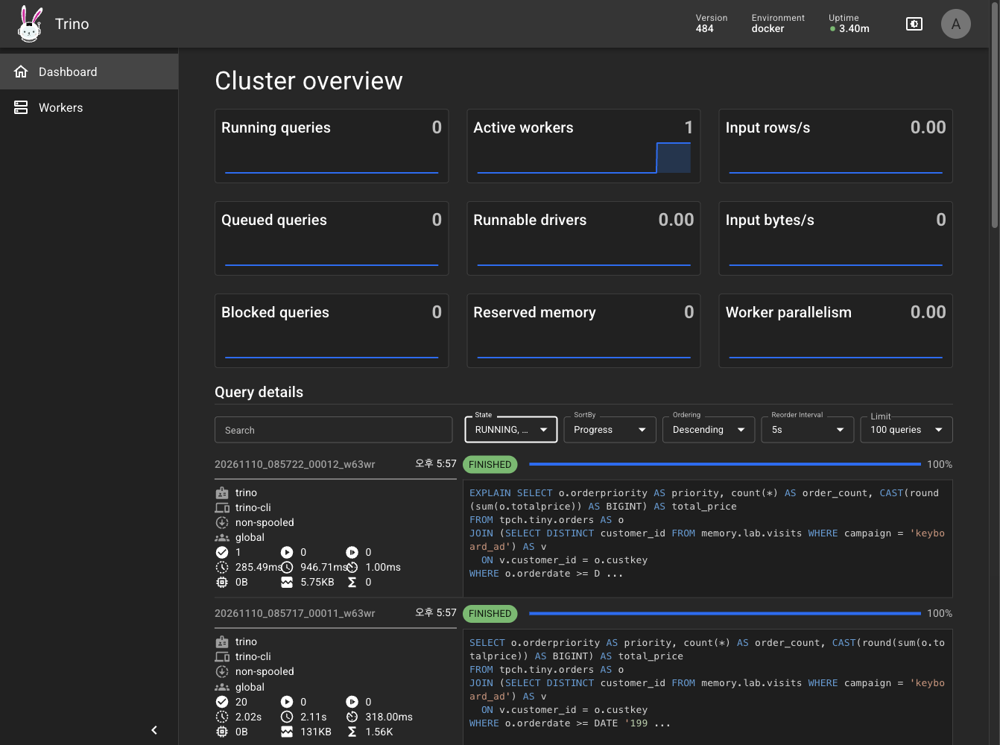

위쪽에는 `Version 484`, `Environment docker`, `Active workers 1`이 보인다. 아래 목록에는 `EXPLAIN` 쿼리와 위의 조인 쿼리가 `FINISHED`로 있고, 쿼리마다 걸린 시간과 처리한 데이터 양이 표시된다.

### 8단계. 정리

```bash
docker rm -f trino
docker rmi trinodb/trino:484
```

첫 줄은 컨테이너를 멈추고 지운다. `memory` 커넥터의 테이블은 컨테이너 메모리에만 있어서 컨테이너를 지우면 함께 사라진다. 둘째 줄은 이미지(약 2.4GB)를 지운다. 같은 이미지로 다시 실습할 계획이면 두 번째 줄은 건너뛴다. `docker rm -f`와 `docker rmi`는 이름을 정확히 적어야 한다. 다른 컨테이너가 같은 이름을 쓰고 있지 않은지 `docker ps -a`로 먼저 본다.

### 로컬 Parquet 파일을 Trino로 읽으려면

실습 1처럼 내 컴퓨터의 Parquet 파일을 Trino로 바로 읽으려면 Hive나 Iceberg 같은 파일 커넥터와 메타스토어 설정이 필요하다. Trino 공식 Hive 커넥터 문서의 예는 `CREATE TABLE ... WITH (format='PARQUET', external_location='s3://...')`처럼 외부 위치를 지정하는 방식이고, 그 문서에서 지원하는 파일시스템은 Azure, GCS, S3, HDFS로 적혀 있다. 필자는 로컬 폴더를 읽는 구성을 찾지 못해서 이 글에서는 하지 않았다. 파일을 바로 읽는 용도라면 영상이 말하듯 DuckDB가 가장 간단하다.

## 나머지 도구의 설치 경로

아래 도구들은 필자가 직접 설치하거나 실행하지 **않았다**. 공식 문서와 저장소의 안내만 확인했다.

**Apache Drill (무료, Apache-2.0).** 공식 Docker 문서의 명령은 다음 형태다. 문서의 원문에는 줄마다 포트 설명 주석이 붙어 있고, 로컬 파일을 읽으려면 `-v`로 폴더를 연결한다고 안내한다.

```bash
docker run -it --name drill -p 8047:8047 -p 31010:31010 apache/drill
```

웹 UI는 8047, JDBC는 31010이고, 셸 종료는 `!quit`이다. JSON 조회는 번들 샘플로 ``SELECT * FROM cp.`employee.json` LIMIT 5;``가 문서에 있다. 알아 둘 점이 있다. 최신 릴리스는 1.22.0(2025-06-28)으로 1년 넘게 새 릴리스가 없고, Docker 페이지의 태그 예시는 1.20.0 기준이다. 다운로드 페이지는 1.22.0부터 Java 8 지원이 끝났다고 하는데 다른 사전 조건 페이지는 Java 8을 요구해서 문서끼리 어긋난다. Docker Hub의 `apache/drill` 이미지는 2025년 10월에 마지막으로 갱신됐다.

**Apache Impala (무료, Apache-2.0).** 공식 퀵스타트는 문서 사이트가 아니라 저장소의 `docker/README.md`에 있다. 서비스 컨테이너 4개(메타스토어, statestore, catalog, impalad)에 클라이언트 컨테이너를 따로 하나 더 실행하는 구성이다. impalad 메모리 상한이 4GB로 설정돼 있어서 Docker에 4GB 이상을 줘야 할 것으로 보이지만 공식 최소 요구량은 확인하지 못했다. 저장소를 내려받은 뒤 그 안에서 실행하는 전제이고, README의 명령은 다음과 같다.


```bash
docker network create -d bridge quickstart-network
export QUICKSTART_IP=$(docker network inspect quickstart-network -f '{{(index .IPAM.Config 0).Gateway}}')
export QUICKSTART_LISTEN_ADDR=$QUICKSTART_IP
export IMPALA_QUICKSTART_IMAGE_PREFIX="apache/impala:81d5377c2-"
docker-compose -f docker/quickstart.yml up -d
```


README에 적힌 이미지 접두사(`81d5377c2-`)가 지금도 유효한지는 확인하지 못했다. Apple Silicon에서 되는지도 확인하지 못했다. 맛보기 이상으로 권하지는 않는다. 서버가 4.5.3이라는 점과 별개로 `impala-shell` 태그는 4.6.0이어서 버전 번호가 달라 혼동하기 쉽다.

**PrestoDB (무료, Apache-2.0).** Docker Hub에 `prestodb/presto` 이미지가 있고 2026-11-04에 마지막으로 갱신됐다. 공식 문서 사이트가 접근되지 않아서 실행 명령과 Java 요건은 확인하지 못했다. 영상의 권장대로 새로 구성한다면 Trino를 쓰는 편이 안전하다.

**Dremio (Community Edition, 문서상 Docker).** 공식 문서 메뉴에 "Community Edition on Docker"가 있다. 그 페이지의 명령과 Docker 이미지의 라이선스는 확인하지 못했고, 위에서 말한 대로 저장소와 Docker 이미지가 약 14개월 갱신되지 않았다. 이 구성으로 시작하려면 그 점을 먼저 감안한다.

## 유료 서비스를 써 보려면

아래는 모두 직접 가입해서 써 보지 않았다. 가격과 체험 조건은 2026-11-10에 공식 페이지에서 확인한 내용이다.

| 서비스 | 무료로 시작하는 길 | 과금 단위 | 같은 일을 하는 무료 대안과 차이 |
|---|---|---|---|
| Snowflake | 셀프 가입 30일 체험. 유효한 이메일만 필요하고 결제 정보는 불필요 | 소비 기반(크레딧). 단가는 확인 못함 | DuckDB(로컬)나 Trino. 컬럼형 분석 SQL이라는 점은 같다. 여러 사용자가 쓰는 관리형 웨어하우스, 컴퓨트와 스토리지 분리는 없다 |
| Starburst Galaxy | 영구 Free 티어(클러스터 3개까지), 30일 체험에 컴퓨트 $500 | 크레딧. Pro $0.50부터, Enterprise $0.75부터 | Trino 오픈소스. Starburst는 Trino 기반 상용판이고 관리형 서비스와 지원이 상용에 있다 |
| MotherDuck | Lite 플랜 $0(내부 사용자 3명, 10GB, 월 10시간 컴퓨트). 카드 불필요 | Business 월 $250에 사용량. 저장 GB당 월 $0.04 | DuckDB 로컬. 같은 엔진이고 로컬은 완전 무료. 클라우드 저장과 공유, 다중 사용자는 MotherDuck에만 있다 |
| Databricks | Free Edition. 비상업적 용도로만 사용 가능 | DBU 종량제. 단가는 확인 못함 | DuckDB, Trino, Apache Spark. Free Edition은 서버리스 전용이고 쿼터를 넘기면 그날 컴퓨트가 중단된다 |
| Dremio Cloud | 30일 체험이 있다고 조사됐으나 금액과 조건은 확인 못함 | DCU 단위 종량제로 조사됐으나 단가는 확인 못함 | Trino나 DuckDB로 레이크 파일 조회는 가능하다. Reflections 같은 가속 기능은 없다 |

- **Starburst Galaxy 가입 경로.** Starburst 가격 페이지의 `Start Free`로 시작한다. 체험이 끝나면 Free 티어로 전환된다고 안내한다.
- **Snowflake 가입 경로.** Snowflake 문서의 체험 계정 안내(셀프 서비스 폼)로 가입하고, 가입할 때 클라우드와 리전, 에디션을 고른다. 선택 가능한 리전 목록은 확인하지 못했다. 에디션 선택이 무료 사용량을 소진하는 속도에 영향을 준다고 문서에 적혀 있다.
- **위의 "무료 대안" 열은 같은 일을 할 수 있는 도구를 적은 것이다.** 동시 사용자, 권한 관리, 가용성 같은 운영 기능까지 대체한다는 뜻은 아니다.

## 어떤 도구를 고를까

영상의 기준에 이번 실습에서 확인한 것을 더하면 이렇게 정리된다.

| 상황 | 고를 것 | 이유 |
|---|---|---|
| 받은 Parquet나 CSV를 노트북에서 한 번 분석한다 | DuckDB | 설치가 `pip install` 한 줄이다. 파이썬 안에서 바로 돌고, 실행 계획에서 필요한 열과 조건만 읽는 것이 확인된다 |
| 레이크와 다른 DB를 한 SQL로 함께 조회한다 | Trino | 커넥터로 저장소를 연결한다. 실행 계획이 저장소마다 읽기를 나눈 것을 보여 준다 |
| 회사가 이미 Hadoop과 Hive를 쓴다 | Impala를 검토 | 영상이 말하는 대화형 SQL용 엔진이다. 설치는 무겁다 |
| JSON을 테이블 정의 없이 바로 조회한다 | Drill 또는 DuckDB | Drill은 영상이 말하는 장점이 있지만 릴리스가 오래됐다. DuckDB도 JSON 파일을 바로 읽는다고 공식 문서에 적혀 있다 |
| 같은 분석을 여럿이 반복하고 대시보드가 필요하다 | Dremio를 검토 | 뷰와 Reflections가 강점이다. 오픈소스판이 오래 갱신되지 않은 점은 확인이 필요하다 |
| 이미 Snowflake 같은 웨어하우스가 있다 | 같은 Iceberg 테이블을 Trino와 Snowflake에서 읽기 | 영상의 마지막 그림이다. 데이터 사본을 도구마다 옮기는 부담이 준다 |

새로 시작한다면 영상도 이 글도 같은 순서를 권한다. 먼저 DuckDB로 내 파일을 분석해 보고, 여러 저장소를 연결해야 하는 순간이 오면 Trino를 설치한다.

## 이 글에서 확인한 것과 확인하지 못한 것

| 구분 | 내용 |
|---|---|
| 직접 실행해 확인 | DuckDB 2.0.0 설치와 실습 1의 모든 명령, Trino 484 컨테이너 기동과 실습 2의 모든 SQL, 실행 계획, 웹 UI, 정리 명령. 환경은 macOS(Apple Silicon)에 한정 |
| 공식 문서와 대조해 확인 | Trino 컨테이너 실행과 첫 쿼리 명령, DuckDB 설치 명령, Drill Docker 명령, Impala 퀵스타트 명령, 각 저장소의 라이선스, Docker Hub 이미지의 마지막 갱신일, Starburst·MotherDuck·Snowflake·Databricks의 공개 조건 |
| 확인하지 못함 | Windows와 Linux에서의 동작, DuckDB CLI 설치 스크립트 실행, Drill·Impala·PrestoDB·Dremio의 실제 설치, Dremio와 Snowflake·Databricks의 가격 숫자, 유료 서비스에 실제 가입했을 때의 절차, Docker 최소 메모리 |
| 영상의 주장이고 따로 검증하지 않음 | 쿼리 엔진별 성능 비교, Presto와 Trino가 갈라진 경위의 세부, Dremio Reflections의 실제 가속 효과 |

글을 따라 하다가 막히면 위의 "함정" 두 곳(DuckDB의 `UBIGINT`, TPC-H의 `custkey % 3`)부터 확인하면 된다.

## 참고

- 영상: [긱뉴스 채널, 2026-11-05](https://www.youtube.com/watch?v=6z7kymKqhAo)
- Trino 컨테이너 설치: [trino.io 공식 문서](https://trino.io/docs/current/installation/containers.html)
- DuckDB 설치: [duckdb.org 공식 문서](https://duckdb.org/docs/2.0/installation.html)
- Apache Drill Docker: [drill.apache.org 공식 문서](https://drill.apache.org/docs/running-drill-on-docker/)
- Apache Impala 퀵스타트: [apache/impala 저장소의 docker/README.md](https://github.com/apache/impala/blob/master/docker/README.md)
- 가격 페이지: [Starburst](https://www.starburst.io/pricing/), [MotherDuck](https://motherduck.com/product/pricing/), [Snowflake 체험 계정 문서](https://docs.snowflake.com/en/user-guide/admin-trial-account), [Databricks Free Edition 제한 사항](https://docs.databricks.com/aws/en/getting-started/free-edition-limitations)
