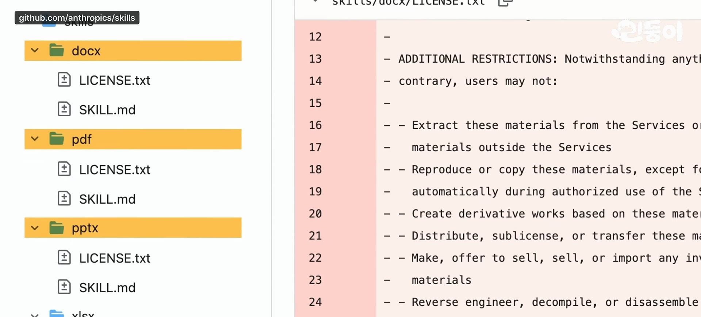
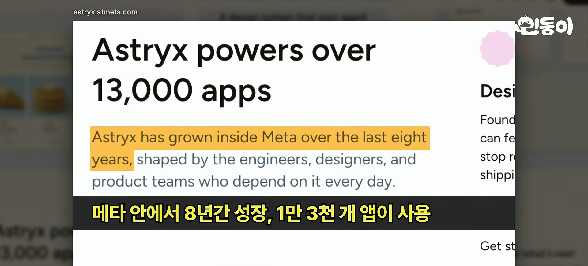
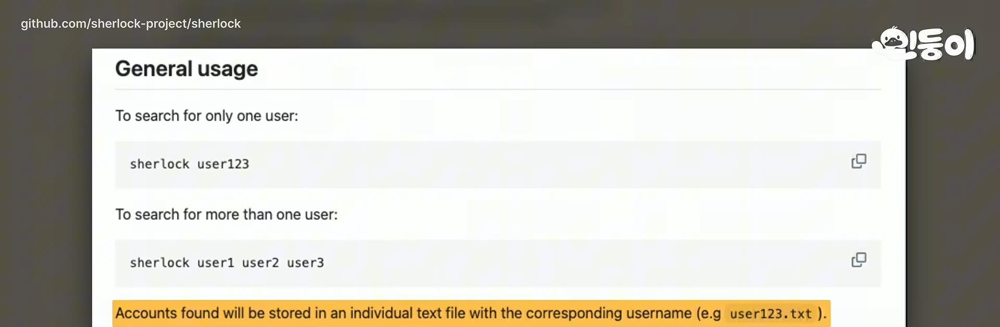
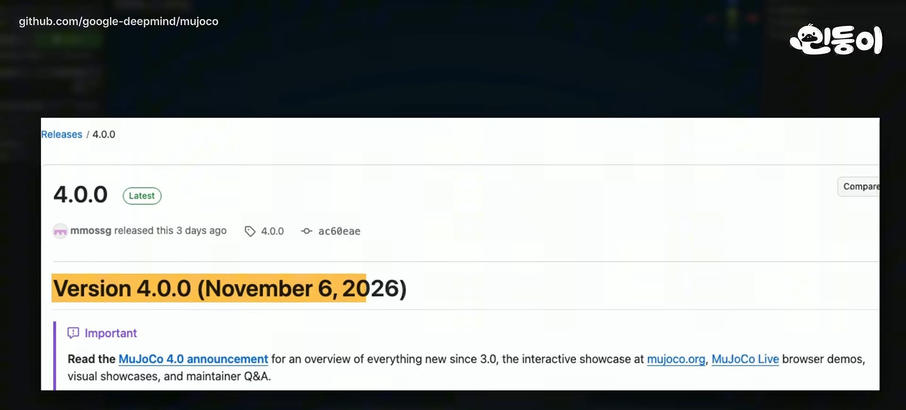
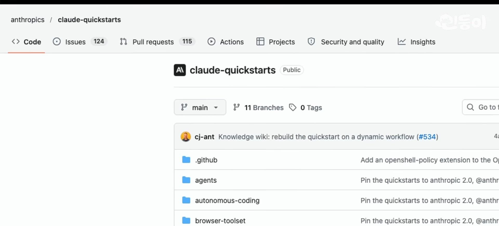
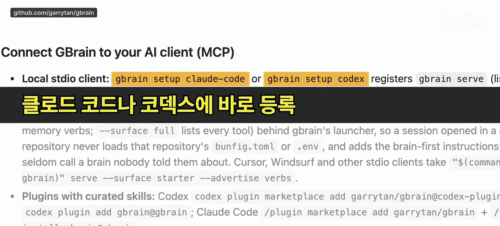
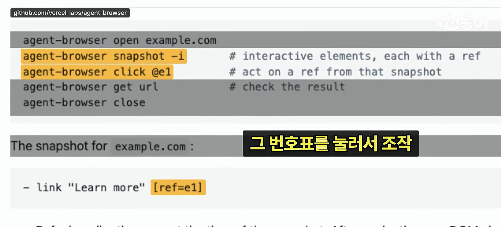
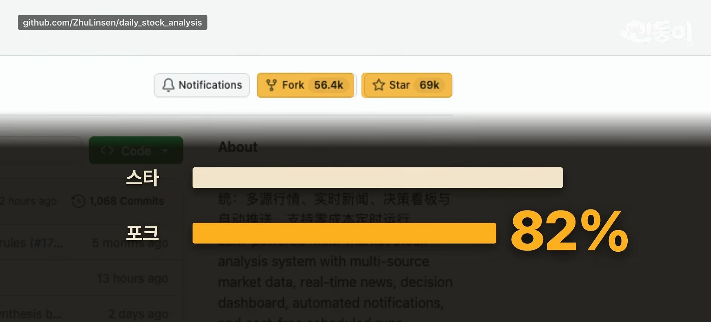
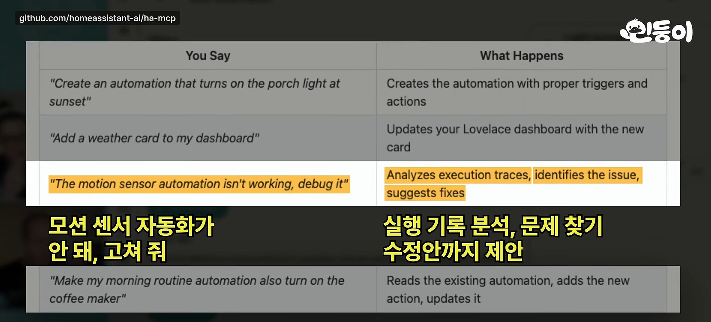
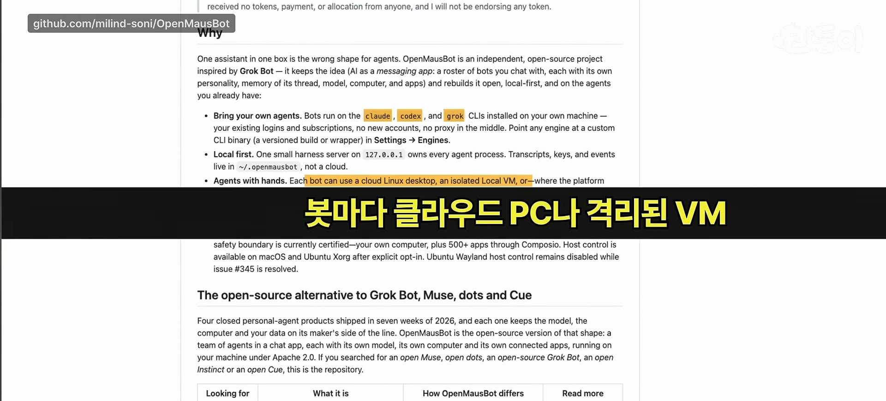

민둥이 \| 쉽게 배우는 AI 채널이 11월 10일에 올린 6분 15초짜리 영상이다. 제목은 "앤트로픽·메타·YC 대표가 전부 풀었다..오늘 깃허브에 풀어 버린 오픈소스 TOP 11 (11.10 트렌딩)"이다. 그날 깃허브 트렌딩에서 11개를 1위부터 한 개씩 짚는다.



영상은 저장소마다 한 문단씩 설명하고 별 수, 라이선스, 최근 변경을 말한다. 이 글은 영상을 따라가되, 말한 내용 중 저장소에서 확인할 수 있는 것은 11월 11일에 GitHub에서 직접 조회해 맞춰 봤다. 확인한 것과 영상의 말일 뿐인 것은 항목마다 구분해서 적었다.

## 한눈에 보기

영상의 별 수는 11월 10일 기준이고 아래 조회값은 11월 11일이다. 하루 사이에도 숫자가 움직이므로 정확한 일치를 기대할 수 없다. 영상 자막은 자동 생성이라 일부 숫자와 이름이 틀리게 적혀 있어서, 화면에 같이 보이거나 서로 맞아떨어지는 숫자만 옮겼다.

| 순위 | 저장소 | 영상이 말한 별 | 11월 11일 조회 | 라이선스(조회) |
|---|---|---|---|---|
| 1 | anthropics/skills | 약 19만 | 192,681 | 폴더별로 다름(아래 참고) |
| 2 | meta/astryx | 약 19,000 | 23,793 | MIT |
| 3 | sherlock-project/sherlock | 10만 6천여 | 109,530 | MIT |
| 4 | google-deepmind/mujoco | 1만 6천여 | 17,520 | Apache-2.0 |
| 5 | anthropics/claude-quickstarts | 약 19,800 | 20,659 | MIT |
| 6 | garrytan/gbrain | 약 32,000 | 32,589 | MIT |
| 7 | vercel-labs/agent-browser | 자막이 깨져 읽을 수 없음 | 49,482 | Apache-2.0 |
| 8 | ruvnet/RuView | 10만 3천 | 103,964 | MIT |
| 9 | ZhuLinsen/daily_stock_analysis | 별 약 6만 8천(포크 56,000이 82%라는 말에서 계산) | 69,658 | MIT |
| 10 | homeassistant-ai/ha-mcp | 약 5,700 | 6,868 | MIT |
| 11 | milind-soni/OpenMausBot | 말하지 않음 | 20,899 | Apache-2.0 |

## 1위. anthropics/skills

영상은 이 저장소를 "앤트로픽이 직접 만든 AI 업무 매뉴얼 모음"으로 소개한다. PDF나 엑셀 작업을 할 때 클로드가 필요한 매뉴얼을 찾아 쓰는 방식이다. 핵심은 11월 6일에 워드, PDF, 파워포인트, 엑셀 스킬 네 개가 Apache 2.0으로 공개됐다는 것이다. 이전에는 수정과 재배포에 제한이 있었다.

- **확인함.** 이 저장소에서 `skills/docx/LICENSE.txt`를 열어 보면 첫머리가 Apache License Version 2.0이다. `pdf`, `pptx`, `xlsx` 폴더에도 각각 `LICENSE.txt`가 있다(이 셋은 파일이 있다는 것만 보고 내용은 읽지 않았다). 11월 6일자 커밋 제목이 "Move Office skills to the Apache 2.0 license (#2146)"다. 영상 화면에 나온 변경 내역에서 "ADDITIONAL RESTRICTIONS" 조항이 지워지는 것도 이 커밋과 맞아 보인다.
- **주의.** GitHub가 이 저장소 전체에 붙여 주는 라이선스는 없음으로 나온다. 폴더마다 라이선스가 다르다는 뜻이므로, 가져다 쓰기 전에 쓰려는 스킬 폴더의 `LICENSE.txt`를 직접 봐야 한다.
- **영상의 말이고 확인하지 못함.** 스킬 표준을 10월에 리눅스 재단 산하로 기증했다는 것, 70개 넘는 AI 플랫폼이 도입했다는 것, 설치 건수가 약 2억 8천만 건이라는 것은 영상이 앤트로픽의 발표라고 소개한 내용이다. 이 글에서는 원문을 찾아 대조하지 않았다.

## 2위. meta/astryx

메타가 내놓은 무료 디자인 시스템이다. 버튼, 메뉴, 입력창 같은 웹 부품을 모은 것인데, 영상은 AI가 쓰기 쉽게 설계됐다는 점을 강조한다. 클로드 코드에 관리자 페이지를 만들어 달라고 하면 AI가 이 부품과 사용법을 참고해 일관된 화면을 만든다는 것이다.

- **확인함.** README 첫머리에 "grew inside Meta over the last eight years", "powering 13,000+ apps"가 있어서 영상의 "8년, 1만 3천 개 앱"과 같다. 저장소 설명도 "fully customizable and agent ready"다. 같은 README에 React 19 이상과 StyleX 기반이고 **현재 베타**라고 적혀 있다. 영상에는 베타라는 말이 없었다.
- **차이.** 영상의 별 수 약 19,000에 비해 조회값은 23,793이다. 하루 사이의 차이로 보기엔 큰 편인데 원인은 확인하지 못했다.

## 3위. sherlock-project/sherlock

아이디 하나로 400개 넘는 SNS와 웹사이트에서 같은 이름이 쓰이는지 찾는 OSINT(공개된 정보를 모아 분석하는 방법) 도구다. 영상은 내 아이디를 넣어 예전에 가입하고 잊은 곳을 훑어 보는 쓰임을 든다.

- **확인함.** README가 "400+ social networks"라고 적고, 사용법 화면에 "Accounts found will be stored in an individual text file with the corresponding username"이 있어서 결과가 파일로 저장된다는 영상의 말과 맞다.
- **영상의 말이고 확인하지 못함.** 하루에만 별 4,294개가 붙었다는 숫자는 영상 화면의 그래픽이다. 깃허브 트렌딩 화면은 그날이 지나면 다시 볼 수 없어서 대조하지 못했다.
- **쓸 때의 주의.** 남의 아이디를 넣는 용도로도 쓸 수 있는 도구다. 이 글은 내 아이디를 점검하는 용도로만 소개한다.

## 4위. google-deepmind/mujoco

구글 딥마인드의 로봇 물리 시뮬레이션 환경이다. 로봇이 실제로 걷기 전에 컴퓨터 안에서 수없이 넘어지며 연습하는 곳이라고 영상은 설명한다. 11월 6일에 4.0이 나와서 브라우저에서 바로 보는 뷰어가 생겼고 말랑한 물체도 다룰 수 있게 됐다고 한다.

- **확인함.** 릴리스 목록에 4.0.0이 2026-11-06에 올라 있다(직전은 3.17.0, 10월 22일). 영상 화면의 릴리스 페이지도 같은 날짜를 보여 준다. 라이선스는 Apache-2.0이다.
- **다르게 나온 것.** 영상은 지난 한 달 파이썬 패키지 저장소(PyPI) 내려받기가 약 360만 번이라고 했다. 11월 11일에 pypistats가 돌려준 최근 한 달 값은 4,023,561이다. 집계 기간이 하루 이틀 다르고 기준 시각도 달라서 어느 한쪽이 틀렸다고 볼 수는 없다.
- **영상의 말이고 확인하지 못함.** 말랑한 물체 지원과 얇은 물체가 뚫고 지나가는 문제를 막았다는 세부 내용은 릴리스 노트를 끝까지 읽어 대조하지 않았다.

## 5위. anthropics/claude-quickstarts

클로드로 앱이나 에이전트를 만들 때 복사해서 시작하는 예제 프로젝트 모음이다. 영상은 10월 29일에 들어온 센트리 오토픽스를 따로 짚는다. 에러 모음 도구 센트리에 에러가 뜨면 에이전트가 기록을 읽고 코드를 고쳐 수정 요청까지 올린다. 사람은 검토하고 병합만 하면 된다. 직접 돌려 보려면 클로드 API 키가 필요하다.

- **확인함.** 저장소에 `managed-agents/sentry-autofix/` 코드가 있고 README에 "Managed Agents: Sentry"가 있다. 같은 폴더 아래 `sentry/agents/sentry-triage.md`도 있다.
- **영상의 말이고 확인하지 못함.** 10월 29일에 추가됐다는 날짜는 커밋 이력을 찾아 대조하지 않았다.

## 6위. garrytan/gbrain

와이 콤비네이터 대표 게리 탄이 만든 AI 에이전트용 장기 기억 저장소다. 미팅, 이메일, 음성 통화, 아이디어까지 쌓아 두고, 미팅 전에 그 사람에 대해 물으면 역할과 지난 대화, 남은 약속을 출처와 함께 정리해 준다. 클로드 코드나 코덱스에 연결해 같은 기억을 쓰게 할 수 있다.

- **확인함.** README에 `gbrain setup claude-code`, `gbrain setup codex`로 등록한다는 설명이 있고 영상 화면과 같다. 영상이 같은 사람이 만든 클로드 코드 설정 모음 gstack이 별 14만 개를 넘는다고 한 것도 맞다(조회값 141,145).
- **영상의 말이고 확인하지 못함.** 해커 뉴스에서 "에이전트의 가장 설득력 있는 쓰임새"라는 평가와 함께 만든 사람이 "AI 정신병"을 앓고 있다는 말이 나왔다는 소개는 해당 토론을 찾아 읽지 않았다. 반응이 갈린다는 정도로만 옮긴다.

## 7위. vercel-labs/agent-browser

버셀 랩스가 만든, AI가 사람처럼 브라우저를 열고 클릭하고 입력하게 해 주는 무료 명령어 도구다. 클로드 코드가 방금 만든 앱을 직접 열어 버튼을 눌러 보고 깨진 곳을 찾아 고치는 식으로 쓴다. 스냅샷을 찍으면 페이지가 `@e1` 같은 번호표로 정리되고, AI는 그 번호표를 눌러 조작한다.

- **확인함.** README가 "native Rust CLI"라고 하고, `snapshot -i`로 상호작용 요소마다 ref를 받아 `click @e1`처럼 쓰는 예가 있다. 영상 화면과 같다. 라이선스는 Apache-2.0이다.
- **영상의 말이고 확인하지 못함.** 해커 뉴스에서 기존 플레이라이트 MCP보다 빠르다는 반응이었다는 소개는 직접 비교해 보지 않았다.

## 8위. ruvnet/RuView

와이파이 전파가 사람 몸에 부딪혀 달라지는 것을 읽어서 카메라 없이 사람이 있는지, 숨 쉬는지, 움직이는지 알아내겠다는 프로젝트다. 영상에 따르면 호흡과 심박까지 보려면 9달러쯤 하는 ESP32-S3 보드가 따로 필요하고, 일반 노트북으로는 있는지와 움직였는지 정도만 거칠게 잡힌다.

- **확인함.** README가 "Detect people, measure breathing and heart rate, track movement"를 내세우고 "through walls, in the dark, with no cameras"라고 적는다. 영상이 소개한 기능과 같다. 별 수 10만 3천도 맞다(103,964).
- **영상이 따로 전한 회의론.** 해커 뉴스에 "만든 사람 말고는 아무도 작동을 확인하지 않았다"는 댓글이 달렸고, 11월 3일의 독립 리뷰에서는 자세 정확도가 같은 기기 안에서는 약 3%, 방을 바꾸면 약 10%로 나왔다고 한다. 이 두 가지는 영상의 소개일 뿐 원문을 찾아 읽지 않았다.
- **글쓴이의 정리.** README의 주장과 영상이 전한 독립 검증이 엇갈린다. 어느 쪽도 이 글에서 직접 시험하지 않았으므로, 별 수가 많다는 사실이 작동한다는 증거는 아니라는 점만 분명히 해 둔다. 9달러라는 가격도 README에서 찾지 못했다.

## 9위. ZhuLinsen/daily_stock_analysis

관심 종목을 AI가 매일 자동으로 훑어보고 시세와 뉴스를 모아 분석 보고서를 메신저로 보내 주는 무료 도구다. 영상은 포크가 56,000개로 별 수의 82%에 달한다는 점을 특이하게 본다. 이유가 있는데, 이 프로젝트는 설치할 때부터 저장소를 포크하라고 안내하고, 복사한 저장소에서 깃허브 액션을 설정하면 서버를 따로 운영하지 않아도 평일 정해진 시간에 자동으로 실행되기 때문이다.

- **확인함.** 조회값으로 포크 56,722, 별 69,658이라서 비율이 약 81.4%다. 영상의 56,000과 82%에 가깝다. README 설치 1단계가 "Fork 本仓库(이 저장소를 포크)"이고, 맨 아래에 "仅供学习和研究使用，不构成任何投资建议(학습과 연구용이며 투자 조언이 아니다)"가 있어서 영상이 짚은 면책 문구와 같다. 이 README는 중국어가 기본이다.
- **영상의 말이고 확인하지 못함.** 자동 실행 구조가 위에서 말한 대로 동작하는지는 설치해 보지 않았다.
- **쓸 때의 주의.** 보고서는 AI가 만든 참고 자료이고 투자 판단의 근거가 아니다. README도 같은 말을 한다.

## 10위. homeassistant-ai/ha-mcp

스마트홈 앱 홈 어시스턴트를 클로드나 챗GPT에 연결해 말로 조작하고, 자동화와 대시보드까지 만들게 해 주는 연결 부품(MCP 서버)이다. 고장 난 자동화는 실행 기록을 뒤져 원인과 수정안까지 내놓는다. 영상은 11월 4일에 나온 홈 어시스턴트 2026.11의 내장 마켓플레이스 기본 목록에 올랐다는 점도 짚는다.

- **확인함.** README가 "on Home Assistant 2026.11+, the Marketplace (the preferred install)"라고 적고, HACS로도 설치할 수 있다고 한다. 영상이 말한 내장 마켓플레이스와 맞는다. 요구 버전은 홈 어시스턴트 2026.8.0 이상이다. 영상 화면의 "내가 말하는 것 / 일어나는 일" 표도 이 저장소 설명이다.
- **영상의 말이고 확인하지 못함.** 11월 4일이라는 출시일과 포럼의 버그 제보글에서 한 사용자가 이 통합을 극찬했다는 소개는 원문을 찾지 않았다.

## 11위. milind-soni/OpenMausBot

그록 봇을 대체하겠다고 나온 무료 오픈소스 프로젝트다. 채팅 앱에서 AI 직원 여러 명에게 일을 맡긴다. 기존에 쓰던 클로드, 코덱스, 그록 CLI를 연결하면 각 AI가 독립된 컴퓨터 환경에서 작업한다. 작업하는 화면을 실시간으로 볼 수 있고, 위험한 명령을 실행하려 하면 승인 여부를 먼저 묻는다.

- **확인함.** README가 "The open-source alternative to Grok Bot"이라고 하고, "Bring your own agents"에 claude, codex, grok CLI를 나열한다. "봇마다 클라우드나 PC의 격리된 VM"이라는 영상 화면과 같은 문서다. 라이선스는 Apache-2.0이다.
- **영상의 말이고 확인하지 못함.** 위험한 명령 앞에서 승인을 묻는 동작은 실행해 보지 않았다.

## 이 글에서 확인한 것과 확인하지 못한 것

| 구분 | 내용 |
|---|---|
| 확인함 | 11개 저장소가 모두 존재하고 별 수와 라이선스를 11월 11일에 조회했다. 1위 스킬 라이선스 변경 커밋(11월 6일), 2위 README의 8년과 13,000개 앱, 3위 400개 이상, 4위 4.0.0 릴리스 날짜, 5위 sentry-autofix 폴더, 6위 gstack 별 수 14만 이상, 7위 snapshot과 ref 방식, 9위 포크 비율과 면책 문구, 10위 마켓플레이스 설치 안내 |
| 영상의 말이고 따로 대조하지 않음 | 리눅스 재단 기증과 설치 건수(1위), 해커 뉴스 반응 전반, 독립 리뷰의 정확도 수치(8위), 각 기능의 세부 동작 |
| 직접 실행하지 않음 | 11개 중 어느 것도 설치하거나 돌려 보지 않았다. 동작에 대한 말은 README와 영상의 설명이다 |
| 확인하지 못함 | 4위 PyPI 내려받기 360만 번(조회값은 약 402만 번, 집계 기간이 다름), 7위의 영상 속 별 수(자막 깨짐), 11위의 영상 속 별 수(언급 없음), 5위와 10위의 출시 날짜 |

## 참고

- 영상: [민둥이 \| 쉽게 배우는 AI 채널, 2026-11-10](https://www.youtube.com/watch?v=QMDi_8YV_Hs)
- 저장소: [anthropics/skills](https://github.com/anthropics/skills), [meta/astryx](https://github.com/meta/astryx), [sherlock-project/sherlock](https://github.com/sherlock-project/sherlock), [google-deepmind/mujoco](https://github.com/google-deepmind/mujoco), [anthropics/claude-quickstarts](https://github.com/anthropics/claude-quickstarts), [garrytan/gbrain](https://github.com/garrytan/gbrain), [vercel-labs/agent-browser](https://github.com/vercel-labs/agent-browser), [ruvnet/RuView](https://github.com/ruvnet/RuView), [ZhuLinsen/daily_stock_analysis](https://github.com/ZhuLinsen/daily_stock_analysis), [homeassistant-ai/ha-mcp](https://github.com/homeassistant-ai/ha-mcp), [milind-soni/OpenMausBot](https://github.com/milind-soni/OpenMausBot)
