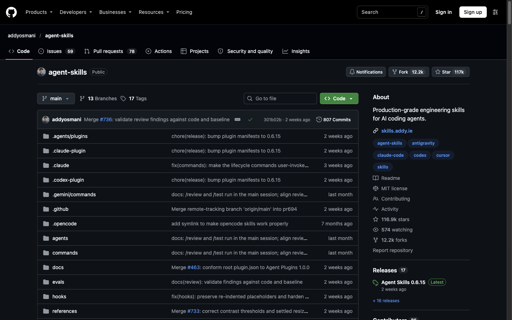
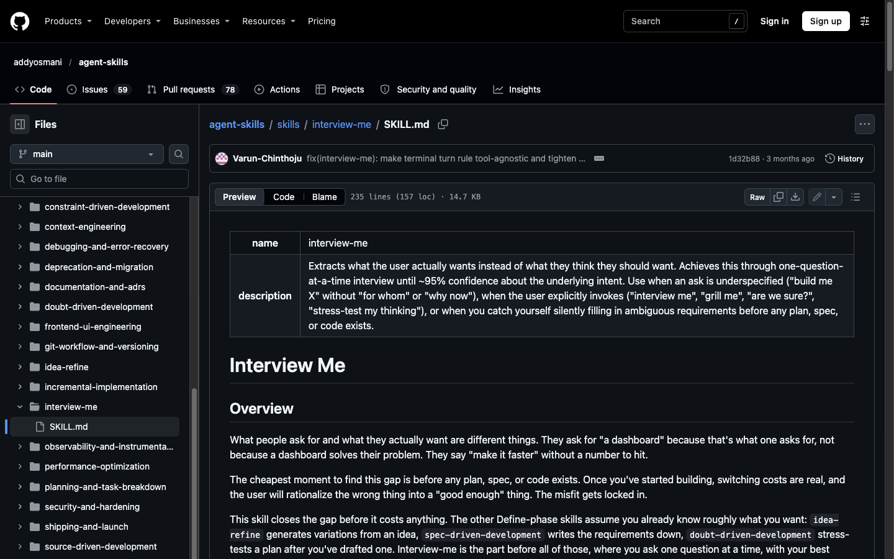
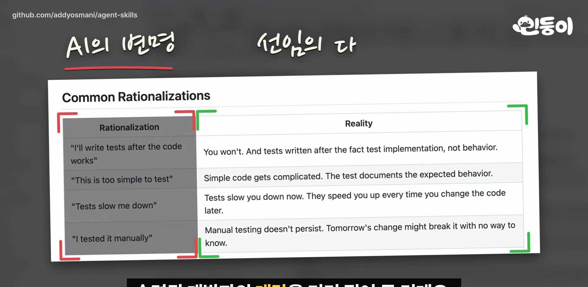
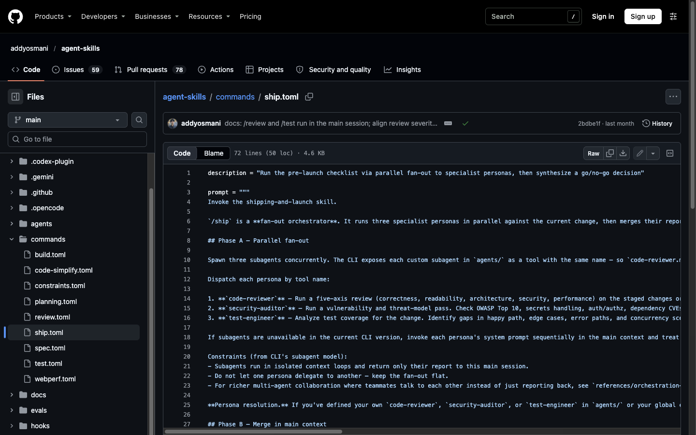
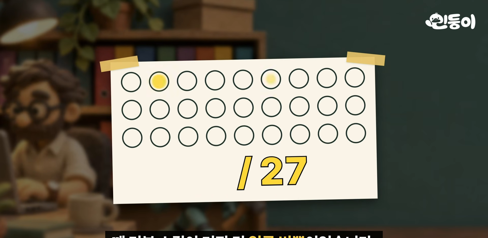

MINDUNG 채널이 11월 12일에 올린 5분 58초짜리 영상이다. 제목은 "매주 깃허브 트렌딩에 올라오는 이유: 클로드 코드 개발자의 AI 노하우 25개"다. 소개하는 저장소는 [addyosmani/agent-skills](https://github.com/addyosmani/agent-skills)다. 영상은 별이 11만 5천 개를 넘었다고 하고, 오늘 확인한 값은 116,899개다(포크 12.2k, MIT 라이선스). 영상은 이 스킬 모음을 "AI를 신입으로 받는 방법"으로 풀어 설명한다.

이 글은 영상을 요약하는 데서 끝내지 않고, 영상이 한 말을 **레포 원문과 하나씩 대조**했다. 대조 기준은 2026-11-01 병합 커밋 `301b02b`다. 대부분 맞았고, 틀리거나 과장된 곳이 몇 군데 있어서 맨 아래에 따로 모았다.





## 한 줄 요약

신입 AI는 시키지 않으면 건너뛰거나 제멋대로 한다. 그래서 숙련된 개발자가 옆에서 시킬 일을 **스킬 25개**로 적어 두고, 메타 스킬을 뺀 24개 스킬에 "AI가 댈 변명"과 "끝났다는 증거"까지 미리 써 둔 저장소다. 영상의 결론은 "AI의 말을 그대로 믿지 않는 것"이다.

## 구조: 6단계, 25개 스킬, 명령 9개, 에이전트 4개

영상은 "스킬은 모두 25개고, 일하는 순서에 따라 여섯 단계로 나뉜다"고 말한다. 레포 `README.md`와 거의 일치한다. 25개는 6단계로 나뉜 라이프사이클 스킬 24개와, 어떤 스킬을 쓸지 안내하는 메타 스킬(`using-agent-skills`) 1개이고, README에서는 메타 스킬이 별도 절(`Meta`)로 분리돼 있다.

```
DEFINE → PLAN → BUILD → VERIFY → REVIEW → SHIP
/spec    /plan   /build   /test    /review  /ship
```

- 위 그림의 명령 6개는 대표 명령이고, 슬래시 명령은 모두 9개다: `/spec`, `/plan`, `/build`, `/test`, `/constraints`, `/review`, `/webperf`, `/code-simplify`, `/ship`.
- `agents/` 폴더에는 서브에이전트 4개가 있다: `code-reviewer`, `security-auditor`, `test-engineer`, `web-performance-auditor`. 영상이 말하는 "검토자 셋"은 이 중 앞의 세 개다.
- Claude Code 설치는 `/plugin marketplace add addyosmani/agent-skills`, `/plugin install agent-skills@addy-agent-skills`다. 다른 에이전트에는 `npx skills add addyosmani/agent-skills`로 25개를 한꺼번에 깔 수 있다.

## 1단계 — 뭘 만들지 캐묻기: interview-me

영상은 "대시보드 만들어 줘"라고 하면 AI가 먼저 짐작을 내놓고(확신 30%), 한 번에 하나씩 묻다가 확신이 95%쯤 되면 질문을 끝낸다고 설명한다. `skills/interview-me/SKILL.md`에 그대로 있다.

> `HYPOTHESIS: You want a way to answer "how are we doing?" in standup, and "dashboard" was the convention that came to mind.`
> `CONFIDENCE: ~30% — missing: who it's for, what "metrics" means in context, and what success looks like`

묻는 방식이 이 스킬의 특징이다. 질문마다 `GUESS:`로 자기 짐작과 그 이유를 붙인다. 95%는 측정값이 아니라 기준 질문으로 판정한다.

> `Can I predict the user's reaction to the next three questions I would ask?`

"다음 질문 세 개에 대한 사용자 반응을 맞힐 수 있으면 멈춘다"는 뜻이다. 영상은 "95%쯤"이라고만 했는데, 원문에서는 숫자보다 이 질문이 실제 종료 조건이다.



영상은 이 질문이 끝나면 "알아낸 걸 스펙으로 정리한다"고 이어서 말하는데, 원문에서는 이 둘이 서로 다른 스킬이다. `interview-me`는 사용자가 확인한 의도 정리(`confirmed statement of intent`)에서 끝나고, 스펙을 쓰는 일은 다음 스킬 `spec-driven-development`가 맡는다. 이 스펙 스킬은 6대 핵심 항목의 마지막(`Boundaries`)에서 세 가지 경계를 적는다. 영상 설명과 같다(스펙 템플릿에서는 이 뒤에 `Success Criteria`와 `Open Questions`가 이어진다).

- **Always do**: 커밋 전에 테스트 실행, 이름 규칙 준수, 입력 검증
- **Ask first**: DB 스키마 변경, 의존성 추가, CI 설정 변경
- **Never do**: 시크릿 커밋, vendor 폴더 수정, 승인 없이 실패 테스트 삭제

스펙을 다 쓰면 AI가 바로 만들기 시작하지 않고 멈춘다는 말도 맞다. `spec-driven-development`에 `Stop after writing the spec (CRITICAL)` 항목이 있고, `STOP YOUR TURN IMMEDIATELY`, `Planning starts only after the human approves the spec in a later turn`이라고 적혀 있다.

## 2단계 — 계획: 층별이 아니라 수직 슬라이스

영상: "로그아웃 같은 기능 하나에도 DB, 서버, 화면이 걸려 있는데, 층별로 따로 만들지 않고 기능 하나를 바닥부터 화면까지 먼저 끝내게 한다." `planning-and-task-breakdown`의 "Slice Vertically" 절이 그 내용이다.

- 나쁜 예(수평): 전체 DB 스키마 → 전체 API → 전체 UI → 연결
- 좋은 예(수직): "사용자가 계정을 만든다(스키마 + API + UI)" → "로그인한다" → "할 일을 만든다" ...

`incremental-implementation`도 같은 원칙이다. 각 슬라이스가 끝나면 테스트를 통과하고, 그 슬라이스를 따로 커밋한다.

## 3단계 — 변명 표: 가장 가져갈 만한 부분

영상이 가장 힘주어 설명하는 부분이다. 메타 스킬을 뺀 24개 스킬에 **Common Rationalizations** 표가 있다. 왼쪽 칸에는 AI가 댈 법한 변명, 오른쪽 칸에는 숙련된 개발자의 반박이 들어 있다. 영상 화면이 `test-driven-development`의 표다.



원문의 해당 행은 이렇다.

| 변명 | 반박 |
|---|---|
| "I'll write tests after the code works" | You won't. And tests written after the fact test implementation, not behavior. |
| "I tested it manually" | Manual testing doesn't persist. Tomorrow's change might break it with no way to know. |

영상은 에디가 이 표를 "AI가 아직 하지도 않은 거짓말에 미리 써 둔 반박"이라고 소개했다고 전한다(이 문구는 레포 원문에서 찾지 못했다. 레포는 `Excuses + rebuttals`라고만 쓴다). 대부분의 스킬에는 표 뒤에 의심해야 할 신호 목록(Red Flags)이, 그 뒤에 증거 목록(`## Verification`)이 이어진다. "테스트가 통과한 결과, 프로그램이 실제로 돌아간 기록 같은 걸 내놓아야 다 했다가 통한다"는 설명도 `README.md`의 `Every skill ends with evidence requirements`와 같다.

### 기준을 슬쩍 낮추는 꼼수 막기

검사를 통과하기 어려우면 검사 기준을 낮추는 꼼수를 `constraint-driven-development`가 막는다. 영상이 든 예(실패하는 테스트를 건너뛰기 표시, 통과 기준 숫자 내리기)가 원문 목록에 있다. 리뷰할 때 diff에서 찾는 다섯 가지는 이렇다.

1. 기준값이 내려갔다.
2. 테스트가 쉬워졌다(`.skip`, 테스트 삭제, assertion 제거).
3. 검사기를 껐다(`@ts-ignore`, `eslint-disable`).
4. 일이 덜 끝났다(예외를 던지는 stub, 빈 `catch`).
5. 아무도 논의하지 않은 예외 항목이 생겼다.

원칙은 한 문장이다. 영상이 말한 "올리는 건 그냥, 내릴 때는 알리고"의 원문은 이것이다.

> `Tightening the bar should be silent; loosening it should be loud.`

### 자신 있는 말은 다른 검토자에게: doubt-driven-development

"이 부분은 안전합니다" 같은 자신 있는 말이 나오면 검토자를 따로 붙인다. 영상이 소개한 주문 "틀린 곳을 찾아라, 칭찬하지 마라, 작성자가 자신감이 지나치다고 가정해라"가 `skills/doubt-driven-development/SKILL.md`에 있다. "칭찬하지 마라"는 `Do NOT validate`를 풀어 쓴 말이다.

> `Adversarial review. Find what is wrong with this artifact.`
> `Assume the author is overconfident.`
> `Do NOT validate. Do NOT summarize.`

검토자에게 넘기는 것은 결과물(ARTIFACT)과 계약(CONTRACT)뿐이다. 작성자의 결론(CLAIM)과 사고 과정은 넘기지 않는다. 이유도 원문에 있다. `Handing the reviewer your conclusion biases it toward agreement.` 결론을 같이 주면 맞장구치는 답이 돌아온다는, 영상 설명 그대로다.

## 4단계 — 내보내기: /ship의 병렬 검토자 3명

`/ship`은 스스로를 "fan-out orchestrator"(여러 검토자에게 일을 동시에 나눠 주고 결과를 모으는 실행기)라고 소개한다. Claude Code용 명령 파일은 `.claude/commands/ship.md`이고, 화면의 `commands/ship.toml`은 같은 문구를 쓰는 Antigravity CLI용 어댑터다.



- 세 서브에이전트(`code-reviewer`, `security-auditor`, `test-engineer`)를 **한 번의 턴에 동시에** 호출한다. `sequential calls defeat the purpose of this command`라고 적혀 있다.
- 각 검토자는 서로의 보고를 보지 못하고 자기 보고만 메인 세션에 돌려준다. 검토자끼리 일을 넘기는 것도 금지다(`Do not let one persona delegate to another`).
- 결과는 `## Ship Decision: GO | NO-GO` 한 줄 판정으로 합쳐진다.
- 셋 중 하나라도 Critical을 찾으면 기본 판정은 NO-GO다.
- **롤백 계획은 GO 판정 전에 필수**다(`The rollback plan is mandatory before any GO decision`). 영상이 말한 "문제가 생기면 어떤 순서로 되돌릴지까지 미리 적어 둔다"가 이것이다.

## 스킬이 정말 켜지는지까지 잰다: 27번 중 7번 → 21번

영상은 "코드 검토를 27번 부탁했을 때 리뷰 스킬이 켜진 건 7번뿐이었는데, 스킬 설명에 한 구절을 넣자 21번으로 늘었다. 그래도 해결된 건 아니라고 적어 뒀다"고 말한다. 출처는 `evals/README.md`다.



원문은 이렇다. "review skill이 diff가 인라인으로 붙어 있는 경우에도 적용된다"는 한 구절을 설명에 넣었더니, claude-opus-5-5 모델을 고정한 상태에서 **네 가지 리뷰 요청 문구**가 27번 중 7번 켜지던 것이 27번 중 21번으로 늘었다. 켜지면 안 되는 인접 프롬프트 9개는 두 경우 모두 0 of 27이었다. 원문도 `so it is better, not solved`라고 쓴다.

이 저장소가 스킬마다 시험지(`evals/`)를 같이 두는 이유다. 설치해 두기만 하면 매번 켜지는 게 아니라 AI가 필요하다고 판단해야 켜진다는 점을 저자가 측정으로 확인한 것이다.

## 다른 스킬 모음과 고르는 법

`docs/comparison.md`에 슈퍼파워스(Superpowers), Matt Pocock의 skills와 비교한 문서가 있다. 영상이 정리한 선택 기준은 원문과 같다.

| 상황 | 고를 것 |
|---|---|
| 기능 하나를 스펙부터 보안·성능·출시까지 처음부터 끝까지 챙기고 싶다 | agent-skills |
| 크고 모호한 덩어리를 통째로 맡기고 자리를 비우고 싶다 | Superpowers |
| 매일 하는 작은 작업, 요구사항을 빨리 정리하고 싶다 | Matt Pocock의 skills |

영상은 "설치하지 않아도 된다. 스킬이 전부 글이라서 자주 쓰는 부분만 골라 내 AI의 지침에 옮겨 적어도 된다"고도 말한다. 레포의 `docs/getting-started.md`도 `spec-driven-development`, `test-driven-development`, `code-review-and-quality` 세 스킬을 규칙 파일에 옮겨 적는 최소 구성을 안내한다. 표 한 장만 따로 옮기라는 말은 원문에 없으니, 그렇게 쓰는 것은 필자의 제안이다.

## 영상 주장 검증: 맞은 것과 고칠 것

Claude와 다른 두 에이전트(pi, agy)가 각자 자막과 레포 원문을 대조했고, 초안도 따로 검토했다. 아래는 그 검토에서 나온 교정까지 반영한 결과다.

**원문과 일치한 주장**

- 스킬 25개·6단계, 슬래시 명령 9개
- 확신 30% 짐작 → 한 번에 하나씩 질문 → 95%쯤에서 종료
- Always / Ask first / Never 3단 경계
- 수직 슬라이스 계획
- 변명 표와 Red Flags(메타 스킬을 뺀 24개)
- 기준 낮추기 꼼수 방지, "낮추는 건 알려라"
- 검토자에게 결론을 주지 않고 결과물만 주기
- `/ship` 병렬 검토자 3명, 하나라도 심각하면 NO-GO, 롤백 계획 필수
- 리뷰 스킬 활성화 27번 중 7번 → 21번
- 세 스킬 모음 비교 문서와 선택 기준

**고쳐 읽어야 할 부분**

1. **"클로드 코드를 만든 에디"는 정확하지 않다.** 영상 도입부는 에디 오스마니를 "구글에서 14년을 일하고 엔트로픽에서 클로드 코드를 만든" 사람이라고 소개한다. 구글에서 14년 넘게 일했다는 것과 지금 Anthropic 소속이라는 것은 맞다. GitHub 프로필의 소개가 `Member of Technical Staff, Anthropic`이고, [보도](https://runtimewire.com/article/addy-osmani-joins-anthropic-claude-code-developer-experience)에 따르면 2026년에 Claude Code의 개발자 경험을 개선하러 합류했다. 하지만 Claude Code를 처음 만든 사람은 아니다. 공식 발표문은 찾지 못했고 프로필과 보도에 근거한 내용이다.
2. **변명 표는 "스킬마다"가 아니라 25개 중 24개다.** 메타 스킬 `using-agent-skills`에는 표 대신 `Failure Modes to Avoid` 목록만 있다. 표 헤더도 23개는 `Rationalization | Reality`, `constraint-driven-development`만 `Excuse | Reality`다.
3. **증거 목록(`## Verification`)도 24개다.** 같은 메타 스킬은 `Verify, Don't Assume` 항목만 있다. 또 `constraint-driven-development`, `incremental-implementation`, `planning-and-task-breakdown` 3개는 `Verification` 뒤에 `See Also`가 이어져서 "맨 끝"은 엄밀히는 아니다.
4. **27번은 한 가지 프롬프트가 아니라 네 가지 문구의 합계다.** 모델을 claude-opus-5-5로 고정한 결과이고, 같은 문서에 "CLI가 하루에 모델 기본값을 두 번 바꿨으니 수치를 말할 때 `--model`과 버전을 기록하라"는 주의도 있다. 다른 모델에서 같은 숫자가 나온다는 보장은 없다.
5. **검토자 셋의 역할 분담은 영상보다 겹친다.** 영상은 한 명이 정확성·가독성, 한 명이 보안, 한 명이 테스트를 본다고 하는데, `code-reviewer`는 정확성·가독성·구조·**보안**·성능 다섯 축을 본다. `security-auditor`가 취약점·위협 모델을 따로 깊게 파고, `test-engineer`가 테스트 공백을 찾는 구조다. 그리고 "하나라도 심각하면 안 된다"는 기본값이고, 사용자가 위험을 명시적으로 받아들이면 넘어갈 수 있다.
6. **영상은 두 스킬을 하나처럼 이어 말한다.** 위에 적었듯 "95%가 되면 스펙으로 정리"는 `interview-me`와 `spec-driven-development` 두 스킬의 연결이다. `interview-me`는 스펙이 아니라 의도 확인서에서 끝나고, 그 확인 전에는 스펙 작성이나 후속 작업을 하지 않는다.
7. **"AI가 아직 하지도 않은 거짓말에 미리 써 둔 반박"은 에디의 말로 소개되지만 레포 원문에서 찾지 못했다.** 표의 취지는 레포의 `Excuses + rebuttals` 설명과 같다.

## 가져다 쓸 때의 메모

- 전부 설치하기 부담스러우면 `interview-me`(요구사항 캐묻기), `code-review-and-quality`(다섯 축 리뷰), `test-driven-development` 셋만 `npx skills add addyosmani/agent-skills --skill <이름>`으로 깔 수 있다. 다만 README는 스킬 하나만 설치하면 저장소 최상위 `references/` 체크리스트가 따라오지 않는다고 경고한다(#361).
- 내 `CLAUDE.md`에는 변명 표와 "기준은 올리는 건 자유, 내릴 때는 알린다"를 옮겨 적는 것부터 시작하는 것이 현실적이다.
- 스킬이 켜지는지는 직접 확인해야 한다. 설명 한 구절이 활성화율을 7/27에서 21/27로 바꿀 만큼 민감하다.

**출처**: [addyosmani/agent-skills](https://github.com/addyosmani/agent-skills)(`README.md`, `commands/ship.toml`, `skills/interview-me`, `skills/doubt-driven-development`, `skills/constraint-driven-development`, `skills/planning-and-task-breakdown`, `evals/README.md`, `docs/comparison.md`, 커밋 `301b02b`), 위 영상.
